<div class="vidwin">
<iframe src="https://www.youtube-nocookie.com/embed/bEskCcK3oAc" title="Árboles de decisión · IN4143" allow="accelerometer; autoplay; clipboard-write; encrypted-media; gyroscope; picture-in-picture; web-share" referrerpolicy="strict-origin-when-cross-origin" allowfullscreen></iframe>
</div>

::: {.box .key}
**En este capítulo.** Un árbol de decisión hace preguntas de sí o no que **parten los datos en rectángulos** y predice con el promedio (regresión) o la clase mayoritaria (clasificación) de cada uno. Es flexible e interpretable, pero tiende a **sobreajustar**. Por eso hay que controlar su complejidad con datos que no vio (validación cruzada y poda) y elegir la **métrica según el costo de equivocarse**. Los bosques y el boosting combinan muchos árboles para predecir mejor.
:::

## Preparación {.unnumbered}

Usamos dos bases reales de *An Introduction to Statistical Learning* [@james2021]:

- **`Hitters`**: sueldos de 263 jugadores de béisbol de las Grandes Ligas, para regresión.
- **`Default`**: 10.000 clientes de tarjetas de crédito, de los cuales solo el 3,3% cae en mora, para clasificación.

::: {.panel-tabset group="lang"}
## R
```{r}
library(ISLR2)        # datos Hitters y Default
library(rpart)        # árboles CART
library(rpart.plot)   # dibujar árboles
library(ranger)       # random forest
library(xgboost)      # boosting
library(pROC)         # curva ROC
library(ggplot2)

hitters <- na.omit(Hitters)              # 263 jugadores con sueldo observado
hitters$logSalary <- log(hitters$Salary) # sueldo en miles de US$ → logaritmo
hitters$Salary <- NULL
default <- Default
set.seed(4143)
```

## Python
```{python}
import numpy as np, pandas as pd, matplotlib.pyplot as plt
from sklearn.tree import DecisionTreeRegressor, DecisionTreeClassifier, export_text, plot_tree
from sklearn.model_selection import train_test_split, KFold, cross_val_score, GridSearchCV
from sklearn.ensemble import RandomForestRegressor, GradientBoostingRegressor
from sklearn.linear_model import LinearRegression
from sklearn import metrics

hitters = pd.read_csv("data/hitters.csv", index_col=0).drop(columns="Salary")
hitters = pd.get_dummies(hitters, drop_first=True, dtype=float)   # League, Division, NewLeague → 0/1
default = pd.read_csv("data/default.csv")
default = default.assign(default=(default["default"] == "Yes").astype(int), student=(default["student"] == "Yes").astype(int))
plt.rcParams.update({"figure.figsize": (7, 3.6), "axes.spines.top": False, "axes.spines.right": False})
CIAN, NARANJA, AZUL, ROJO = "#0891B2", "#FF6B1A", "#0A84FF", "#E11D48"
```
:::

::: {.box .def label="Antes de empezar · Vocabulario"}
**Variable respuesta** $y$: lo que queremos predecir (el sueldo, si el cliente cae en mora).

**Predictores** $X$: la información con la que predecimos (años en la liga, hits, saldo…).

**Entrenar** (o ajustar) un modelo: usar datos con $y$ conocida para que el modelo aprenda la relación entre $X$ e $y$. **Predecir**: aplicar ese modelo a observaciones nuevas, cuya $y$ no conocemos.

**Parámetro vs. hiperparámetro**: los parámetros los aprende el modelo con los datos (en un árbol, dónde corta y qué predice cada hoja). Los **hiperparámetros** los fijamos nosotros antes de entrenar (la profundidad máxima, el mínimo de observaciones por hoja, la penalización de la poda). Elegirlos bien es buena parte del trabajo.

**Conjunto de entrenamiento y conjunto de prueba**: antes de entrenar, los datos se separan al azar en dos grupos. Con el **conjunto de entrenamiento** el modelo aprende. El **conjunto de prueba** se aparta y el modelo nunca lo ve mientras aprende: hace el papel de los «datos nuevos» que tendrá que predecir en el futuro, pero con la ventaja de que ahí sí conocemos la respuesta $y$ y podemos medir cuánto se equivoca.

**Error de entrenamiento vs. error de prueba** (o *fuera de muestra*): el primero se mide con el conjunto de entrenamiento; el segundo, con el de prueba. Solo el segundo dice qué tan bien va a predecir el modelo, porque un modelo siempre se ve mejor en los datos con que se entrenó (como un estudiante al que se le toma una prueba con las mismas preguntas que estudió).
:::

## Adivina quién: preguntas que parten un grupo

[▶ ver en el video · 0:00](https://youtu.be/bEskCcK3oAc?t=0){.vidlink}

{.still}

Un árbol de decisión hace lo mismo que un jugador de *Adivina quién*. En cada paso hace una pregunta de sí o no y se queda con la mitad que corresponde. Con datos, las preguntas son del tipo «¿años en la liga < 4,5?» y, al final del camino, en vez de una persona hay un **grupo** de observaciones parecidas que comparten la misma predicción.

::: {.box .intuit}
La mejor pregunta no es cualquiera: es la que deja **dos grupos lo más distintos posible entre sí** y lo más parecidos posible por dentro. Todo lo que sigue es formalizar esa idea.
:::

## Anatomía de un árbol

[▶ ver en el video · 0:41](https://youtu.be/bEskCcK3oAc?t=41){.vidlink}

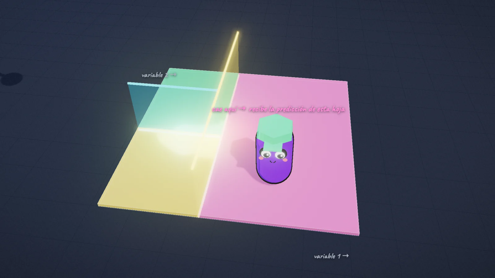{.still}

::: {.box .def}
**Raíz:** la primera pregunta, que recibe a todas las observaciones.

**Nodos internos:** preguntas intermedias. Cada una divide a su grupo en dos (división **binaria**).

**Hojas** (nodos terminales): donde se deja de preguntar. Cada hoja entrega una **predicción**.

**Profundidad:** el número máximo de preguntas desde la raíz hasta una hoja.

**Partición:** cada pregunta es un corte recto, perpendicular a un eje, así que el árbol divide el espacio de las variables en **rectángulos** $R_1, \dots, R_J$.
:::

## Árboles de regresión: el sueldo de los peloteros

[▶ ver en el video · 1:28](https://youtu.be/bEskCcK3oAc?t=88){.vidlink}

Queremos predecir el sueldo de un jugador a partir de los **años en la liga** (`Years`) y los **hits de la temporada anterior** (`Hits`).

### ¿Por qué predecimos el logaritmo del sueldo?

Los sueldos son muy **asimétricos**: la mayoría gana poco y unos pocos ganan muchísimo (en `Hitters`, de US\$68 mil a US\$2,5 millones). Eso es un problema para un árbol de regresión, por dos razones:

- **El RSS eleva los errores al cuadrado.** Un error de US\$1 millón pesa un millón de veces más que uno de US\$1 mil, así que los cortes se eligen casi solo para acomodar a las estrellas.
- **Los promedios se distorsionan.** Una sola estrella en una hoja tira su promedio hacia arriba y la predicción deja de representar al jugador típico.

El logaritmo comprime los valores grandes y estira los chicos. Su propiedad clave es que **convierte multiplicaciones en sumas**: $\ln(2x) = \ln(x) + \ln(2) = \ln(x) + 0{,}69$. Duplicar el sueldo siempre suma lo mismo, sea de 100 a 200 mil o de 800 mil a 1,6 millones.

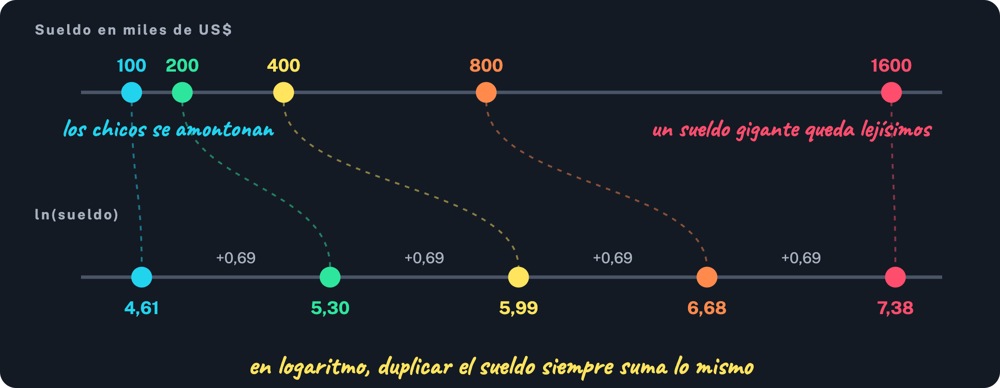{.still}

::: {.box .intuit}
**En logaritmo, las diferencias se leen como porcentajes.** Una diferencia de 0,1 en $\ln(\text{sueldo})$ equivale a ganar aproximadamente un 10% más. Por eso el árbol pasa a comparar **cuántas veces más** gana un jugador que otro, y no cuántos dólares más. Para volver a dólares se aplica la exponencial: $e^{5{,}11} \approx 166$ (miles de US\$).
:::

::: {.panel-tabset group="lang"}
## R
```{r}
#| fig-height: 2.8
par(mfrow = c(1, 2), mar = c(4, 4, 1, 1))
hist(na.omit(Hitters)$Salary, breaks = 30, col = "#FF6B1A", border = "white", main = "", xlab = "Sueldo (miles de US$)")
hist(hitters$logSalary, breaks = 30, col = "#0891B2", border = "white", main = "", xlab = "ln(sueldo)")
```

## Python
```{python}
sal = pd.read_csv("data/hitters.csv", index_col=0)["Salary"]
fig, ax = plt.subplots(1, 2, figsize=(8, 2.8))
ax[0].hist(sal, bins=30, color=NARANJA, edgecolor="white"); ax[0].set_xlabel("Sueldo (miles de US$)")
ax[1].hist(np.log(sal), bins=30, color=CIAN, edgecolor="white"); ax[1].set_xlabel("ln(sueldo)"); plt.tight_layout(); plt.show()
```
:::

### El árbol de tres hojas

::: {.panel-tabset group="lang"}
## R
```{r}
#| fig-height: 3.4
arbol_full <- rpart(logSalary ~ Years + Hits, data = hitters, control = rpart.control(maxdepth = 2))
arbol_full$cptable                        # rpart hizo 3 cortes…
cp2   <- arbol_full$cptable[arbol_full$cptable[, "nsplit"] == 2, "CP"]
arbol <- prune(arbol_full, cp = cp2)      # …podamos al subárbol de 2 cortes (3 hojas)
arbol
rpart.plot(arbol, type = 2, extra = 1, box.palette = "BuGn", branch.lty = 1, roundint = FALSE)
```

## Python
```{python}
X2, y = hitters[["Years", "Hits"]], hitters["logSalary"]
arbol = DecisionTreeRegressor(max_leaf_nodes=3, random_state=0).fit(X2, y)
print(export_text(arbol, feature_names=["Years", "Hits"], decimals=2))
plot_tree(arbol, feature_names=["Years", "Hits"], filled=True, precision=2, impurity=False); plt.show()
```
:::

El árbol tiene **tres hojas**:

| Región | Regla | ln(sueldo) | Sueldo predicho |
|---|---|---|---|
| $R_1$ | años < 4,5 | 5,11 | ≈ US\$166 mil |
| $R_2$ | años ≥ 4,5 y hits < 117,5 | 6,00 | ≈ US\$403 mil |
| $R_3$ | años ≥ 4,5 y hits ≥ 117,5 | 6,74 | ≈ US\$845 mil |

El mismo árbol, visto en el plano de las dos variables: cada jugador es un punto y cada región es una hoja.

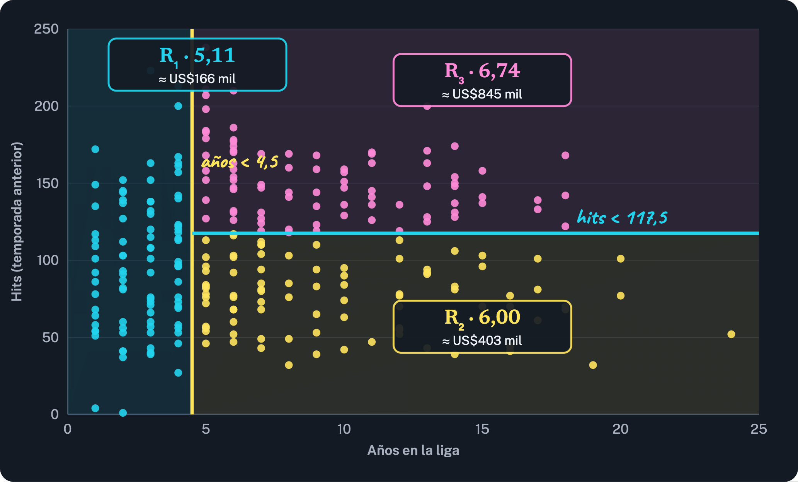{.still}

Y si elevamos cada región a la altura de su predicción, se ve la forma de la función que aprendió el árbol:

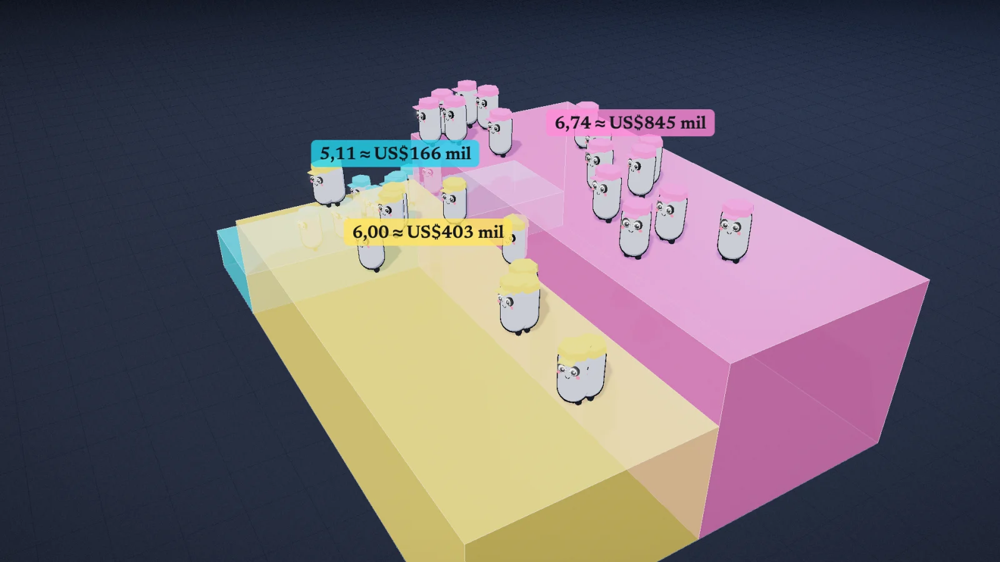{.still}

::: {.box .key}
**La predicción es el promedio de la región:** $\hat{y}_{R_j} = \frac{1}{n_j}\sum_{i \in R_j} y_i$. Dentro de cada rectángulo la predicción es plana y cambia de golpe en los cortes. Un jugador nuevo cae en una región y recibe su promedio.
:::

::: {.box .intuit}
**Comparado con una regresión lineal.** La recta $\hat{y} = \beta_0 + \beta_1\,\text{años} + \beta_2\,\text{hits}$ supone que cada hit extra suma lo mismo para todos. El árbol no supone eso: encuentra los **umbrales** por su cuenta y además captura **interacciones**, porque los hits solo importan para los veteranos.
:::

::: {.box .warn}
En R, `rpart` con profundidad 2 hace un tercer corte (años < 3,5) dentro de los novatos. Al **podarlo** se obtiene exactamente el árbol de tres hojas. Es un adelanto de la poda (@sec-poda): un árbol más chico, obtenido desde uno más grande.
:::

## ¿Cómo elige el corte? {#sec-corte}

[▶ ver en el video · 2:59](https://youtu.be/bEskCcK3oAc?t=179){.vidlink}

¿Por qué 4,5 años y no 3 o 6? El algoritmo **prueba todos los cortes posibles en todas las variables** y elige el que minimiza la suma de residuos al cuadrado:

::: {.hero}
[Función de pérdida de un árbol de regresión]{.cap}
[[RSS]{.v}[]{.u}[suma de residuos al cuadrado]{.n}]{.tm style="--c:#67E8F9"}
[=]{.op}
[[$\displaystyle\sum_{j=1}^{J}\sum_{i\in R_j}$]{.v}[]{.u}[cada región, cada jugador]{.n}]{.tm style="--c:#EEF2F7"}
[[$(y_i - \hat{y}_{R_j})^2$]{.v}[]{.u}[distancia al promedio de su región]{.n}]{.tm style="--c:#FFE45E"}
[Ejemplo: sueldos 5, 5 y 6 → promedio 5,33 → RSS = 0,11 + 0,11 + 0,44 = [0,67]{.res}]{.nums}
:::

Para un corte $s$ en la variable $X_k$, se forman las mitades $\{X_k < s\}$ y $\{X_k \geq s\}$, se calcula el RSS de ambas y se elige el par $(k, s)$ con el menor RSS.

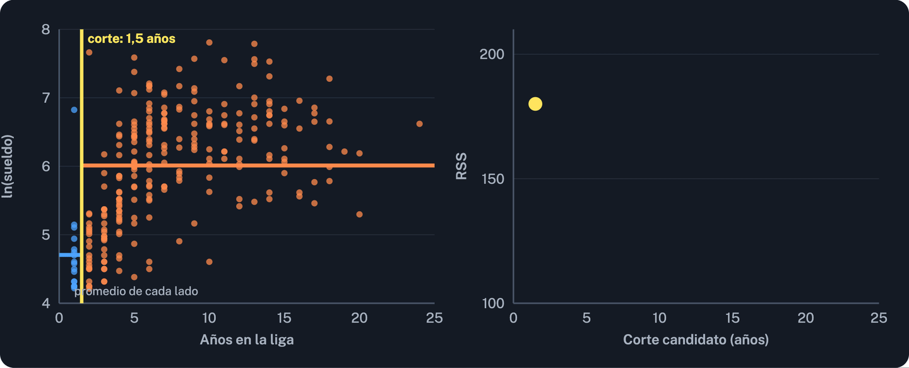{.still}

Hagámoslo a mano con los años:

::: {.panel-tabset group="lang"}
## R
```{r}
#| fig-height: 3
rss_corte <- function(x, y, s) { izq <- y[x < s]; der <- y[x >= s]
  sum((izq - mean(izq))^2) + sum((der - mean(der))^2) }
mejor_corte <- function(x, y) { u <- sort(unique(x)); cortes <- (head(u, -1) + tail(u, -1)) / 2
  rss <- sapply(cortes, rss_corte, x = x, y = y); list(cortes = cortes, rss = rss, s = cortes[which.min(rss)], min = min(rss)) }

anios <- mejor_corte(hitters$Years, hitters$logSalary)
hits  <- mejor_corte(hitters$Hits,  hitters$logSalary)
c(mejor_anios = anios$s, rss_anios = anios$min, mejor_hits = hits$s, rss_hits = hits$min)

ggplot(data.frame(corte = anios$cortes, rss = anios$rss), aes(corte, rss)) +
  geom_line(color = "#0891B2", linewidth = 1.1) + geom_point(color = "#0891B2") +
  geom_vline(xintercept = anios$s, linetype = 2, color = "#E11D48") +
  labs(x = "Corte en años en la liga", y = "RSS") + theme_minimal(base_size = 12)
```

## Python
```{python}
def rss_corte(x, y, s):
    izq, der = y[x < s], y[x >= s]
    return ((izq - izq.mean())**2).sum() + ((der - der.mean())**2).sum()

def mejor_corte(x, y):
    u = np.sort(np.unique(x)); cortes = (u[:-1] + u[1:]) / 2
    rss = np.array([rss_corte(x, y, s) for s in cortes])
    return cortes, rss, cortes[rss.argmin()], rss.min()

c_a, r_a, s_a, m_a = mejor_corte(hitters["Years"].values, y.values)
c_h, r_h, s_h, m_h = mejor_corte(hitters["Hits"].values, y.values)
print(f"años: corte {s_a}, RSS {m_a:.1f}   |   hits: corte {s_h}, RSS {m_h:.1f}")
plt.figure(figsize=(7, 3)); plt.plot(c_a, r_a, "o-", color=CIAN); plt.axvline(s_a, ls="--", color=ROJO)
plt.xlabel("Corte en años en la liga"); plt.ylabel("RSS"); plt.show()
```
:::

El mínimo está en **4,5 años**, y ese corte reduce el RSS más que el mejor corte posible en hits. Por eso la raíz pregunta por los años.

::: {.box .def label="Definición · Partición binaria recursiva"}
1. Empezar con todos los datos en un nodo.
2. Buscar la variable y el corte que más reducen la pérdida (RSS en regresión, impureza en clasificación).
3. Dividir el nodo en dos y **repetir dentro de cada mitad**.
4. Parar con una regla (profundidad máxima, mínimo de observaciones por hoja…).

Es **codiciosa** (*greedy*): en cada paso elige el mejor corte de ese momento, sin mirar hacia adelante. Por eso es rápida, pero **no garantiza el mejor árbol posible**.
:::

## Árboles de clasificación

[▶ ver en el video · 3:53](https://youtu.be/bEskCcK3oAc?t=233){.vidlink}

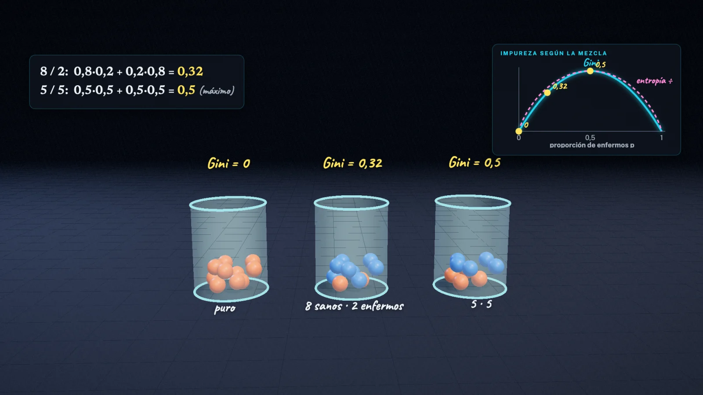{.still}

Ahora la variable a predecir es una **clase** (enfermo o sano, moroso o al día). Cada hoja predice la **clase más frecuente** de su grupo y puede entregar la proporción como **probabilidad**: una hoja con 7 enfermos y 3 sanos predice «enfermo» con $\hat{p} = 0{,}7$.

Para elegir el corte ya no sirve el RSS: buscamos **nodos puros**. Si $\hat{p}_{mk}$ es la proporción de la clase $k$ en el nodo $m$:

::: {.hero}
[Impureza de un nodo]{.cap}
[[Gini]{.v}[]{.u}[índice de Gini]{.n}]{.tm style="--c:#67E8F9"}
[=]{.op}
[[$\displaystyle\sum_{k}\hat{p}_{mk}(1-\hat{p}_{mk})$]{.v}[]{.u}[0 si el frasco es puro, máximo si es 50/50]{.n}]{.tm style="--c:#FFE45E"}
[ | ]{.op}
[[Entropía $= -\displaystyle\sum_{k}\hat{p}_{mk}\log\hat{p}_{mk}$]{.v}[]{.u}[la alternativa: se comporta casi igual]{.n}]{.tm style="--c:#FF8A4C"}
[8 sanos y 2 enfermos: 0,8·0,2 + 0,2·0,8 = [0,32]{.res} · 5 y 5: [0,5]{.res} (máximo con dos clases)]{.nums}
:::

::: {.panel-tabset group="lang"}
## R
```{r}
#| fig-height: 3
gini <- function(p) 2 * p * (1 - p)
entropia <- function(p) ifelse(p %in% c(0, 1), 0, -(p * log2(p) + (1 - p) * log2(1 - p)))
c(gini_8_2 = gini(0.2), gini_5_5 = gini(0.5))
p <- seq(0, 1, 0.01)
ggplot(data.frame(p, Gini = gini(p), `Entropía / 2` = entropia(p) / 2, check.names = FALSE) |>
         tidyr::pivot_longer(-p), aes(p, value, color = name)) + geom_line(linewidth = 1.1) +
  scale_color_manual(values = c("#FF6B1A", "#0891B2")) + labs(x = "Proporción de una clase en el nodo", y = "Impureza", color = NULL) +
  theme_minimal(base_size = 12)
```

## Python
```{python}
gini = lambda p: 2 * p * (1 - p)
def entropia(p):
    p = np.clip(p, 1e-12, 1 - 1e-12); return -(p * np.log2(p) + (1 - p) * np.log2(1 - p))
print("Gini 8/2:", gini(0.2), "| Gini 5/5:", gini(0.5))
p = np.linspace(0, 1, 101)
plt.figure(figsize=(7, 3)); plt.plot(p, gini(p), color=CIAN, label="Gini"); plt.plot(p, entropia(p) / 2, color=NARANJA, label="Entropía / 2")
plt.xlabel("Proporción de una clase en el nodo"); plt.ylabel("Impureza"); plt.legend(); plt.show()
```
:::

::: {.box .key}
El árbol elige el corte que **más reduce la impureza ponderada**: $\text{Gini(padre)} - \sum_{m} \frac{n_m}{n}\,\text{Gini}(m)$. Un nodo 50/50 no informa nada: es como lanzar una moneda.
:::

¿Qué significa «ponderada»? Cada hijo pesa según cuántas observaciones recibe. Un ejemplo con 100 clientes:

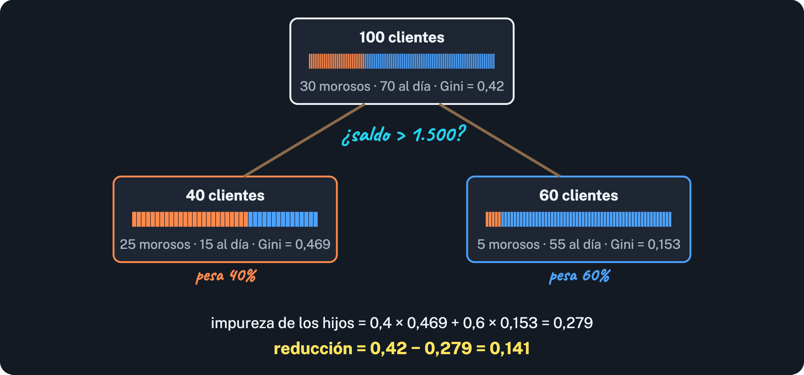{.still}

El algoritmo calcula esta reducción para **cada variable y cada corte posible**, y se queda con el que reduce más. Es la misma lógica de la @sec-corte, cambiando el RSS por la impureza.

Un árbol de clasificación para predecir la mora con el saldo, el ingreso y si es estudiante:

::: {.panel-tabset group="lang"}
## R
```{r}
#| fig-height: 3.6
arbol_mora <- rpart(default ~ balance + income + student, data = default, method = "class", control = rpart.control(maxdepth = 3))
rpart.plot(arbol_mora, type = 2, extra = 104, box.palette = "OrRd", roundint = FALSE)
```

## Python
```{python}
Xd, yd = default[["balance", "income", "student"]], default["default"]
arbol_mora = DecisionTreeClassifier(max_depth=3, criterion="gini", random_state=0).fit(Xd, yd)
print(export_text(arbol_mora, feature_names=list(Xd.columns), decimals=0, show_weights=True))
```
:::

## Sobreajuste y el trade-off sesgo–varianza

[▶ ver en el video · 5:06](https://youtu.be/bEskCcK3oAc?t=306){.vidlink} [▶ ver en el video: sesgo y varianza · 6:15](https://youtu.be/bEskCcK3oAc?t=375){.vidlink}

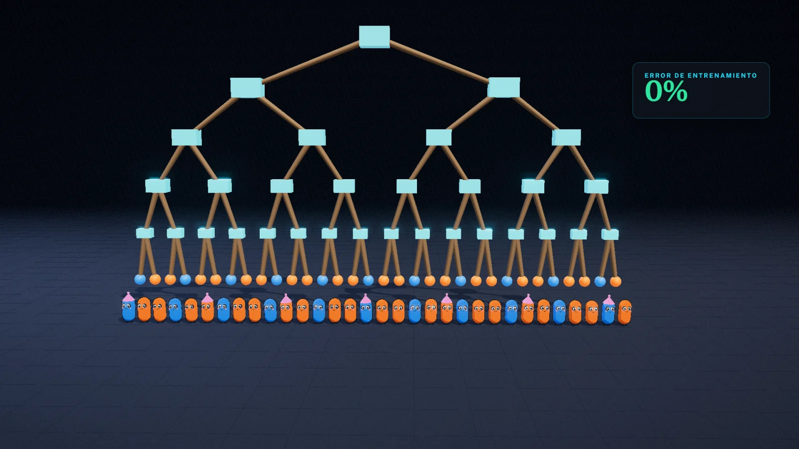{.still}

Cada pregunta nueva baja el error en los datos de entrenamiento. Si nunca paramos, cada observación queda sola en su hoja y el error de entrenamiento llega a **cero**. Pero con datos nuevos el árbol se equivoca una y otra vez: no aprendió el patrón, **memorizó el ruido**.

Se ve claramente con una sola variable: puntos que siguen una curva más ruido, ajustados con árboles de distinta profundidad.

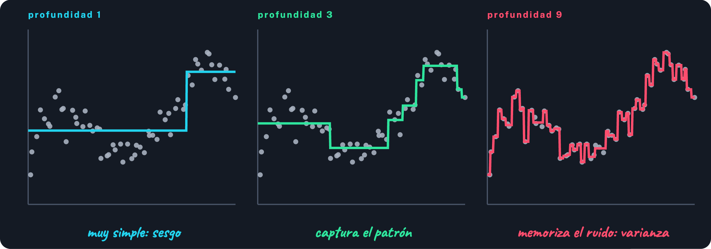{.still}

La analogía de los dardos resume las dos formas de equivocarse:

:::: {layout-ncol="2"}
{.still}

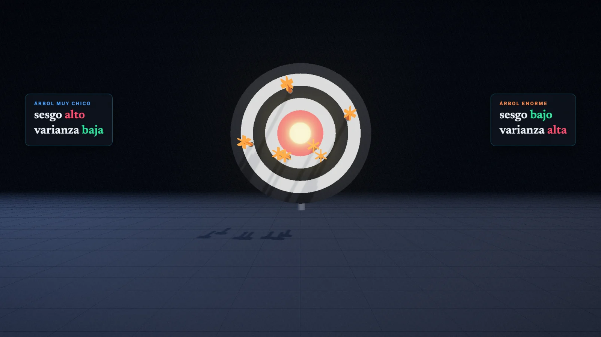{.still}
::::

::: {.hero}
[Descomposición del error esperado en un punto nuevo]{.cap}
[[$\mathbb{E}[(y_0-\hat f(x_0))^2]$]{.v}[]{.u}[error de predicción esperado]{.n}]{.tm}
[=]{.op}
[[$\text{Sesgo}[\hat f(x_0)]^2$]{.v}[]{.u}[qué tan lejos apunta en promedio]{.n}]{.tm style="--c:#0A84FF;--c:#4DA3FF"}
[+]{.op}
[[$\text{Var}[\hat f(x_0)]$]{.v}[]{.u}[cuánto cambia con otra muestra]{.n}]{.tm style="--c:#FF8A4C"}
[+]{.op}
[[$\sigma^2$]{.v}[]{.u}[ruido que nadie elimina]{.n}]{.tm style="--c:#A7B0BE"}
:::

Veámoslo con todas las variables de `Hitters`. Primero separamos al azar a los jugadores en dos grupos: un **conjunto de entrenamiento** (70%), con el que crecemos árboles cada vez más profundos, y un **conjunto de prueba** (30%), que los árboles nunca ven y que usamos solo para medir su error con jugadores «nuevos». Para cada profundidad comparamos el error en ambos grupos. (En la @sec-separar vemos cómo y en qué proporciones conviene separar la muestra.)

::: {.panel-tabset group="lang"}
## R
```{r}
#| fig-height: 3.2
idx   <- sample(nrow(hitters), round(0.7 * nrow(hitters)))
train <- hitters[idx, ]; test <- hitters[-idx, ]
mse   <- function(y, yhat) mean((y - yhat)^2)
curva <- do.call(rbind, lapply(1:10, function(d) {
  m <- rpart(logSalary ~ ., data = train, control = rpart.control(maxdepth = d, cp = 0, minsplit = 2, minbucket = 1, xval = 0))
  data.frame(profundidad = d, entrenamiento = mse(train$logSalary, predict(m, train)), prueba = mse(test$logSalary, predict(m, test))) }))
ggplot(tidyr::pivot_longer(curva, -profundidad), aes(profundidad, value, color = name)) + geom_line(linewidth = 1.1) + geom_point() +
  scale_color_manual(values = c(entrenamiento = "#0A84FF", prueba = "#FF6B1A")) + scale_x_continuous(breaks = 1:10) +
  labs(x = "Profundidad del árbol (complejidad)", y = "MSE", color = NULL) + theme_minimal(base_size = 12)
```

## Python
```{python}
X, y = hitters.drop(columns="logSalary"), hitters["logSalary"]
X_tr, X_te, y_tr, y_te = train_test_split(X, y, test_size=0.3, random_state=4143)
prof = range(1, 11); tr, te = [], []
for d in prof:
    m = DecisionTreeRegressor(max_depth=d, random_state=0).fit(X_tr, y_tr)
    tr.append(metrics.mean_squared_error(y_tr, m.predict(X_tr))); te.append(metrics.mean_squared_error(y_te, m.predict(X_te)))
plt.figure(figsize=(7, 3.2)); plt.plot(prof, tr, "o-", color=AZUL, label="entrenamiento"); plt.plot(prof, te, "o-", color=NARANJA, label="prueba")
plt.xlabel("Profundidad del árbol (complejidad)"); plt.ylabel("MSE"); plt.legend(); plt.show()
```
:::

::: {.box .key}
Al aumentar la complejidad, el error de **entrenamiento siempre baja**, pero el de **prueba** baja y luego sube: dibuja una **U**. Un árbol chico tiene sesgo; uno enorme, varianza. El trabajo es encontrar el fondo de esa U, y para un árbol la complejidad es su tamaño (número de hojas o profundidad).
:::

::: {.box .warn}
La curva de prueba con una sola partición es **ruidosa**: depende de qué jugadores cayeron en el 30% de prueba. Cambia la semilla y la U se mueve. Por eso, para *elegir* la profundidad se usa validación cruzada, no el conjunto de prueba.
:::

## Separar la muestra {#sec-separar}

[▶ ver en el video · 7:06](https://youtu.be/bEskCcK3oAc?t=426){.vidlink} [▶ ver en el video: doble clic: conjunto de prueba · 5:31](https://youtu.be/bEskCcK3oAc?t=331){.vidlink}

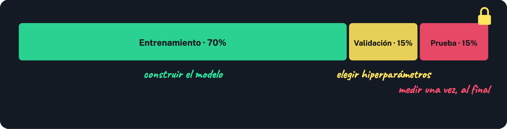{.still}

::: {.box .def}
**Entrenamiento** (~70%): para construir el modelo.

**Validación** (~15%): para comparar alternativas y elegir hiperparámetros (profundidad, poda…).

**Prueba** (~15%): para medir, **una sola vez y al final**, el desempeño del modelo elegido.

La partición se hace **al azar**, para que los tres grupos se parezcan.
:::

::: {.box .warn}
**Regla de oro:** si miras el conjunto de prueba para tomar decisiones, deja de ser una prueba y pasa a ser parte del entrenamiento. El error que reportes será optimista.
:::

## Validación cruzada

[▶ ver en el video · 7:42](https://youtu.be/bEskCcK3oAc?t=462){.vidlink}

Con pocos datos, un solo grupo de validación es ruidoso. La **validación cruzada con K grupos** (*K-fold*) lo resuelve: se divide el entrenamiento en K partes, se entrena con K−1, se valida con la restante y se rota hasta que cada parte fue validación una vez.

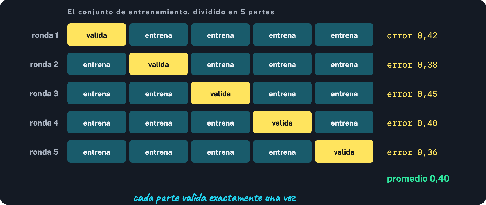{.still}

Paso a paso, para elegir, por ejemplo, la profundidad de un árbol:

1. Dividir **el conjunto de entrenamiento** (no la prueba) en K partes al azar.
2. Para cada profundidad candidata y cada ronda $k$: entrenar con las K−1 partes restantes y medir el error en la parte $k$.
3. Promediar los K errores de cada profundidad.
4. Elegir la profundidad con menor error promedio y **reentrenar con todo el entrenamiento**.
5. Recién ahí, una vez, medir en la prueba.

Comparado con una sola partición de validación, cada observación se usa para validar exactamente una vez, y el promedio de K errores es mucho menos ruidoso.

::: {.hero}
[Error de validación cruzada]{.cap}
[[$\text{CV}_{(K)}$]{.v}[]{.u}[aproxima el error fuera de muestra]{.n}]{.tm style="--c:#67E8F9"}
[=]{.op}
[[$\displaystyle\frac{1}{K}\sum_{k=1}^{K}\text{MSE}_k$]{.v}[]{.u}[promedio de las K rondas]{.n}]{.tm style="--c:#FFE45E"}
[Lo más común: K = 5 o K = 10]{.nums}
:::

::: {.panel-tabset group="lang"}
## R
```{r}
#| fig-height: 3
folds <- sample(rep(1:5, length.out = nrow(train)))
cv_prof <- sapply(1:10, function(d) mean(sapply(1:5, function(k) {
  m <- rpart(logSalary ~ ., data = train[folds != k, ], control = rpart.control(maxdepth = d, cp = 0, minsplit = 2, minbucket = 1, xval = 0))
  mse(train$logSalary[folds == k], predict(m, train[folds == k, ])) })))
d_star <- which.min(cv_prof); d_star
ggplot(data.frame(profundidad = 1:10, cv = cv_prof), aes(profundidad, cv)) + geom_line(color = "#0891B2", linewidth = 1.1) + geom_point(color = "#0891B2") +
  geom_point(data = data.frame(profundidad = d_star, cv = min(cv_prof)), color = "#E11D48", size = 4) +
  scale_x_continuous(breaks = 1:10) + labs(x = "Profundidad", y = "MSE de validación cruzada (K = 5)") + theme_minimal(base_size = 12)
```

## Python
```{python}
kf = KFold(n_splits=5, shuffle=True, random_state=4143)
cv_prof = [-cross_val_score(DecisionTreeRegressor(max_depth=d, random_state=0), X_tr, y_tr, cv=kf, scoring="neg_mean_squared_error").mean() for d in prof]
d_star = list(prof)[int(np.argmin(cv_prof))]; print("profundidad elegida:", d_star)
plt.figure(figsize=(7, 3)); plt.plot(list(prof), cv_prof, "o-", color=CIAN); plt.plot(d_star, min(cv_prof), "o", color=ROJO, ms=10)
plt.xlabel("Profundidad"); plt.ylabel("MSE de validación cruzada (K = 5)"); plt.show()
```
:::

::: {.box .turn}
Cambia la semilla y vuelve a correr la validación cruzada. ¿Cambia la profundidad elegida? ¿Cambia más o menos que con una sola partición de validación?
:::

### Entrenamiento, prueba y validación cruzada: cómo se relacionan

Hasta aquí aparecieron tres errores distintos. Conviene ponerlos lado a lado, porque responden preguntas distintas:

{.still}

| Error | ¿Con qué datos se mide? | ¿Qué responde? | ¿Para qué se usa? |
|---|---|---|---|
| **Entrenamiento** | Los mismos con que se entrenó | ¿Qué tan bien memoriza? | Diagnóstico: si es muy alto, el modelo es demasiado simple (sesgo) |
| **Validación cruzada** (u OOB) | Partes del entrenamiento que el modelo de cada ronda no vio | ¿Qué error tendría con datos nuevos? (estimación) | **Elegir** hiperparámetros: profundidad, α, número de árboles |
| **Prueba** (fuera de muestra) | Datos guardados que nunca participaron | ¿Qué error tiene con datos nuevos? (medición final) | **Reportar** el desempeño, una sola vez |

::: {.box .key}
**La brecha entre el error de entrenamiento y el de prueba es el sobreajuste.** La validación cruzada existe porque el error de prueba no se puede usar para decidir sin «gastarlo»: es una **prueba de ensayo** hecha solo con el entrenamiento. Por eso sus resultados se parecen a los de prueba y no a los de entrenamiento.
:::

Juega con la complejidad: en la siguiente figura, los puntos son 50 observaciones de entrenamiento generadas a partir de una curva verdadera (verde) más ruido. El árbol (amarillo) se entrena con ellas, y su error se mide en entrenamiento, con validación cruzada (K = 5) y en 600 observaciones de prueba nuevas.

::: {.interactivo}
[Interactivo · Complejidad y error]{.kicker}

```{ojs}
//| echo: false
viewof ctl1 = Inputs.form({
  prof: Inputs.range([0, 10], {step: 1, value: 3, label: "Profundidad del árbol"}),
  semilla: Inputs.range([1, 30], {step: 1, value: 1, label: "Muestra de entrenamiento nº"})
})
```

```{ojs}
//| echo: false
curvas1 = {
  const train = ML.simula(50, ctl1.semilla), test = ML.simula(600, 999), filas = [];
  for (let d = 0; d <= 10; d++) {
    let cv = 0;
    for (let k = 0; k < 5; k++) {
      const tr = train.filter((_, i) => i % 5 !== k), va = train.filter((_, i) => i % 5 === k);
      cv += ML.mse(va, ML.arbol(tr, d));
    }
    const f = ML.arbol(train, d);
    filas.push({d, tipo: "Entrenamiento", error: ML.mse(train, f)}, {d, tipo: "Validación cruzada", error: cv / 5}, {d, tipo: "Prueba", error: ML.mse(test, f)});
  }
  return {train, filas, f: ML.arbol(train, ctl1.prof)};
}
```

```{ojs}
//| echo: false
{
  const xs = d3.range(0, 10.001, 0.02);
  const ajuste = Plot.plot({
    ...ML.estilo, width: ML.ancho(width), height: 290, y: {label: "y", domain: [-3, 6]}, x: {label: "x"},
    marks: [
      Plot.dot(curvas1.train, {x: "x", y: "y", r: 3.5, fill: "#A7B0BE"}),
      Plot.line(xs.map(x => ({x, y: ML.fVerdad(x)})), {x: "x", y: "y", stroke: "#2EE59D", strokeWidth: 2, strokeDasharray: "6 5"}),
      Plot.line(xs.map(x => ({x, y: curvas1.f(x)})), {x: "x", y: "y", stroke: "#FFE45E", strokeWidth: 3})
    ]
  });
  const errores = Plot.plot({
    ...ML.estilo, width: ML.ancho(width), height: 290, x: {label: "Profundidad", ticks: 10}, y: {label: "Error (MSE)", domain: [0, 2.6]},
    color: {domain: ["Entrenamiento", "Validación cruzada", "Prueba"], range: ["#4DA3FF", "#FFE45E", "#FF8A4C"], legend: true},
    marks: [
      Plot.ruleX([ctl1.prof], {stroke: "#2EE59D", strokeDasharray: "5 4"}),
      Plot.line(curvas1.filas, {x: "d", y: "error", stroke: "tipo", strokeWidth: 3}),
      Plot.dot(curvas1.filas.filter(r => r.d === ctl1.prof), {x: "d", y: "error", fill: "tipo", r: 6})
    ]
  });
  const e = t => curvas1.filas.find(r => r.d === ctl1.prof && r.tipo === t).error.toFixed(2).replace(".", ",");
  return html`<div class="fila">${ajuste}${errores}</div>
    <div class="lectura">Profundidad ${ctl1.prof}: entrenamiento <b>${e("Entrenamiento")}</b> · validación cruzada <b>${e("Validación cruzada")}</b> · prueba <b>${e("Prueba")}</b></div>`;
}
```
:::

::: {.box .turn}
1. Sube la profundidad de 0 a 10. ¿En qué profundidad es mínimo el error de prueba? ¿Y el de validación cruzada? ¿Coinciden?
2. Deja la profundidad en 8 y cambia la **muestra de entrenamiento**. ¿Cuánto cambia el árbol? Ahora hazlo con profundidad 2. Eso es la **varianza**.
:::

## Poda {#sec-poda}

[▶ ver en el video · 8:37](https://youtu.be/bEskCcK3oAc?t=517){.vidlink}

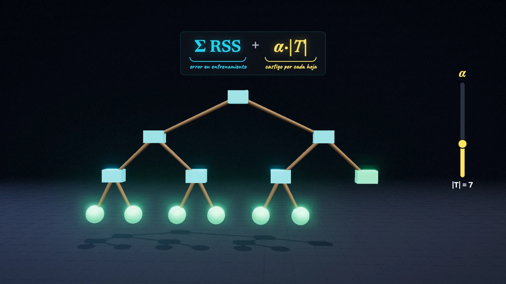{.still}

Una opción es **frenar antes**, con una profundidad máxima o un mínimo de observaciones por hoja. Lo usual, sin embargo, es dejar crecer un árbol grande $T_0$ y luego **podarlo**: una regla de parada puede detenerse antes de un corte que parecía malo pero que habilitaba cortes muy buenos más abajo.

::: {.hero}
[Poda por costo–complejidad (weakest link pruning)]{.cap}
[[$\displaystyle\sum_{j=1}^{|T|}\sum_{i\in R_j}(y_i-\hat y_{R_j})^2$]{.v}[]{.u}[qué tan bien ajusta el subárbol T]{.n}]{.tm style="--c:#FFE45E"}
[+]{.op}
[[$\alpha\,|T|$]{.v}[]{.u}[castigo por cada hoja]{.n}]{.tm style="--c:#FF8A4C"}
[α = 0 → el árbol gigante · α grande → solo la raíz · [la validación cruzada elige α]{.res}]{.nums}
:::

¿Cómo funciona α? Cada subárbol posible tiene un costo $\text{RSS} + \alpha|T|$. Si α es 0, solo importa el RSS y gana el árbol más grande. A medida que α sube, cada hoja «cuesta» más, y empiezan a ganar subárboles más chicos:

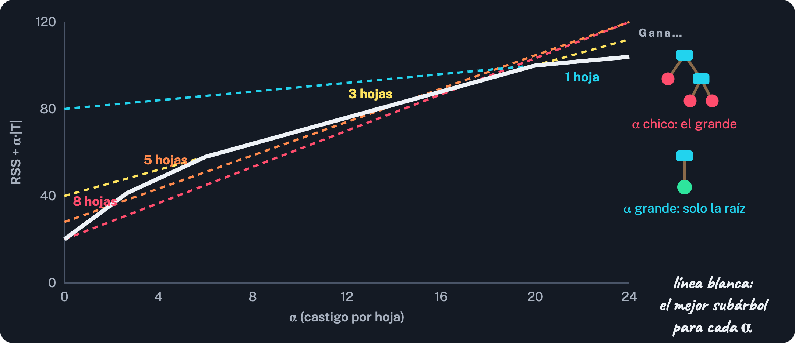{.still}

Así, recorrer α de 0 a ∞ produce una **secuencia de árboles anidados**, cada uno una poda del anterior. La validación cruzada elige cuál usar. En R, `rpart` llama `cp` a este parámetro (es α dividido por el RSS de la raíz) y calcula automáticamente el error de validación cruzada (`xerror`) de cada árbol de la secuencia.

::: {.panel-tabset group="lang"}
## R
```{r}
#| fig-height: 3.2
grande <- rpart(logSalary ~ ., data = train, control = rpart.control(cp = 0, xval = 10))
head(grande$cptable, 8)                     # xerror = error de validación cruzada (relativo)
plotcp(grande)
cp_star <- grande$cptable[which.min(grande$cptable[, "xerror"]), "CP"]
podado  <- prune(grande, cp = cp_star)
c(hojas_grande = sum(grande$frame$var == "<leaf>"), hojas_podado = sum(podado$frame$var == "<leaf>"),
  mse_prueba_grande = mse(test$logSalary, predict(grande, test)), mse_prueba_podado = mse(test$logSalary, predict(podado, test)))
```

## Python
```{python}
camino = DecisionTreeRegressor(random_state=0).cost_complexity_pruning_path(X_tr, y_tr)
alphas = np.unique(camino.ccp_alphas)[:-1]
busca = GridSearchCV(DecisionTreeRegressor(random_state=0), {"ccp_alpha": alphas}, cv=kf, scoring="neg_mean_squared_error").fit(X_tr, y_tr)
grande = DecisionTreeRegressor(random_state=0).fit(X_tr, y_tr); podado = busca.best_estimator_
print(f"α* = {busca.best_params_['ccp_alpha']:.4f} | hojas: {grande.get_n_leaves()} → {podado.get_n_leaves()}")
print(f"MSE de prueba: grande {metrics.mean_squared_error(y_te, grande.predict(X_te)):.3f} | podado {metrics.mean_squared_error(y_te, podado.predict(X_te)):.3f}")
```
:::

::: {.box .def label="Definición · Algoritmo CART completo"}
1. Crecer un árbol grande con partición binaria recursiva, parando solo cuando las hojas tienen muy pocas observaciones.
2. Aplicar la poda por costo–complejidad: para cada α se obtiene el mejor subárbol $T_\alpha$, una **secuencia de árboles anidados**.
3. Elegir α con validación cruzada.
4. Entregar el subárbol $T_{\alpha^*}$ y medir su error **una vez** en la prueba.
:::

::: {.box .paper}
Breiman, Friedman, Olshen y Stone propusieron CART en 1984. La poda por costo–complejidad es suya, igual que la regla práctica «1-SE»: elegir el árbol **más simple** cuyo error de validación esté a menos de un error estándar del mínimo [@breiman1984; @james2021, cap. 8].
:::

## Métricas de regresión

[▶ ver en el video · 9:24](https://youtu.be/bEskCcK3oAc?t=564){.vidlink}

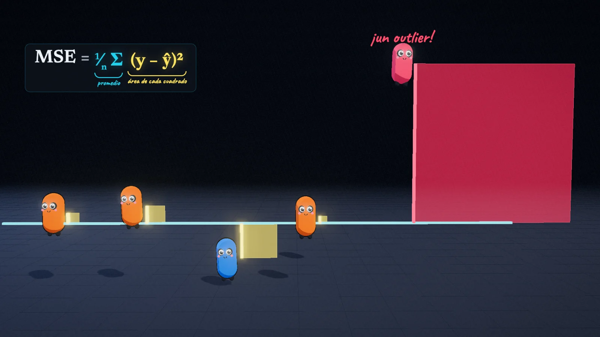{.still}

::: {.box .def}
**MSE** $= \frac{1}{n}\sum (y_i-\hat y_i)^2$: promedia los errores al cuadrado y castiga mucho los errores grandes.

**RMSE** $= \sqrt{\text{MSE}}$: lo mismo, pero en las unidades de $y$.

**MAE** $= \frac{1}{n}\sum |y_i-\hat y_i|$: promedia los errores absolutos. Es más robusto a outliers.

**R²** $= 1 - \frac{\sum (y_i-\hat y_i)^2}{\sum (y_i-\bar y)^2}$: la fracción de la varianza de $y$ que explica el modelo.
:::

Con errores de 1, 2 y 9, el MAE es $(1+2+9)/3 = 4$, pero el MSE es $(1+4+81)/3 = 28{,}7$: el nueve al cuadrado aporta 81.

::: {.panel-tabset group="lang"}
## R
```{r}
metricas <- function(y, yhat) c(MSE = mean((y - yhat)^2), RMSE = sqrt(mean((y - yhat)^2)), MAE = mean(abs(y - yhat)),
                                 R2 = 1 - sum((y - yhat)^2) / sum((y - mean(y))^2))
ols <- lm(logSalary ~ ., data = train)
round(rbind(OLS = metricas(test$logSalary, predict(ols, test)), `Árbol podado` = metricas(test$logSalary, predict(podado, test))), 3)
```

## Python
```{python}
def metricas(y, yhat):
    return {"MSE": metrics.mean_squared_error(y, yhat), "RMSE": metrics.root_mean_squared_error(y, yhat),
            "MAE": metrics.mean_absolute_error(y, yhat), "R2": metrics.r2_score(y, yhat)}
ols = LinearRegression().fit(X_tr, y_tr)
pd.DataFrame({"OLS": metricas(y_te, ols.predict(X_te)), "Árbol podado": metricas(y_te, podado.predict(X_te))}).T.round(3)
```
:::

::: {.box .key}
Si los errores grandes son graves (por ejemplo, subestimar la demanda de un hospital), prioriza **MSE o RMSE**. Si hay outliers que no te importan, usa el **MAE**. El **R²** sirve para comunicar, pero no compara bien modelos con distintas $y$.
:::

## Métricas de clasificación

[▶ ver en el video · 10:22](https://youtu.be/bEskCcK3oAc?t=622){.vidlink}

### De la probabilidad a la clase: el umbral

Un árbol de clasificación no entrega directamente «enfermo» o «sano»: entrega una **probabilidad**. Si una hoja tiene 7 enfermos y 3 sanos, todo paciente nuevo que caiga ahí recibe $\hat{p} = 7/10 = 0{,}7$. Para convertir esa probabilidad en una decisión (0 o 1) hace falta una regla, el **umbral**:

$$
\hat{y} = \begin{cases} 1 \;(\text{enfermo}) & \text{si } \hat{p} \geq \text{umbral} \\ 0 \;(\text{sano}) & \text{si } \hat{p} < \text{umbral} \end{cases}
$$

El umbral por defecto es 0,5, que equivale a predecir la clase mayoritaria de la hoja. Pero **no tiene por qué ser 0,5**: es una decisión que depende de qué error nos duele más.

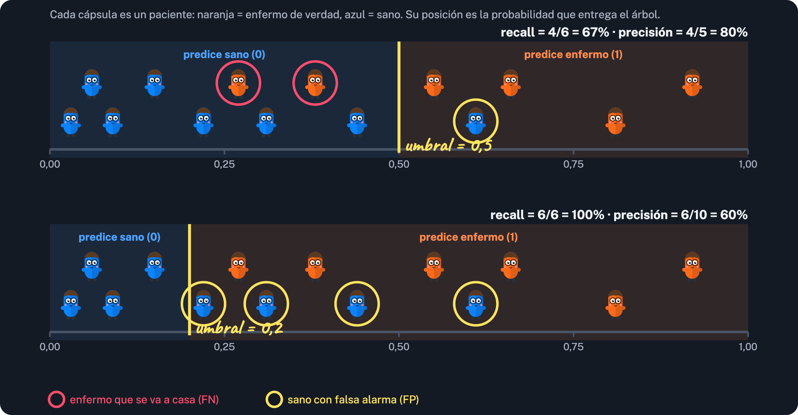{.still}

::: {.box .intuit}
**El umbral es una perilla.** Bajarlo marca a más pacientes como enfermos: encontramos más enfermos (sube el recall) a costa de más falsas alarmas (baja la precisión). Subirlo hace lo contrario. El modelo es el mismo; lo que cambia es **dónde trazamos la raya**.
:::

### La matriz de confusión

Una vez fijado el umbral, cada paciente cae en una de cuatro celdas, según lo que es en realidad y lo que predijimos:

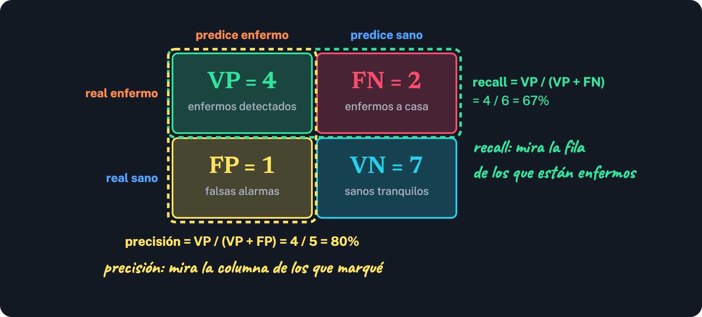{.still}

::: {.box .def}
**Verdadero positivo (VP):** enfermo y lo marcamos enfermo. **Falso negativo (FN):** enfermo y lo mandamos a casa. **Falso positivo (FP):** sano y le dimos una falsa alarma. **Verdadero negativo (VN):** sano y lo marcamos sano.

**Precisión** $= \frac{VP}{VP+FP}$: de los que marqué como enfermos, ¿cuántos lo estaban?

**Recall** (sensibilidad) $= \frac{VP}{VP+FN}$: de los enfermos, ¿cuántos encontré?

**F1** $= \frac{2\cdot P\cdot R}{P+R}$: un promedio (armónico) de ambas; es alto solo si las dos son altas.

**Exactitud** (*accuracy*) $= \frac{VP+VN}{n}$: la proporción de aciertos.
:::

::: {.hero}
[Con números: 100 pacientes, 10 enfermos]{.cap}
[[VP = 8]{.v}[]{.u}[enfermos detectados]{.n}]{.tm style="--c:#2EE59D"}
[[FN = 2]{.v}[]{.u}[enfermos a casa]{.n}]{.tm style="--c:#FF4D6D"}
[[FP = 6]{.v}[]{.u}[falsas alarmas]{.n}]{.tm style="--c:#FFB020"}
[precisión = 8/14 = [57%]{.res} · recall = 8/10 = [80%]{.res}]{.nums}
:::

::: {.box .key}
**La métrica depende del costo de equivocarse.** En una clínica, mandar a casa a un enfermo es grave: prioriza el **recall**. En un filtro de spam, lo grave es botar un correo importante: prioriza la **precisión**. Si ambos errores importan parecido, mira el **F1**.
:::

::: {.box .warn}
**La exactitud engaña con clases desbalanceadas.** En `Default`, el 96,7% de los clientes está al día: un modelo que siempre dice «al día» acierta el 96,7% de las veces y no detecta a ningún moroso. Su recall es 0%.
:::

En los datos de mora, con umbrales 0,5 y 0,2:

::: {.panel-tabset group="lang"}
## R
```{r}
idx_d <- sample(nrow(default), 7000); tr_d <- default[idx_d, ]; te_d <- default[-idx_d, ]
# cp = -1: rpart mide la mejora con el error de clasificación; con cp >= 0 descarta cortes que no cambian
# la clase predicha (aunque separen bien las probabilidades), y el AUC queda bajo
m_d   <- rpart(default ~ balance + income + student, data = tr_d, method = "class", control = rpart.control(cp = -1, maxdepth = 5, minbucket = 20))
prob  <- predict(m_d, te_d)[, "Yes"]          # probabilidad de mora de cada cliente de prueba
evalua <- function(umbral) { pred <- factor(ifelse(prob >= umbral, "Yes", "No"), levels = c("Yes", "No")); real <- factor(te_d$default, levels = c("Yes", "No"))
  t <- table(real, pred); vp <- t["Yes", "Yes"]; fn <- t["Yes", "No"]; fp <- t["No", "Yes"]
  c(umbral = umbral, precision = vp / (vp + fp), recall = vp / (vp + fn), F1 = 2 * vp / (2 * vp + fp + fn), exactitud = sum(diag(t)) / sum(t)) }
round(rbind(evalua(0.5), evalua(0.2)), 3)
c(exactitud_siempre_al_dia = mean(te_d$default == "No"))
```

## Python
```{python}
Xd_tr, Xd_te, yd_tr, yd_te = train_test_split(Xd, yd, test_size=0.3, random_state=4143, stratify=yd)
m_d = DecisionTreeClassifier(max_depth=5, min_samples_leaf=20, random_state=0).fit(Xd_tr, yd_tr)
prob = m_d.predict_proba(Xd_te)[:, 1]          # probabilidad de mora de cada cliente de prueba
def evalua(umbral):
    pred = (prob >= umbral).astype(int)
    return {"precision": metrics.precision_score(yd_te, pred, zero_division=0), "recall": metrics.recall_score(yd_te, pred),
            "F1": metrics.f1_score(yd_te, pred), "exactitud": metrics.accuracy_score(yd_te, pred)}
print(pd.DataFrame({"umbral 0,5": evalua(0.5), "umbral 0,2": evalua(0.2)}).T.round(3))
print("exactitud de «siempre al día»:", round(1 - yd_te.mean(), 3))
```
:::

Fíjate en que la exactitud casi no cambia entre umbrales y apenas supera a «siempre al día», mientras el recall y la precisión se mueven mucho. Esa es la información que importa para decidir.

::: {.box .warn}
**Detalle de `rpart` en clasificación.** `rpart` decide si un corte «vale la pena» con el **error de clasificación**, no con el Gini. Con clases desbalanceadas, casi todos los cortes dejan a ambos hijos prediciendo «al día» y se descartan, aunque separen muy bien las **probabilidades**. Para usar el árbol como modelo de probabilidades (curva ROC, cambiar el umbral) conviene `cp = -1` y controlar el tamaño con `maxdepth` y `minbucket`.
:::

### La curva ROC y el AUC

[▶ ver en el video: doble clic: curva ROC · 11:44](https://youtu.be/bEskCcK3oAc?t=704){.vidlink}

Cada umbral produce una matriz de confusión distinta. La **curva ROC** las resume todas en un solo gráfico: para cada umbral posible dibuja un punto con

- en el eje horizontal, la **tasa de falsos positivos**: qué fracción de los sanos recibió una falsa alarma, $\frac{FP}{FP+VN}$;
- en el eje vertical, el **recall**: qué fracción de los enfermos encontramos, $\frac{VP}{VP+FN}$.

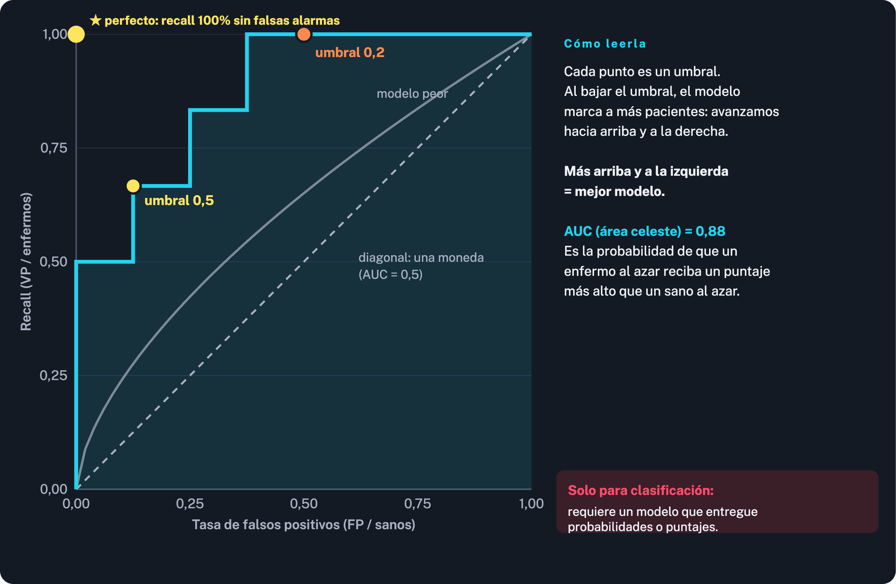{.still}

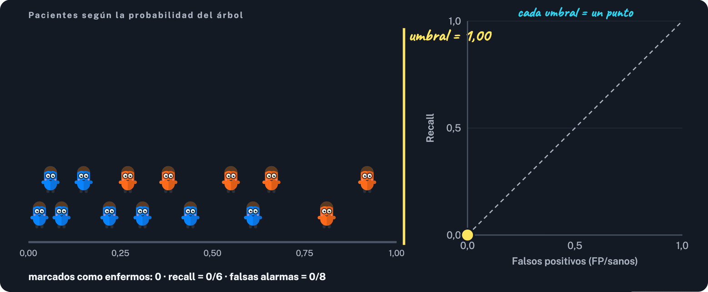{.still}

Cómo se recorre:

1. **Umbral muy alto** (por ejemplo, 1): nadie es marcado como enfermo. No hay falsas alarmas, pero tampoco encontramos a nadie: el punto $(0, 0)$, abajo a la izquierda.
2. **Al bajar el umbral**, se marca a más pacientes: subimos (más enfermos encontrados) y avanzamos a la derecha (más falsas alarmas).
3. **Umbral 0**: todos son marcados como enfermos. Encontramos a todos los enfermos, pero todos los sanos tienen falsa alarma: el punto $(1, 1)$.

::: {.box .key}
**Más arriba y a la izquierda es mejor.** La esquina $(0, 1)$ es el modelo perfecto: encuentra a todos los enfermos sin ninguna falsa alarma. La **diagonal** es lo que lograría una moneda: si marcas al azar, encuentras enfermos exactamente en la misma proporción que generas falsas alarmas. Entre dos modelos, el que tiene la curva **por encima** separa mejor a enfermos de sanos para cualquier umbral.
:::

::: {.box .def label="Definición · AUC"}
El **AUC** (*area under the curve*) es el área bajo la curva ROC: vale 0,5 para una moneda y 1 para un modelo perfecto. Tiene una interpretación directa: es la **probabilidad de que un enfermo elegido al azar reciba un puntaje más alto que un sano elegido al azar**. No depende de ningún umbral, así que sirve para comparar modelos antes de decidir dónde trazar la raya.
:::

::: {.box .warn}
**La curva ROC es solo para clasificación**, y requiere un modelo que entregue probabilidades o puntajes, no solo la clase. En regresión no existe: ahí se usan el MSE, el MAE o el R². Además, con clases **muy** desbalanceadas, la ROC puede verse optimista, porque los VN son muchísimos y la tasa de falsos positivos casi no se mueve. En esos casos conviene mirar también la curva **precisión–recall**.
:::

Prueba moviendo el umbral con 200 pacientes simulados (40 enfermos):

::: {.interactivo}
[Interactivo · Umbral, matriz de confusión y ROC]{.kicker}

```{ojs}
//| echo: false
viewof umbral = Inputs.range([0, 1], {step: 0.01, value: 0.5, label: "Umbral"})
```

```{ojs}
//| echo: false
{
  const P = pacientes, u = umbral;
  const vp = P.filter(p => p.enfermo && p.prob >= u).length, fn = 40 - vp;
  const fp = P.filter(p => !p.enfermo && p.prob >= u).length, vn = 160 - fp;
  const prec = vp + fp ? vp / (vp + fp) : NaN, rec = vp / 40, fpr = fp / 160;
  const pct = v => isNaN(v) ? "—" : Math.round(100 * v) + "%";
  const franja = Plot.plot({
    ...ML.estilo, width: ML.ancho(width), height: 230, x: {label: "Probabilidad que entrega el modelo", domain: [0, 1]}, y: {axis: null, domain: [-1.2, 1.2]},
    color: {domain: ["Enfermo", "Sano"], range: ["#FF6B1A", "#0A84FF"], legend: true},
    marks: [
      Plot.rect([{x1: u, x2: 1}], {x1: "x1", x2: "x2", y1: -1.2, y2: 1.2, fill: "#FF8A4C", fillOpacity: 0.12}),
      Plot.dot(P, {x: "prob", y: "j", fill: d => d.enfermo ? "Enfermo" : "Sano", r: 4.5, stroke: d => d.prob >= u ? "#FFE45E" : "none", strokeWidth: 1.5}),
      Plot.ruleX([u], {stroke: "#FFE45E", strokeWidth: 3}),
      Plot.text([{x: u}], {x: "x", y: 1.12, text: () => "umbral", dx: 30, fill: "#FFE45E", fontSize: 14, fontWeight: 700})
    ]
  });
  const roc = Plot.plot({
    ...ML.estilo, width: Math.min(300, ML.ancho(width)), height: 290, x: {label: "Falsos positivos (FP/sanos)", domain: [0, 1]}, y: {label: "Recall", domain: [0, 1]},
    marks: [
      Plot.line([[0, 0], [1, 1]], {stroke: "#A7B0BE", strokeDasharray: "6 5"}),
      Plot.areaY(rocCurva, {x: "fpr", y: "tpr", fill: "#22D3EE", fillOpacity: 0.12, curve: "step-after"}),
      Plot.line(rocCurva, {x: "fpr", y: "tpr", stroke: "#22D3EE", strokeWidth: 3, curve: "step-after"}),
      Plot.dot([{fpr, tpr: rec}], {x: "fpr", y: "tpr", r: 8, fill: "#FFE45E", stroke: "#141A24"})
    ]
  });
  return html`<div class="fila">${franja}${roc}</div>
    <table class="cm"><tr><th></th><th>Predice enfermo</th><th>Predice sano</th></tr>
    <tr><th>Real enfermo</th><td style="background:#1F3A33;color:#2EE59D">VP<b>${vp}</b></td><td style="background:#3A1E28;color:#FF4D6D">FN<b>${fn}</b></td></tr>
    <tr><th>Real sano</th><td style="background:#3A3418;color:#FFE45E">FP<b>${fp}</b></td><td style="background:#183340;color:#67E8F9">VN<b>${vn}</b></td></tr></table>
    <div class="lectura" style="text-align:center">recall <b>${pct(rec)}</b> · precisión <b>${pct(prec)}</b> · falsos positivos <b>${pct(fpr)}</b> · exactitud <b>${pct((vp + vn) / 200)}</b> · AUC del modelo <b>${aucSim.toFixed(2).replace(".", ",")}</b></div>`;
}
```
:::

::: {.box .turn}
Lleva el umbral a 1 y bájalo de a poco hasta 0. ¿Por dónde parte el punto en la curva ROC y por dónde termina? ¿En qué umbral obtendrías un recall de al menos 90%? ¿Cuánto cuesta en falsos positivos?
:::

::: {.panel-tabset group="lang"}
## R
```{r}
#| fig-height: 4
roc_d <- roc(te_d$default, prob, levels = c("No", "Yes"), quiet = TRUE)
auc(roc_d)
plot(roc_d, col = "#0891B2", lwd = 3, legacy.axes = TRUE, asp = NA, xlab = "Tasa de falsos positivos", ylab = "Recall")
abline(a = 0, b = 1, lty = 2, col = "grey60")     # la diagonal: una moneda
```

## Python
```{python}
print("AUC:", round(metrics.roc_auc_score(yd_te, prob), 3))
metrics.RocCurveDisplay.from_predictions(yd_te, prob, color=CIAN, plot_chance_level=True)
plt.xlabel("Tasa de falsos positivos"); plt.ylabel("Recall"); plt.show()
```
:::

## Del árbol al bosque

[▶ ver en el video · 12:18](https://youtu.be/bEskCcK3oAc?t=738){.vidlink}

{.still}

Un árbol solo es **inestable**: si cambias unos pocos datos, el primer corte puede ser otro, y como todo lo demás cuelga de ese corte, sale un árbol muy distinto. Eso es varianza alta. La solución es plantar muchos árboles y promediarlos, porque **promediar reduce la varianza**: los errores de un árbol se compensan con los de otro.

El problema es que tenemos una sola muestra. ¿De dónde sacamos muchas muestras distintas para crecer muchos árboles?

### Bootstrap y bagging

[▶ ver en el video: doble clic: bootstrap · 12:36](https://youtu.be/bEskCcK3oAc?t=756){.vidlink}

El **bootstrap** fabrica muestras nuevas a partir de la que tenemos: se sacan $n$ observaciones **al azar y con reposición**. Es como sacar una bolita de una tómbola, anotarla y **devolverla** antes de sacar la siguiente. Por eso, en cada muestra bootstrap algunas observaciones aparecen repetidas y otras no aparecen.

::: {.box .def label="Definición · Bootstrap"}
El **bootstrap** [@efron1979] es una técnica general para simular «qué habría pasado con otra muestra» cuando solo tenemos una. La idea: si la muestra representa bien a la población, sacar muestras **de la muestra** (con reposición y del mismo tamaño $n$) imita sacar muestras nuevas de la población.

Con muchas muestras bootstrap podemos recalcular cualquier estadístico (un promedio, un coeficiente, una predicción) y ver **cuánto varía**. Por eso se usa para:

- **errores estándar e intervalos de confianza** cuando no hay fórmula fácil (es su uso más conocido en econometría);
- **fabricar modelos distintos** a partir de los mismos datos, que es lo que hace bagging.

¿Por qué con reposición? Sin reposición, cada muestra de tamaño $n$ sería idéntica a la original (solo cambiaría el orden). La reposición es lo que genera variación.
:::

Un ejemplo pequeño, independiente de los árboles: el error estándar del promedio de $\ln(\text{sueldo})$, calculado con bootstrap y comparado con la fórmula de siempre, $s/\sqrt{n}$:

::: {.panel-tabset group="lang"}
## R
```{r}
prom_boot <- replicate(2000, mean(sample(hitters$logSalary, replace = TRUE)))   # 2.000 muestras bootstrap
c(ee_bootstrap = sd(prom_boot), ee_formula = sd(hitters$logSalary) / sqrt(nrow(hitters)))
quantile(prom_boot, c(0.025, 0.975))                                              # intervalo de confianza al 95%
```

## Python
```{python}
rng = np.random.default_rng(4143); ls = hitters["logSalary"].values
prom_boot = np.array([rng.choice(ls, size=len(ls), replace=True).mean() for _ in range(2000)])
print("EE bootstrap:", round(prom_boot.std(ddof=1), 4), "| EE fórmula:", round(ls.std(ddof=1) / np.sqrt(len(ls)), 4))
print("IC 95%:", np.percentile(prom_boot, [2.5, 97.5]).round(3))
```
:::

Los dos errores estándar casi coinciden. La ventaja del bootstrap es que funciona igual para estadísticos que no tienen fórmula, como la predicción de un árbol.

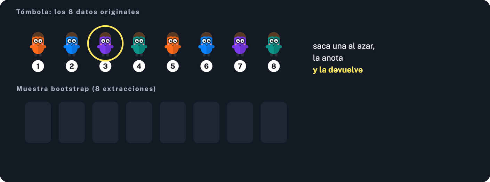{.still}

Repitiendo el sorteo se obtienen muchas muestras distintas, y cada una crece su propio árbol:

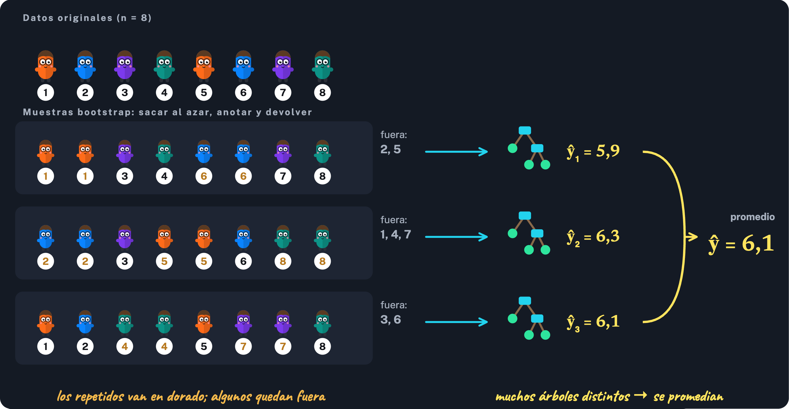{.still}

::: {.box .def}
**Bagging** (*bootstrap aggregating*):

1. Sacar $B$ muestras bootstrap (por ejemplo, $B = 500$).
2. En cada una, crecer un árbol **profundo, sin podar**: cada árbol tiene poco sesgo y mucha varianza, y el promedio se encarga de la varianza.
3. Predecir con el **promedio** de los $B$ árboles en regresión, o con la **votación** en clasificación: $\hat f_{\text{bag}}(x) = \frac{1}{B}\sum_{b=1}^{B}\hat f^{*b}(x)$.
:::

### El error *out of bag*: validación gratis

Cada observación queda fuera de cerca de un tercio de las muestras bootstrap. La probabilidad de que una observación no salga en ninguna de las $n$ extracciones es $(1-1/n)^n$, que para $n$ grande se acerca a $e^{-1} \approx 0{,}368$.

Esto permite validar sin separar datos: cada observación se predice **solo con los árboles que no la vieron**, y el promedio de esos errores es el **error OOB**, una estimación honesta del error fuera de muestra.

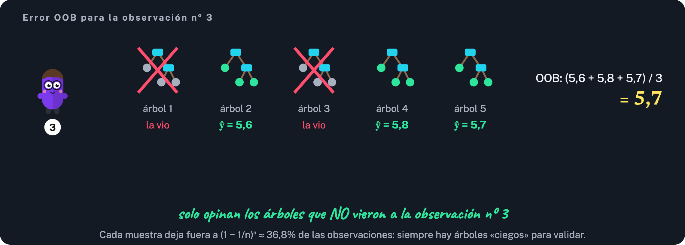{.still}

### *Random forest*: árboles que se parecen menos

Bagging tiene un límite. Si una variable es muy fuerte (en `Hitters`, los años en la liga), casi todos los árboles la usan en el primer corte, así que **se parecen mucho entre sí**. Promediar árboles parecidos reduce poco la varianza: sus errores van en la misma dirección.

*Random forest* agrega un truco: **en cada corte**, el árbol solo puede elegir entre $m$ variables sorteadas al azar ($m \approx \sqrt{p}$ en clasificación y $p/3$ en regresión, donde $p$ es el número de variables). A veces la variable fuerte no está disponible, y el árbol tiene que usar otra.

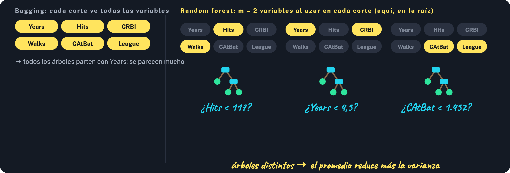{.still}

::: {.box .key}
Más diversidad entre árboles significa errores menos correlacionados, así que el promedio reduce más la varianza [@breiman2001]. Con $m = p$, random forest es exactamente bagging.
:::

::: {.panel-tabset group="lang"}
## R
```{r}
#| fig-height: 3.4
p <- ncol(train) - 1
bag <- ranger(logSalary ~ ., data = train, num.trees = 500, mtry = p, seed = 4143)
rf  <- ranger(logSalary ~ ., data = train, num.trees = 500, mtry = floor(p / 3), importance = "impurity", seed = 4143)
round(rbind(Bagging = c(OOB = bag$prediction.error, prueba = mse(test$logSalary, predict(bag, test)$predictions)),
            `Random forest` = c(OOB = rf$prediction.error, prueba = mse(test$logSalary, predict(rf, test)$predictions))), 3)
imp <- sort(rf$variable.importance, decreasing = TRUE)[1:8]
ggplot(data.frame(var = factor(names(imp), rev(names(imp))), imp), aes(imp, var)) + geom_col(fill = "#0891B2") +
  labs(x = "Importancia (reducción media del RSS)", y = NULL) + theme_minimal(base_size = 12)
```

## Python
```{python}
p = X_tr.shape[1]
bag = RandomForestRegressor(n_estimators=500, max_features=1.0, oob_score=True, random_state=4143).fit(X_tr, y_tr)
rf  = RandomForestRegressor(n_estimators=500, max_features=1/3, oob_score=True, random_state=4143).fit(X_tr, y_tr)
for nombre, m in [("Bagging", bag), ("Random forest", rf)]:
    print(f"{nombre}: OOB MSE {metrics.mean_squared_error(y_tr, m.oob_prediction_):.3f} | prueba {metrics.mean_squared_error(y_te, m.predict(X_te)):.3f}")
imp = pd.Series(rf.feature_importances_, index=X_tr.columns).sort_values().tail(8)
plt.figure(figsize=(7, 3.4)); plt.barh(imp.index, imp.values, color=CIAN); plt.xlabel("Importancia (reducción media de impureza)"); plt.show()
```
:::

::: {.box .warn}
Con cientos de árboles perdemos la imagen de un solo árbol. La **importancia de variables** recupera algo de interpretabilidad, pero mide **asociación para predecir, no causalidad**. Que «años en la liga» sea importante no significa que alargar una carrera suba el sueldo.
:::

### ¿Cuántos árboles? Más no sobreajusta, pero cuesta

[▶ ver en el video: doble clic: ¿más árboles sobreajustan? · 14:58](https://youtu.be/bEskCcK3oAc?t=898){.vidlink}

En bagging y random forest, **agregar árboles no produce sobreajuste**. Cada árbol nuevo es otra muestra bootstrap del mismo procedimiento, y el promedio de más árboles simplemente se **estabiliza**: el error OOB baja rápido al principio y luego se queda plano. Pasados unos cientos de árboles, agregar más no mejora ni empeora; solo **cuesta más tiempo de cómputo** (y memoria), que crece en proporción al número de árboles.

::: {.panel-tabset group="lang"}
## R
```{r}
B_grid <- c(25, 50, 100, 250, 500, 1000)
curva_B <- do.call(rbind, lapply(B_grid, function(b) {
  t0 <- Sys.time(); m <- ranger(logSalary ~ ., data = train, num.trees = b, mtry = floor(p / 3), seed = 4143, num.threads = 1)
  data.frame(arboles = b, error_OOB = round(m$prediction.error, 3), segundos = round(as.numeric(Sys.time() - t0, units = "secs"), 3)) }))
curva_B
```

## Python
```{python}
import time
filas = []
for b in [25, 50, 100, 250, 500, 1000]:
    t0 = time.perf_counter()
    m = RandomForestRegressor(n_estimators=b, max_features=1/3, oob_score=True, random_state=4143).fit(X_tr, y_tr)
    filas.append({"árboles": b, "error OOB": metrics.mean_squared_error(y_tr, m.oob_prediction_), "segundos": time.perf_counter() - t0})
pd.DataFrame(filas).round(3)
```
:::

::: {.box .key}
**En bagging y random forest, el número de árboles no es un hiperparámetro para afinar**: basta con «suficientes» (que el error OOB se haya estabilizado) y el único costo de pasarse es tiempo. Con la capacidad de cómputo actual, unos 500 o 1.000 árboles suelen ser baratos. Ojo: esto **no** vale para el boosting, como se ve a continuación.
:::

## Boosting

[▶ ver en el video · 13:51](https://youtu.be/bEskCcK3oAc?t=831){.vidlink}

{.still}

Boosting toma el camino contrario al bagging: en vez de árboles independientes, **árboles en secuencia**, cada uno pequeño, y cada uno ajustado a los **residuos** del modelo acumulado. El **residuo** de una observación es lo que el modelo todavía no explica: $r_i = y_i - \hat{y}_i$.

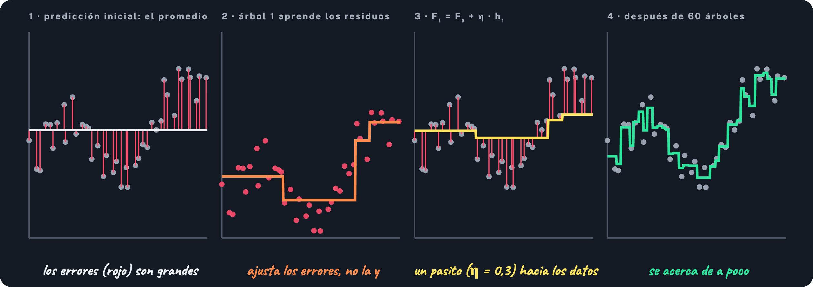{.still}

¿Por qué sumar solo una fracción $\eta$ y no la corrección completa? Porque cada árbol pequeño se equivoca; si le hiciéramos caso entero, sobreajustaríamos rápido. Con pasos pequeños, cada árbol corrige un poco, y muchos árboles juntos llegan lejos sin perseguir el ruido.

{.still}

::: {.hero}
[Boosting para regresión]{.cap}
[[$F_m(x)$]{.v}[]{.u}[predicción nueva]{.n}]{.tm style="--c:#67E8F9"}
[=]{.op}
[[$F_{m-1}(x)$]{.v}[]{.u}[predicción anterior]{.n}]{.tm style="--c:#EEF2F7"}
[+]{.op}
[[$\eta$]{.v}[]{.u}[tasa de aprendizaje, p. ej. 0,1]{.n}]{.tm style="--c:#FFE45E"}
[·]{.op}
[[$h_m(x)$]{.v}[]{.u}[árbol que aprende los residuos]{.n}]{.tm style="--c:#2EE59D"}
[sueldo real 6 · árbol 1 predice 5 · residuo 1 · con η = 0,1: [5 → 5,1 → 5,19 → …]{.res}]{.nums}
:::

::: {.box .def label="Definición · Hiperparámetros del boosting"}
**Número de árboles** $M$: a diferencia del bagging, **demasiados árboles sobreajustan**.

**Tasa de aprendizaje** $\eta$: más chica significa más lento, pero generaliza mejor (necesita más árboles).

**Profundidad** de cada árbol: árboles pequeños (de 1 a 4 cortes) suelen bastar.

Los tres se eligen con validación cruzada o con un conjunto de validación y *early stopping*. En clasificación, *gradient boosting* hace lo mismo con el gradiente de la pérdida logística. **XGBoost** [@chen2016] y **LightGBM** son las implementaciones que dominan las competencias con datos tabulares.
:::

::: {.panel-tabset group="lang"}
## R
```{r}
Xtr <- model.matrix(logSalary ~ . - 1, train); Xte <- model.matrix(logSalary ~ . - 1, test)
dtr <- xgb.DMatrix(Xtr, label = train$logSalary)
par <- list(objective = "reg:squarederror", eta = 0.05, max_depth = 2, subsample = 0.8)
cv  <- xgb.cv(params = par, data = dtr, nrounds = 1500, nfold = 5, early_stopping_rounds = 50, verbose = 0)
M   <- which.min(cv$evaluation_log$test_rmse_mean); M          # número de árboles elegido por CV
bst <- xgb.train(params = par, data = dtr, nrounds = M)
round(rbind(OLS = mse(test$logSalary, predict(ols, test)), `Árbol podado` = mse(test$logSalary, predict(podado, test)),
            Bagging = mse(test$logSalary, predict(bag, test)$predictions), `Random forest` = mse(test$logSalary, predict(rf, test)$predictions),
            Boosting = mse(test$logSalary, predict(bst, Xte))), 3)
```

## Python
```{python}
# gradient boosting de scikit-learn, con parada temprana sobre un 20% de validación
# (xgboost.XGBRegressor funciona igual; aquí no lo usamos porque comparte proceso con el xgboost de R)
bst = GradientBoostingRegressor(n_estimators=1500, learning_rate=0.05, max_depth=2, subsample=0.8,
                                validation_fraction=0.2, n_iter_no_change=50, random_state=4143).fit(X_tr, y_tr)
print("número de árboles elegido:", bst.n_estimators_)
pd.Series({"OLS": metrics.mean_squared_error(y_te, ols.predict(X_te)), "Árbol podado": metrics.mean_squared_error(y_te, podado.predict(X_te)),
           "Bagging": metrics.mean_squared_error(y_te, bag.predict(X_te)), "Random forest": metrics.mean_squared_error(y_te, rf.predict(X_te)),
           "Boosting": metrics.mean_squared_error(y_te, bst.predict(X_te))}, name="MSE de prueba").round(3)
```
:::

Compara directamente bagging y boosting a medida que se agregan árboles, con los mismos datos simulados del interactivo de complejidad:

::: {.interactivo}
[Interactivo · Número de árboles]{.kicker}

```{ojs}
//| echo: false
viewof nArb = Inputs.range([1, 200], {step: 1, value: 10, label: "Número de árboles"})
```

```{ojs}
//| echo: false
{
  const xs = d3.range(0, 10.001, 0.02), B = bosques;
  const ajuste = Plot.plot({
    ...ML.estilo, width: ML.ancho(width), height: 290, y: {label: "y", domain: [-3, 6]}, x: {label: "x"},
    color: {domain: ["Bagging", "Boosting"], range: ["#FFE45E", "#FF8AD8"], legend: true},
    marks: [
      Plot.dot(B.train, {x: "x", y: "y", r: 3.5, fill: "#A7B0BE"}),
      Plot.line(xs.map(x => ({x, y: B.bag(x, nArb), m: "Bagging"})), {x: "x", y: "y", stroke: "m", strokeWidth: 3}),
      Plot.line(xs.map(x => ({x, y: B.boost(x, nArb), m: "Boosting"})), {x: "x", y: "y", stroke: "m", strokeWidth: 2.5})
    ]
  });
  const errores = Plot.plot({
    ...ML.estilo, width: ML.ancho(width), height: 290, x: {label: "Número de árboles"}, y: {label: "Error de prueba (MSE)", domain: [0.5, 1.2]},
    color: {domain: ["Bagging", "Boosting"], range: ["#FFE45E", "#FF8AD8"], legend: true},
    marks: [
      Plot.ruleX([nArb], {stroke: "#2EE59D", strokeDasharray: "5 4"}),
      Plot.line(B.curva, {x: "b", y: "error", stroke: "m", strokeWidth: 3}),
      Plot.dot(B.curva.filter(r => r.b === nArb), {x: "b", y: "error", fill: "m", r: 6})
    ]
  });
  const e = m => B.curva.find(r => r.b === nArb && r.m === m).error.toFixed(2).replace(".", ",");
  return html`<div class="fila">${ajuste}${errores}</div>
    <div class="lectura">${nArb} árboles: error de prueba bagging <b>${e("Bagging")}</b> · boosting <b>${e("Boosting")}</b> · tiempo de cómputo ∝ ${nArb}</div>`;
}
```
:::

::: {.box .intuit}
**Bagging promedia, boosting acumula.** Agregar un árbol a un promedio de 100 casi no lo mueve, así que bagging se estabiliza. En boosting, cada árbol nuevo **corrige** al modelo, y cuando ya no queda señal, corrige el ruido: el error de prueba vuelve a subir. Por eso en boosting el número de árboles se elige con validación (*early stopping*).
:::

::: {.box .warn}
R y Python no dan exactamente los mismos números: las particiones al azar y los detalles de cada implementación difieren. Lo que se debe repetir es el **patrón**: los conjuntos de árboles (bagging, random forest y boosting) le ganan al árbol solo.
:::

```{ojs}
//| echo: false
//| output: false
ML = {
  const mulberry = seed => () => { seed |= 0; seed = seed + 0x6D2B79F5 | 0; let t = Math.imul(seed ^ seed >>> 15, 1 | seed); t = t + Math.imul(t ^ t >>> 7, 61 | t) ^ t; return ((t ^ t >>> 14) >>> 0) / 4294967296; };
  const gauss = r => { let u = 0, v = 0; while (!u) u = r(); while (!v) v = r(); return Math.sqrt(-2 * Math.log(u)) * Math.cos(2 * Math.PI * v); };
  const fVerdad = x => Math.sin(0.9 * x) * 1.6 + 0.25 * x;
  const simula = (n, seed) => { const r = mulberry(seed); return Array.from({length: n}, () => { const x = 10 * r(); return {x, y: fVerdad(x) + 0.7 * gauss(r)}; }); };
  const promedio = a => a.reduce((s, v) => s + v, 0) / a.length;
  const arbol = (D, depth, minLeaf = 1) => {
    const crece = (pts, d) => {
      const m = promedio(pts.map(p => p.y));
      if (d === 0 || pts.length < 2 * minLeaf) return {v: m};
      const s = pts.slice().sort((a, b) => a.x - b.x), n = s.length;
      const tot = s.reduce((a, p) => a + p.y, 0), tot2 = s.reduce((a, p) => a + p.y * p.y, 0);
      let mejor = null, sl = 0, sl2 = 0;
      for (let k = 1; k < n; k++) {
        sl += s[k - 1].y; sl2 += s[k - 1].y ** 2;
        if (k < minLeaf || n - k < minLeaf || s[k - 1].x === s[k].x) continue;
        const rss = (sl2 - sl * sl / k) + ((tot2 - sl2) - (tot - sl) ** 2 / (n - k));
        if (!mejor || rss < mejor.rss) mejor = {rss, k};
      }
      if (!mejor) return {v: m};
      return {s: (s[mejor.k - 1].x + s[mejor.k].x) / 2, L: crece(s.slice(0, mejor.k), d - 1), R: crece(s.slice(mejor.k), d - 1)};
    };
    const t = crece(D, depth);
    return x => { let n = t; while (n.v === undefined) n = x < n.s ? n.L : n.R; return n.v; };
  };
  const mse = (D, f) => D.reduce((s, d) => s + (d.y - f(d.x)) ** 2, 0) / D.length;
  const estilo = {style: {background: "#141A24", color: "#EEF2F7", fontFamily: "Public Sans", fontSize: "13px"}, marginLeft: 50, marginBottom: 42, grid: true};
  const ancho = w => Math.max(280, Math.floor((w - 60) / 2));
  return {mulberry, gauss, fVerdad, simula, arbol, mse, estilo, ancho};
}

bosques = {
  const train = ML.simula(50, 11), test = ML.simula(600, 999), r = ML.mulberry(123), B = 200, eta = 0.5;
  const bagF = [], boostF = [], curva = [];
  const sb = new Float64Array(test.length);
  for (let b = 1; b <= B; b++) {
    const muestra = Array.from({length: train.length}, () => train[Math.floor(r() * train.length)]);
    const f = ML.arbol(muestra, 50, 1); bagF.push(f);
    test.forEach((d, i) => sb[i] += f(d.x));
    curva.push({b, m: "Bagging", error: test.reduce((s, d, i) => s + (d.y - sb[i] / b) ** 2, 0) / test.length});
  }
  const m0 = train.reduce((s, d) => s + d.y, 0) / train.length;
  let Ftr = train.map(() => m0), Fte = test.map(() => m0);
  for (let b = 1; b <= B; b++) {
    const res = train.map((d, i) => ({x: d.x, y: d.y - Ftr[i]}));
    const h = ML.arbol(res, 3, 2); boostF.push(h);
    Ftr = Ftr.map((f, i) => f + eta * h(train[i].x)); Fte = Fte.map((f, i) => f + eta * h(test[i].x));
    curva.push({b, m: "Boosting", error: test.reduce((s, d, i) => s + (d.y - Fte[i]) ** 2, 0) / test.length});
  }
  return {
    train, curva,
    bag: (x, n) => bagF.slice(0, n).reduce((s, f) => s + f(x), 0) / n,
    boost: (x, n) => boostF.slice(0, n).reduce((s, f) => s + eta * f(x), m0)
  };
}

pacientes = {
  const r = ML.mulberry(7), lim = v => Math.min(0.99, Math.max(0.01, v));
  return Array.from({length: 200}, (_, i) => {
    const enfermo = i < 40;
    return {enfermo, prob: lim(enfermo ? 0.66 + 0.18 * ML.gauss(r) : 0.3 + 0.17 * ML.gauss(r)), j: (r() - 0.5) * 1.8};
  });
}

rocCurva = {
  const u = [1.01, ...pacientes.map(p => p.prob).sort((a, b) => b - a), 0];
  return u.map(t => ({fpr: pacientes.filter(p => !p.enfermo && p.prob >= t).length / 160, tpr: pacientes.filter(p => p.enfermo && p.prob >= t).length / 40}));
}

aucSim = {
  const E = pacientes.filter(p => p.enfermo), S = pacientes.filter(p => !p.enfermo);
  let a = 0; E.forEach(e => S.forEach(s => a += e.prob > s.prob ? 1 : e.prob === s.prob ? 0.5 : 0));
  return a / (E.length * S.length);
}
```

## Resumen

[▶ ver en el video: cierre · 15:33](https://youtu.be/bEskCcK3oAc?t=933){.vidlink}

::: {.box .key label="Tres ideas para llevarse"}
1. **Un árbol parte el mundo con preguntas** y predice con el promedio (regresión) o la mayoría (clasificación) de cada región. Los cortes se eligen de forma codiciosa minimizando RSS o impureza.
2. **La complejidad se controla con datos que el modelo no vio:** separar la muestra, validación cruzada y poda. El error de entrenamiento siempre engaña.
3. **La métrica se elige según el costo de equivocarse:** MSE o MAE en regresión; recall, precisión, F1 o AUC en clasificación, y nunca solo la exactitud con clases desbalanceadas.
:::

En las próximas clases estos bosques se vuelven **causales**: bosques que estiman efectos de tratamiento heterogéneos [@wager2018].

## Ejercicios

::: {.box .turn label="Tu turno · 1"}
Con `Hitters` y solo `Years` y `Hits`, encuentra con la función `mejor_corte` el mejor corte **dentro de los veteranos** (años ≥ 4,5). ¿Obtienes hits = 117,5?
:::

::: {.box .turn label="Tu turno · 2"}
Calcula a mano el Gini de un nodo con 50 morosos y 50 al día, y el de sus hijos si el corte deja (45 morosos, 15 al día) y (5 morosos, 35 al día). ¿Cuánto se reduce la impureza ponderada?
:::

::: {.box .turn label="Tu turno · 3"}
En el árbol de mora, ¿qué umbral necesitas para lograr un recall de al menos 80%? ¿Cuánto cae la precisión?
:::

::: {.box .turn label="Tu turno · 4"}
Entrena el boosting con $\eta = 0{,}3$ y con $\eta = 0{,}01$. ¿Qué pasa con el número de árboles elegido y con el error de prueba?
:::

::: {.callout-tip collapse="true"}
## Soluciones

**1.** Sí: entre los veteranos, el mejor corte en hits es 117,5. En R es `mejor_corte(hitters$Hits[hitters$Years >= 4.5], hitters$logSalary[hitters$Years >= 4.5])$s`.

**2.** Padre: $2 \cdot 0{,}5 \cdot 0{,}5 = 0{,}5$. Hijo 1, con 60 observaciones: $2 \cdot 0{,}75 \cdot 0{,}25 = 0{,}375$. Hijo 2, con 40: $2 \cdot 0{,}125 \cdot 0{,}875 = 0{,}219$. Ponderado: $0{,}6 \cdot 0{,}375 + 0{,}4 \cdot 0{,}219 = 0{,}3125$. Reducción: $0{,}5 - 0{,}3125 = 0{,}1875$.

**3.** Hay que bajar el umbral hasta que `recall ≥ 0,8` (prueba una grilla de umbrales con `evalua`). La precisión cae, porque aparecen muchas más falsas alarmas.

**4.** Con $\eta = 0{,}3$ se eligen pocos árboles y es más fácil sobreajustar; con $\eta = 0{,}01$ se necesitan muchos más, el entrenamiento es más lento y el error suele ser igual o un poco mejor.
:::

## Referencias {.unnumbered}

::: {#refs}
:::
