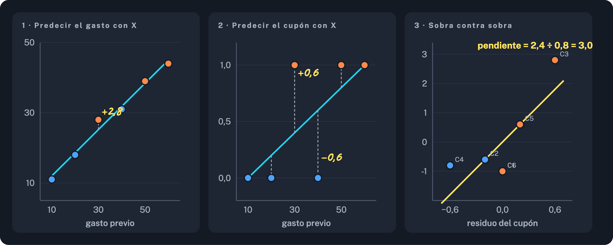
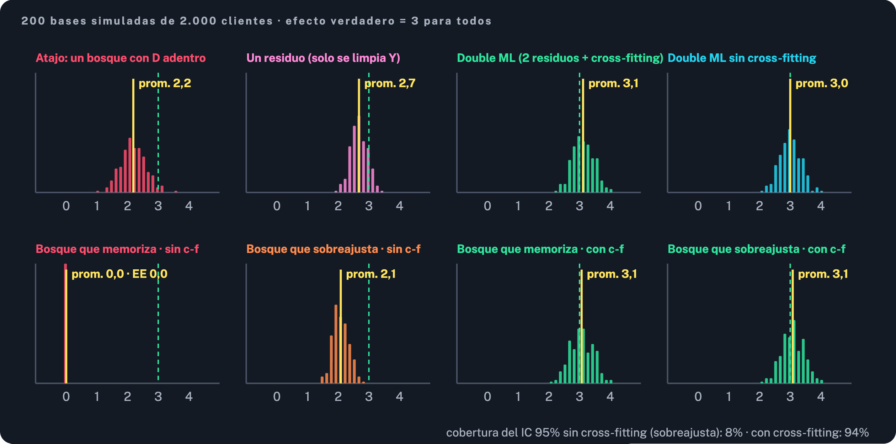
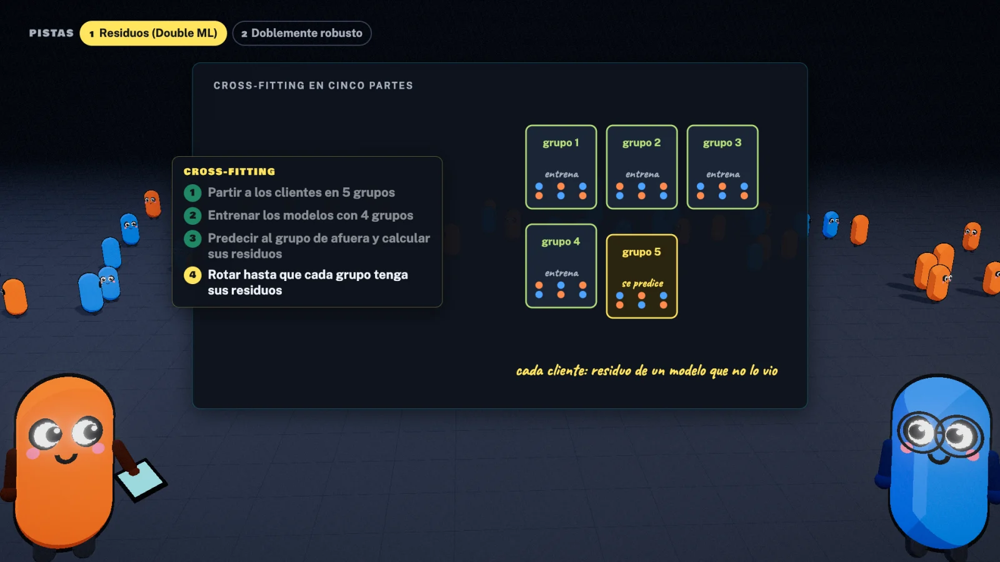
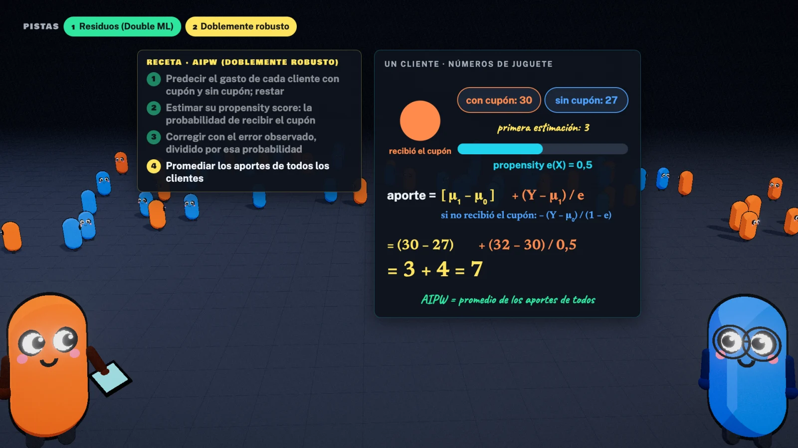
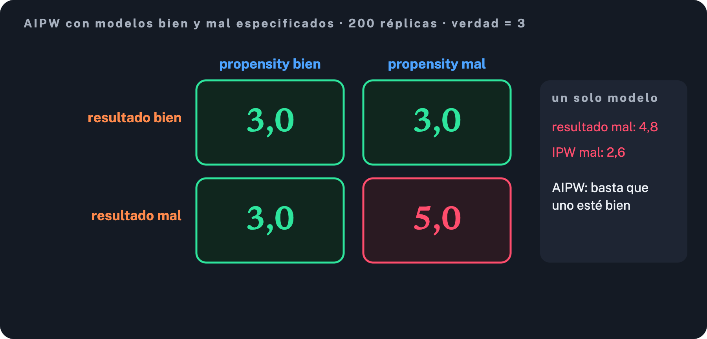
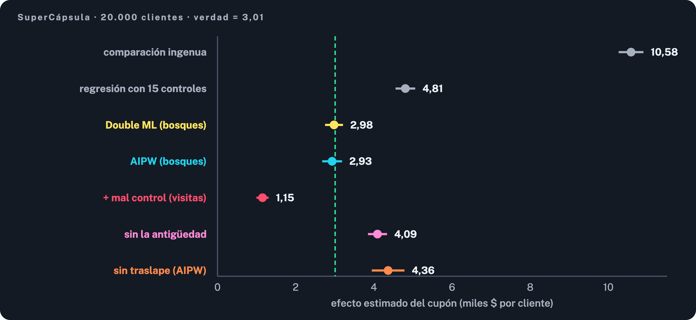

```{r}
#| include: false
library(jsonlite)
V <- fromJSON("data/cml/video.json", simplifyVector = FALSE)   # todos los números del texto salen de aquí (05 Causal ML/codigo)
f1 <- function(x) formatC(x, format = "f", digits = 1, decimal.mark = ",")
f2 <- function(x) formatC(x, format = "f", digits = 2, decimal.mark = ",")
pc <- function(x) round(100 * x)
s4 <- V$s4; s2 <- V$s2; s3 <- V$s3; s5 <- V$s5; seis <- V$seis
```

::: {.box .key}
**En este capítulo.**

- Cuando el tratamiento **no se sorteó**, comparar promedios mezcla el efecto con el tipo de persona que lo recibió. Controlar por las características que confunden es la receta de siempre.
- **Controlar es limpiar** (teorema de Frisch, Waugh y Lovell): se le quita al resultado y al tratamiento lo que las características explican, y se compara lo que sobra.
- Esa limpieza es una **predicción**, así que se puede hacer con *machine learning*. Para que funcione hacen falta **dos residuos** (los errores de los dos modelos se multiplican) y ***cross-fitting*** (cada residuo sale de un modelo que no vio a esa persona). Eso es **Double ML** [@chernozhukov2018; @ahrens2025].
- Una segunda ruta, **doblemente robusta (AIPW)**, combina un modelo del resultado con la probabilidad de recibir el tratamiento: basta que uno de los dos esté bien.
- El ML **no arregla la identificación**: confusores no observados, malos controles y falta de traslape siguen ahí.
:::

<div class="vidwin">
<iframe src="https://www.youtube-nocookie.com/embed/fuj2B0mJbrc" title="Causal ML · Parte 1 · IN4143" allow="accelerometer; autoplay; clipboard-write; encrypted-media; gyroscope; picture-in-picture; web-share" referrerpolicy="strict-origin-when-cross-origin" allowfullscreen></iframe>
</div>

::: {.box .noicon}
**Video.** Este capítulo acompaña al video [«Causal ML · Parte 1: ¿Funcionó el cupón?»](https://youtu.be/fuj2B0mJbrc). Las imágenes del capítulo son fotogramas de ese video.
:::

## Preparación {.unnumbered}

Todo el capítulo usa **SuperCápsula** y su app de fidelización. El mes pasado, la app le mandó un **cupón de descuento** a parte de sus `r format(V$caso$n, big.mark = ".", decimal.mark = ",")` clientes, **sin sortear**: marketing se lo mandó sobre todo a los que más compraban. Queremos saber cuánto subió el **gasto del mes siguiente** (en miles de pesos) gracias al cupón.

Los datos son **sintéticos** (`codigo/cml/gen_datos_cupon.py`), así que conocemos la verdad: en promedio, el cupón sube el gasto en **`r f2(V$caso$ate)` mil pesos**. Cada fila es un cliente, con:

- `D`: recibió el cupón (0/1) e `Y`: gasto del mes siguiente;
- quince características `X`: gasto previo, compras al mes, antigüedad, sensibilidad al precio, edad, ingreso de la comuna, distancia a la tienda, competidor cercano, reclamos, días desde la última compra, tamaño del hogar, si usa la app, notificaciones, apertura de correos y categoría favorita;
- solo porque es sintético: `tau` (el efecto verdadero de cada cliente) y `e` (su probabilidad verdadera de recibir el cupón).

::: {.panel-tabset group="lang"}
## R
```{r}
source("codigo/cml/cml.R")   # fwl(), residuos_cf(), plr(), nuisance_aipw(), aipw_scores(), aipw()
library(DoubleML); library(mlr3); library(mlr3learners)
lgr::get_logger("mlr3")$set_threshold("warn")
df <- read.csv("data/cml/datos_cupon.csv")
XC <- c("gasto_prev", "frecuencia", "antiguedad", "sens_precio", "edad", "ingreso", "distancia", "competidor",
        "reclamos", "recencia", "hogar", "app", "notif", "abre_mail", "categoria")
X <- df[, XC]; Y <- df$Y; D <- df$D
c(clientes = nrow(df), con_cupon = mean(D), ate_verdadero = mean(df$tau))
```

## Python
```{python}
import sys, numpy as np, pandas as pd
sys.path.insert(0, "codigo/cml")
import cml                                   # las mismas recetas, escritas a mano
df = pd.read_csv("data/cml/datos_cupon.csv")
XC = ["gasto_prev", "frecuencia", "antiguedad", "sens_precio", "edad", "ingreso", "distancia", "competidor",
      "reclamos", "recencia", "hogar", "app", "notif", "abre_mail", "categoria"]
X, Y, D = df[XC].to_numpy(float), df.Y.to_numpy(float), df.D.to_numpy(float)
pd.Series({"clientes": len(df), "con_cupon": D.mean(), "ate_verdadero": df.tau.mean()}).round(3)
```
:::

::: {.box .warn}
Los bosques de R (`ranger`) y de Python (`scikit-learn`) no son idénticos, así que las cifras con *machine learning* **difieren en el segundo decimal** entre pestañas. Las del texto y las figuras son las de las simulaciones del tema (`05 Causal ML/codigo`, Python; el bosque causal del capítulo 2, `grf` en R).
:::

## El caso: comparar promedios

{.still}

Los clientes con cupón gastaron `r f1(V$caso$media_con)` mil el mes siguiente y los sin cupón, `r f1(V$caso$media_sin)`: una diferencia de **`r f1(s4$ingenuo$theta)` mil**. Pero los con cupón ya gastaban más antes (`r f1(V$caso$gasto_prev_con)` contra `r f1(V$caso$gasto_prev_sin)` mil), y la regla de marketing le mandó el cupón a `r pc(V$caso$frac_oro_con_cupon)` de cada 100 clientes «Oro» (gasto previo > 30 mil y más de dos años) y solo a `r pc(V$caso$frac_no_oro_con_cupon)` de cada 100 del resto.

::: {.box .def label="Definición · Confusor"}
Un **confusor** es una característica que empuja a la vez **quién recibe el tratamiento** y **cuánto vale el resultado**. Aquí, el gasto previo y ser cliente Oro. Si no se limpia, la comparación de promedios atribuye al cupón lo que en realidad es el tipo de cliente.
:::

La receta de siempre es una regresión con controles: el gasto contra el cupón y las quince características. Da **`r f1(s4$regresion$theta)`**. Mejor que `r f1(s4$ingenuo$theta)`, pero lejos de `r f2(V$caso$ate)`: la regla de marketing tiene **umbrales** (el escalón de los clientes Oro, la caída de los inactivos) y una regresión lineal supone que cada característica pesa en línea recta.

::: {.panel-tabset group="lang"}
## R
```{r}
c(ingenuo = mean(Y[D == 1]) - mean(Y[D == 0]),
  regresion = unname(coef(lm(Y ~ D + ., data = cbind(Y, D, X)))["D"]))
```

## Python
```{python}
import statsmodels.api as sm
pd.Series({"ingenuo": Y[D == 1].mean() - Y[D == 0].mean(),
           "regresion": sm.OLS(Y, sm.add_constant(np.column_stack([D, X]))).fit().params[1]}).round(2)
```
:::

## Pista 1 · Controlar es limpiar: FWL en tres pasos {#sec-fwl}

Para ver qué hace una regresión con controles, achiquemos el problema a **seis clientes** y una sola característica, el gasto previo. Cada número se puede seguir a mano.

```{r}
#| echo: false
t6 <- do.call(rbind, lapply(seis$tabla, as.data.frame))
knitr::kable(t6[, c("cliente", "gasto_prev", "cupon", "gasto_sig", "y_pred", "resid_y", "d_pred", "resid_d", "producto", "resid_d2")],
             col.names = c("cliente", "gasto prev.", "cupón", "gasto sig.", "Y predicho", "resid. Y", "D predicho", "resid. D", "rY × rD", "rD²"),
             digits = 2, format.args = list(decimal.mark = ","), align = "c")
```

Comparando promedios, los con cupón gastan `r f1(seis$media_con)` y los sin cupón `r f1(seis$media_sin)`: diferencia de `r f1(seis$ingenuo)`. Pero los con cupón son los que más gastaban antes. La receta tiene **tres pasos**:

1. **Predecir el gasto con X** (una recta) y quedarse con lo que sobra: el **residuo del gasto**. Al tercer cliente la recta le predice `r f1(seis$tabla[[3]]$y_pred)` y gastó `r f1(seis$tabla[[3]]$gasto_sig)`: le sobran `r f1(seis$tabla[[3]]$resid_y)`.
2. **Predecir el cupón con X** y quedarse con lo que sobra: el **residuo del cupón**. A quien gastaba 30 mil le tocaba un cupón con probabilidad `r f1(seis$tabla[[3]]$d_pred)`; el tercero sí lo recibió (le sobran `r f1(seis$tabla[[3]]$resid_d)`), el cuarto no (le faltan `r f1(-seis$tabla[[4]]$resid_d)`). El primero y el sexto quedan con residuo cero: no aportan a la comparación.
3. **Regresar sobra contra sobra.** La pendiente es la suma de los productos dividida por la suma de los residuos del cupón al cuadrado.

{.still}

::: {.hero}
[El coeficiente del cupón, como residuo sobre residuo]{.cap}
[[$\hat\theta$]{.v}[]{.u}[efecto del cupón]{.n}]{.tm}
[=]{.op}
[[$\dfrac{\sum_i \tilde Y_i \tilde D_i}{\sum_i \tilde D_i^2}$]{.v}[]{.u}[sobra del gasto × sobra del cupón]{.n}]{.tm style="--c:#FFE45E"}
[con números: $`r f1(seis$suma_prod)` \div `r f1(seis$suma_rd2)` = `r f1(seis$beta)`$, igual que el coeficiente de D en la regresión del gasto contra el cupón y el gasto previo.]{.nums}
:::

::: {.box .def label="Definición · Residuo y teorema FWL"}
El **residuo** de una variable es lo que sobra después de predecirla con X: $\tilde Y = Y - \hat{\mathbb E}[Y \mid X]$. El **teorema de Frisch, Waugh y Lovell** [@frischwaugh1933; @lovell1963] dice que el coeficiente de D en la regresión de Y sobre D y X es **igual** a la pendiente de $\tilde Y$ sobre $\tilde D$, con los residuos de regresiones lineales en X.
:::

En SuperCápsula, con las quince características, la regresión múltiple da `r f2(seis$caso_mult)` y residuo sobre residuo da `r f2(seis$caso_fwl)`: idénticos hasta el último decimal.

::: {.panel-tabset group="lang"}
## R
```{r}
fwl(Y, D, X)                   # regresión múltiple = residuo sobre residuo
x6 <- c(10, 20, 30, 40, 50, 60); d6 <- c(0, 0, 1, 0, 1, 1); y6 <- c(11, 18, 28, 31, 39, 44)
fwl(y6, d6, x6)                # el ejemplo de seis clientes: 3 y 3
```

## Python
```{python}
b_mult, b_fwl, rY, rD = cml.fwl(Y, D, X)
x6, d6, y6 = np.array([10, 20, 30, 40, 50, 60.]), np.array([0, 0, 1, 0, 1, 1.]), np.array([11, 18, 28, 31, 39, 44.])
round(b_mult, 4), round(b_fwl, 4), [round(v, 4) for v in cml.fwl(y6, d6, x6)[:2]]
```
:::

::: {.box .intuit}
**Por qué funciona.** Al residualizar el cupón le quitamos justo la parte que «se parece» al gasto previo. Lo que queda es su **parte sorpresa**, que no tiene nada en común con X. Una parte sorpresa solo puede moverse junto con el gasto si el cupón tiene efecto. La letra chica: con rectas, solo se quita lo que se parece **en forma lineal**.
:::

::: {.box .turn label="Tu turno · 1"}
Con los seis clientes, verifica a mano que $\sum \tilde Y_i \tilde D_i = `r f1(seis$suma_prod)`$ usando la tabla. ¿Qué pasa con la pendiente si al sexto cliente le cambias el gasto siguiente de 44 a 54? ¿Y si le cambias el cupón de 1 a 0?
:::

::: {.callout-tip collapse="true"}
## Solución
Los productos son 0; 0,12; 1,68; 0,48; 0,12 y 0, que suman 2,4. Cambiar el gasto del sexto cliente **no mueve la pendiente**: su residuo del cupón es 0, así que su producto sigue siendo 0 (aunque cambia la recta del paso 1, la suma de productos con $\tilde D$ no cambia, porque $\tilde D$ es ortogonal a la constante y a X). Cambiarle el cupón sí la mueve: ahora tiene residuo del cupón distinto de cero y entra en la comparación.
:::

## De la recta al *machine learning*

Los pasos 1 y 2 son **predicciones**: predecir el gasto con X y predecir el cupón con X. Y predecir es lo que el *machine learning* hace bien. Si cambiamos la recta por un bosque aleatorio, el bosque sí ve el escalón de los clientes Oro.

::: {.box .def label="Definición · Modelo parcialmente lineal y modelos auxiliares"}
$$Y = \theta D + g(X) + \varepsilon, \qquad D = m(X) + v .$$
El efecto $\theta$ es una constante, pero $g$ y $m$ pueden tener cualquier forma. Las predicciones $\hat\ell(X) \approx \mathbb E[Y\mid X]$ y $\hat m(X) \approx \mathbb E[D\mid X]$ se llaman **modelos auxiliares** (*nuisance*): no buscamos interpretarlos, solo sirven para limpiar. La idea de limpiar con predicciones flexibles es de Robinson [-@robinson1988].
:::

::: {.box .warn}
**El supuesto no cambia.** El método limpia lo que **ve**. Si hay un confusor que no está en los datos, ningún bosque lo encuentra (@sec-noarregla).
:::

## Dos trampas: el atajo y el sobreajuste

**Trampa 1, el atajo.** ¿Para qué dos modelos? Metamos D y X en un solo bosque, prediciendo el gasto, y leamos el efecto prediciendo a cada cliente con D = 1 y con D = 0. Lo probamos en `r s2$R` bases simuladas de 2.000 clientes con efecto 3 para todos: el atajo da en promedio **`r f1(s2$atajo_3)`**. El bosque **regulariza**: le baja el volumen a lo que ayuda poco a predecir, y entre dieciséis variables el cupón ayuda poco. Limpiar solo el gasto tampoco basta (`r f1(s2$un_residuo_3)`). Con los dos residuos, el promedio es `r f1(s2$dml_cf_3)`.

{.still}

::: {.box .intuit}
**Ortogonalidad: los errores se multiplican.** Con dos residuos, el resultado queda en el «fondo del valle» respecto de los modelos auxiliares: si uno se equivoca un poco, el efecto casi no se mueve. El sesgo que queda es del orden del error de un modelo **por** el error del otro (algo chico por algo chico). Esa propiedad se llama ortogonalidad de Neyman [@chernozhukov2018; @ahrens2025].
:::

**Trampa 2, el sobreajuste.** Si el bosque se entrena con un cliente y después lo predice, puede **recordar** lo que gastó: su residuo queda artificialmente chico. En el extremo, con un bosque que memoriza, el residuo del gasto es cero para todos y el efecto estimado es **`r f1(s2$dml_sin_cf_memoriza_3)`**, con error estándar `r f1(s2$se_dml_sin_cf_memoriza_3)`: equivocado y muy seguro. Con un bosque que solo sobreajusta un poco, el efecto cae a `r f1(s2$dml_sin_cf_sobreajusta_3)` y el intervalo cubre el 3 solo `r pc(s2$cob_dml_sin_cf_sobreajusta_3)` de cada 100 veces.

::: {.box .warn label="Ojo · Lo que el sobreajuste hace y lo que no"}
Con efecto verdadero **cero**, el sobreajuste no inventa un efecto (en la simulación, `r f1(s2$dml_sin_cf_sobreajusta_0)` en promedio). Lo que hace es **comerse el efecto que sí existe**: el modelo del gasto memoriza también la parte del gasto que viene del cupón.
:::

::: {.box .def label="Definición · Cross-fitting"}
1. Partir a los clientes en K grupos (aquí, 5).
2. Entrenar los modelos auxiliares con K − 1 grupos.
3. Predecir al grupo que quedó afuera y calcular sus residuos.
4. Rotar hasta que cada grupo tenga los suyos.

Así, **cada cliente recibe su residuo de un modelo que nunca lo vio**. No hay que confundirlo con la validación cruzada: las dos parten la muestra, pero la validación cruzada sirve para **elegir** un modelo y el *cross-fitting* para **limpiar** residuos.
:::

{.still}

Con *cross-fitting*, los dos bosques problemáticos vuelven a `r f1(s2$dml_cf_memoriza_3)` y `r f1(s2$dml_cf_sobreajusta_3)`. Con un bosque bien regularizado la diferencia es chica (`r f1(s2$dml_sin_cf_3)` sin y `r f1(s2$dml_cf_3)` con): el *cross-fitting* es un cinturón de seguridad.

## La receta Double ML

::: {.box .def label="Receta · Double ML (modelo parcialmente lineal)"}
1. Partir a los clientes en 5 grupos.
2. Para cada grupo, predecir el gasto con un modelo entrenado en los otros, y guardar el residuo del gasto $\tilde Y$.
3. Lo mismo con el cupón: residuo del cupón $\tilde D$.
4. Regresar $\tilde Y$ contra $\tilde D$: la pendiente es el efecto $\hat\theta$.
5. Calcular el error estándar de esa regresión y el intervalo de confianza.
:::

::: {.hero}
[El error estándar de Double ML]{.cap}
[[$\widehat{\text{SE}}(\hat\theta)$]{.v}[]{.u}[cuánto bailaría]{.n}]{.tm}
[=]{.op}
[[$\sqrt{\dfrac{1}{n}\,\dfrac{\overline{\left[(\tilde Y - \hat\theta\tilde D)\,\tilde D\right]^2}}{\left(\overline{\tilde D^2}\right)^2}}$]{.v}[]{.u}[el sándwich de la regresión final]{.n}]{.tm style="--c:#FFE45E"}
[con números: $\hat\theta = `r f2(s4$dml$theta)`$, SE $= `r f2(s4$dml$se)`$, IC 95% $[`r f2(s4$dml$lo)`;\ `r f2(s4$dml$hi)`]$. La verdad es `r f2(V$caso$ate)`.]{.nums}
:::

::: {.panel-tabset group="lang"}
## R
```{r}
r <- residuos_cf(Y, D, X, K = 5, seed = 2)     # pasos 1 a 3 (bosques de ranger)
round(plr(r$rY, r$rD), 3)                      # pasos 4 y 5
# lo mismo con el paquete DoubleML (Bach et al., 2024)
set.seed(10)
dat <- DoubleMLData$new(cbind(Y, D, X), y_col = "Y", d_cols = "D", x_cols = XC)
dml <- DoubleMLPLR$new(dat, ml_l = lrn("regr.ranger", num.trees = 300, min.node.size = 20, mtry = 6),
                       ml_m = lrn("classif.ranger", num.trees = 300, min.node.size = 20, mtry = 6), n_folds = 5)
dml$fit(); dml$summary()
```

## Python
```{python}
p = cml.dml_plr(Y, D, X, seed=10)              # pasos 1 a 5 (bosques de scikit-learn), la corrida del video
{k: round(float(p[k]), 3) for k in ["theta", "se", "lo", "hi"]}
```

```{python}
# lo mismo con el paquete doubleml
import doubleml as dml
from sklearn.ensemble import RandomForestRegressor, RandomForestClassifier
dat = dml.DoubleMLData(df[["Y", "D"] + XC], y_col="Y", d_cols="D", x_cols=XC)
m = dml.DoubleMLPLR(dat, RandomForestRegressor(300, min_samples_leaf=20, max_features=0.4, random_state=1, n_jobs=-1),
                    RandomForestClassifier(300, min_samples_leaf=20, max_features=0.4, random_state=1, n_jobs=-1), n_folds=5)
m.fit().summary.round(3)
```
:::

En SuperCápsula, Double ML da **`r f2(s4$dml$theta)`** con IC $[`r f2(s4$dml$lo)`;\ `r f2(s4$dml$hi)`]$, y cubre la verdad. No depende de la suerte del corte: con otras cuatro particiones da entre `r f2(s4$dml_rango[[1]])` y `r f2(s4$dml_rango[[2]])`, y con *boosting* en vez de bosques, `r f2(s4$dml_boost$theta)`.

::: {.box .warn label="Ojo · ¿Qué promedio estima Double ML?"}
Si el efecto **cambia entre clientes**, el modelo parcialmente lineal no estima el efecto promedio (ATE): estima un promedio **ponderado** por $e(X)\,(1-e(X))$, que pesa más a los clientes con probabilidad de cupón cercana a ½. En nuestros datos ese promedio vale `r f2(V$caso$plr_obj)` y el ATE `r f2(V$caso$ate)`: la regla de marketing del generador se calibró para que coincidieran. Si lo que se quiere es el ATE con efectos heterogéneos, la ruta es la de la sección siguiente (en DoubleML, `DoubleMLIRM`).
:::

::: {.box .paper label="Del paper · Los hiperparámetros importan"}
Bach et al. [-@bach2024tuning] muestran por simulación que modelos auxiliares mal afinados sesgan el efecto. Recomiendan afinarlos (con toda la muestra o por grupo) y **reportar su capacidad predictiva**. En SuperCápsula, el bosque explica `r pc(s4$r2_y)`% de la varianza del gasto y `r pc(s4$r2_d)`% de la del cupón.
:::

## Pista 2 · Doblemente robusto (AIPW)

::: {.box .def label="Definición · Propensity score"}
El ***propensity score*** de un cliente es su **probabilidad de recibir el cupón**, dadas sus características: $e(X) = \Pr(D = 1 \mid X)$. Un cliente Oro tiene un *propensity* alto; uno ocasional, bajo.
:::

::: {.box .def label="Receta · AIPW"}
1. Con un modelo, predecir para cada cliente cuánto gastaría **con** cupón, $\hat\mu_1(X)$, y **sin** cupón, $\hat\mu_0(X)$. La resta es una primera estimación de su efecto.
2. Con otro modelo, estimar su *propensity* $\hat e(X)$.
3. Corregir con el error observado: si recibió el cupón, sumar $(Y - \hat\mu_1)/\hat e$; si no, restar $(Y - \hat\mu_0)/(1-\hat e)$.
4. Promediar los aportes de todos los clientes. Con *cross-fitting* en los pasos 1 y 2, es el Double ML para el efecto promedio.
:::

::: {.hero}
[Aporte de un cliente al estimador doblemente robusto]{.cap}
[[$\hat\psi_i$]{.v}[]{.u}[aporte]{.n}]{.tm}
[=]{.op}
[[$\hat\mu_1(X_i) - \hat\mu_0(X_i)$]{.v}[]{.u}[predicción]{.n}]{.tm style="--c:#FFE45E"}
[+]{.op}
[[$\dfrac{D_i\,(Y_i - \hat\mu_1(X_i))}{\hat e(X_i)}$]{.v}[]{.u}[error con cupón]{.n}]{.tm style="--c:#FF8A4C"}
[−]{.op}
[[$\dfrac{(1-D_i)\,(Y_i - \hat\mu_0(X_i))}{1-\hat e(X_i)}$]{.v}[]{.u}[error sin cupón]{.n}]{.tm style="--c:#4DA3FF"}
[con números de juguete: un cliente con cupón, $\hat\mu_1 = `r V$juguete_aipw$mu1`$, $\hat\mu_0 = `r V$juguete_aipw$mu0`$, gastó `r V$juguete_aipw$y`, $\hat e = `r f1(V$juguete_aipw$e)`$: aporte $= `r V$juguete_aipw$prediccion` + `r V$juguete_aipw$correccion` = `r V$juguete_aipw$aporte`$. El ATE es el promedio de los aportes.]{.nums}
:::

{.still}

::: {.panel-tabset group="lang"}
## R
```{r}
nu <- nuisance_aipw(Y, D, X, K = 5, seed = 2)
round(aipw(aipw_scores(Y, D, nu$mu0, nu$mu1, nu$e)), 3)
```

## Python
```{python}
mu0, mu1, e = cml.nuisance_aipw(Y, D, X, seed=10)
a = cml.aipw(Y, D, mu0, mu1, e)
{k: round(float(a[k]), 3) for k in ["theta", "se", "lo", "hi"]}
```
:::

En SuperCápsula, AIPW da **`r f2(s4$aipw$theta)`**, con IC $[`r f2(s4$aipw$lo)`;\ `r f2(s4$aipw$hi)`]$. Cubre la verdad.

**¿Por qué «doblemente robusto»?** Tiene dos motores: el modelo del resultado y el del *propensity*. Si el del resultado es bueno, los errores promedian cero y la corrección no hace daño. Si es malo, los errores pesados por la probabilidad reconstruyen lo que falta [@robins1994; @bangrobins2005].

{.still}

::: {.box .warn label="Ojo · Traslape"}
Dividir por $\hat e$ es peligroso cuando la probabilidad es casi 0 o casi 1: un cliente con $e = 1/100$ que recibió el cupón pesa como 100. En una variante del caso donde marketing aplica la regla casi sin excepciones, `r pc(s5$frac_extremo)` de cada 100 clientes tienen $e < 0{,}02$ o $e > 0{,}98$, y AIPW da `r f1(s5$sin_traslape)` (verdad `r f1(V$caso$ate)`). **Recortar los pesos no lo arregla**: no hay clientes comparables. Antes de estimar, se mira el histograma de $\hat e$ en los dos grupos.
:::

## Lo que el *machine learning* no arregla {#sec-noarregla}

{.still}

- **Un mal control.** Si agregamos las **visitas a la tienda del mes siguiente**, que ocurren después del cupón, Double ML da `r f1(s5$mal_control)` con IC $[`r f1(s5$mal_control_lo)`;\ `r f1(s5$mal_control_hi)`]$. El cupón sube el gasto en parte porque la gente va más a la tienda: controlar por las visitas le quita al cupón justo el camino por donde funciona.
- **Un confusor no observado.** Sin la antigüedad no se puede reconstruir quién es Oro, y Double ML da `r f1(s5$sin_antig)` (sin antigüedad ni gasto previo, `r f1(s5$sin_antig_gasto)`).
- **Falta de traslape** (arriba).

::: {.box .paper label="Del paper · El DAG sigue mandando"}
Hünermund, Louw y Caspi [-@hunermund2023] muestran que «tirarle todas las variables al algoritmo» puede meter malos controles y sesgar Double ML. Qué variables entran se decide con el DAG (clase 5), no con el algoritmo. Para confusores no observados hay cotas de sensibilidad hechas para Double ML [@cinelli2021lss].
:::

## Ejercicios {.unnumbered}

::: {.box .turn label="Tu turno · 2"}
Corre Double ML **sin cross-fitting** con un bosque que memoriza (`min.node.size = 1` y sin remuestreo en `ranger`: `replace = FALSE, sample.fraction = 1`) para el gasto, y con el bosque regularizado para el cupón. ¿Qué pasa con $\hat\theta$ y con su error estándar? Explica por qué.
:::

::: {.callout-tip collapse="true"}
## Solución
```r
m_y <- ranger(x = X, y = Y, num.trees = 100, min.node.size = 1, replace = FALSE, sample.fraction = 1)
rY  <- Y - predict(m_y, data = X)$predictions                    # ≈ 0 para todos: el bosque memorizó
rD  <- D - pred_d(bosque_d(X, D), X)
plr(rY, rD)                                                      # θ ≈ 0 y SE ≈ 0
```
El bosque que memoriza predice exactamente el gasto de cada cliente que vio, así que el residuo del gasto es cero y la pendiente también. El error estándar también es casi cero: el método «está seguro» de un efecto nulo. Con *cross-fitting* (`residuos_cf`), el mismo bosque vuelve a dar cerca de 3.
:::

::: {.box .turn label="Tu turno · 3"}
Agrega la variable `visitas_sig` (visitas del mes siguiente) a las características y vuelve a correr Double ML. ¿Cuánto da? Dibuja el DAG con D, Y, X y las visitas y explica qué camino se cortó.
:::

::: {.callout-tip collapse="true"}
## Solución
```r
r2 <- residuos_cf(Y, D, cbind(X, visitas_sig = df$visitas_sig)); plr(r2$rY, r2$rD)
```
Da alrededor de `r f1(s5$mal_control)`, con un intervalo angosto. Las visitas son un **mediador**: D → visitas → Y. Controlar por ellas bloquea ese camino, y el efecto que queda es solo el que no pasa por ir más a la tienda. No es un confusor: ocurre **después** del tratamiento.
:::

::: {.box .turn label="Tu turno · 4"}
Calcula $\hat e(X)$ con *cross-fitting* y haz el histograma separado por grupo. ¿Hay clientes con $\hat e < 0{,}05$ o $\hat e > 0{,}95$? ¿Cuál es el peso más grande que entra en AIPW con el recorte de 0,01?
:::

::: {.callout-tip collapse="true"}
## Solución
```r
hist(nu$e[D == 1], col = rgb(1, .5, .2, .5), main = "", xlab = "e(X)"); hist(nu$e[D == 0], col = rgb(.2, .5, 1, .5), add = TRUE)
max(ifelse(D == 1, 1 / pmax(nu$e, .01), 1 / pmax(1 - nu$e, .01)))
```
En el caso hay traslape: casi todas las probabilidades están entre 0,05 y 0,95 y el peso más grande ronda `r round(s5$peso_max_caso)`. En la variante sin traslape, el peso llega al tope del recorte (`r round(s5$peso_max_sin)` con recorte 0,001).
:::

::: {.box .paper label="Estado del arte · revisado 18-nov-2026"}
Este capítulo se armó a partir de un sondeo de la literatura (*surveys* primero, luego papers de 2021–2026 y el software vigente):

- **Ahrens et al. (2025)**, la introducción de referencia a Double ML [@ahrens2025], y el paper original de **Chernozhukov et al. (2018)** [@chernozhukov2018]. El libro abierto de **Chernozhukov, Hansen, Kallus, Spindler y Syrgkanis** tiene el mismo arco, con *notebooks* en R y Python [@cck2024].
- **Robinson (1988)** para el puente entre FWL y lo no lineal [@robinson1988]; **Robins et al. (1994)** y **Bang y Robins (2005)** para lo doblemente robusto [@robins1994; @bangrobins2005].
- **Bach et al. (2024)** sobre afinar hiperparámetros [@bach2024tuning]; **Hünermund et al. (2023)** sobre malos controles [@hunermund2023]; **Knaus (2022)**, guía aplicada [@knaus2022].
- Software: `DoubleML` en R y Python [@doubleml2024]; `grf` (R) y `econml` (Python) en el capítulo 2.
:::

## Referencias {.unnumbered}

::: {#refs}
:::
