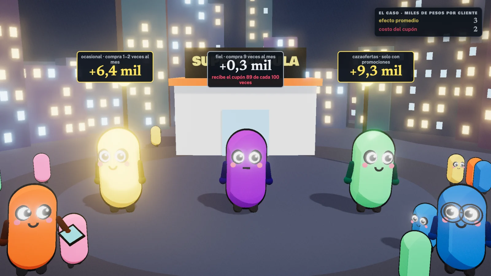
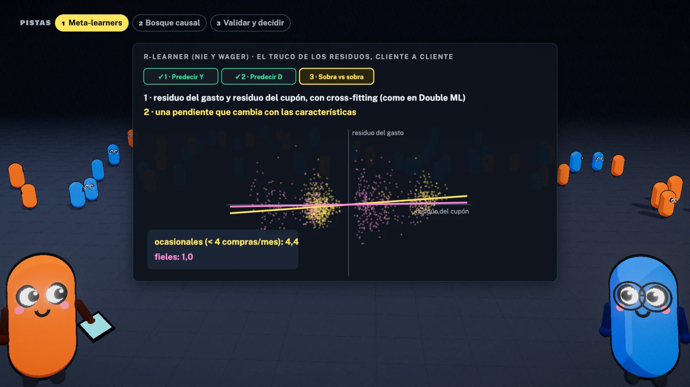
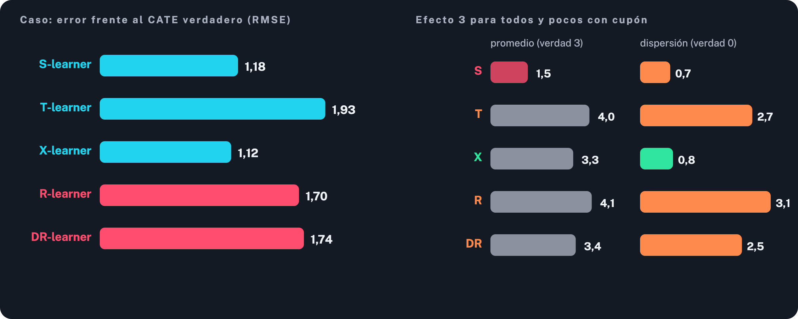
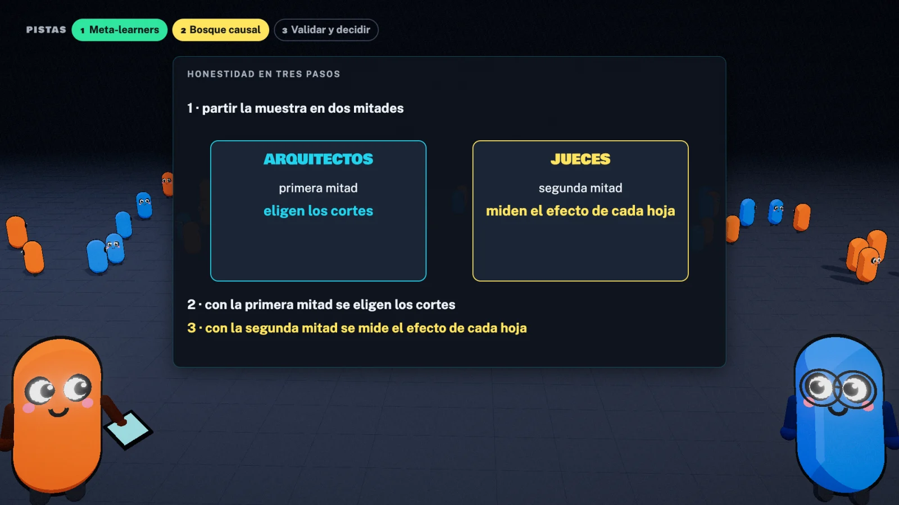
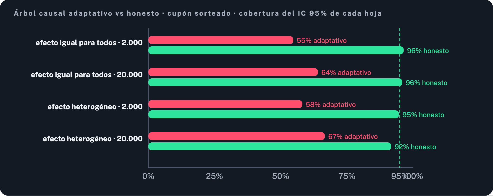
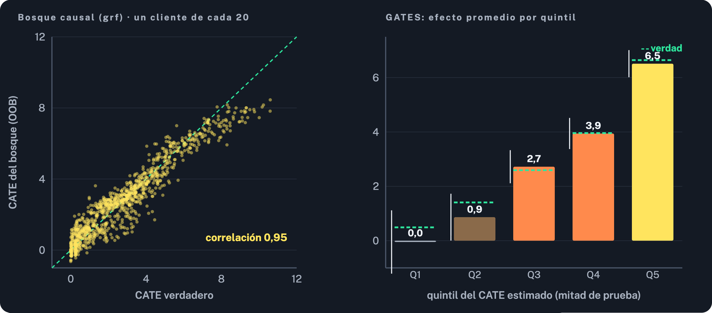
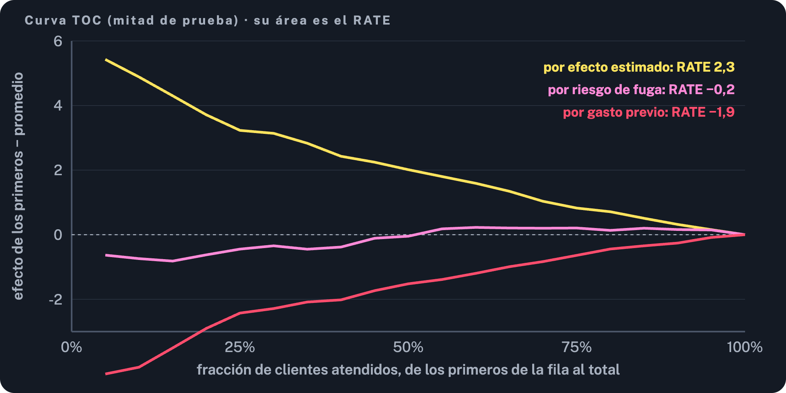
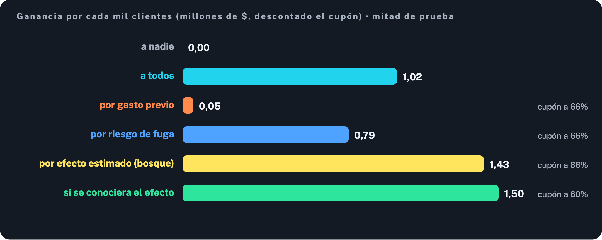

```{r}
#| include: false
library(jsonlite)
V <- fromJSON("data/cml/video.json", simplifyVector = FALSE)   # todos los números del texto salen de aquí (05 Causal ML/codigo)
f1 <- function(x) formatC(x, format = "f", digits = 1, decimal.mark = ",")
f2 <- function(x) formatC(x, format = "f", digits = 2, decimal.mark = ",")
pc <- function(x) round(100 * x)
pf <- setNames(V$perfiles, sapply(V$perfiles, `[[`, "perfil"))
s6c <- V$s6[["caso (efecto heterogéneo)"]]; s6p <- V$s6[["efecto 3 para todos, pocos con cupón"]]
s7 <- V$s7; s8 <- V$s8; ve <- V$s8_vecinos[[1]]; ga <- V$s8_gates; s9 <- V$s9
ra <- setNames(V$s8_rate, sapply(V$s8_rate, `[[`, "prioridad"))
```

::: {.box .key}
**En este capítulo.**

- El efecto **promedio** puede esconder clientes a los que el cupón les cambia mucho la conducta y otros a los que no les cambia nada. El **CATE** separa esos efectos según las características.
- De cada cliente vemos **un solo mundo** (con o sin cupón): no hay «respuesta correcta» para medir el error del CATE como en una predicción cualquiera.
- Los **meta-learners** (S, T, X, R, DR) arman el CATE con modelos de predicción comunes. El R y el DR son las ideas del capítulo 1, cliente a cliente.
- El **árbol causal** corta buscando efectos distintos; la **honestidad** separa los datos que eligen los cortes de los que miden. El **bosque causal** es residuo sobre residuo en el barrio de cada cliente [@wager2018; @athey2019grf].
- No se valida el efecto de cada cliente: se valida el **orden** (GATES, curva TOC y RATE). Y se decide **por efecto**, no por riesgo ni por gasto.
:::

<div class="vidwin">
<iframe src="https://www.youtube-nocookie.com/embed/s-1vcyw7hGE" title="Causal ML · Parte 2 · IN4143" allow="accelerometer; autoplay; clipboard-write; encrypted-media; gyroscope; picture-in-picture; web-share" referrerpolicy="strict-origin-when-cross-origin" allowfullscreen></iframe>
</div>

::: {.box .noicon}
**Video.** Este capítulo acompaña al video [«Causal ML · Parte 2: ¿A quién le mando el cupón?»](https://youtu.be/s-1vcyw7hGE). Las imágenes del capítulo son fotogramas de ese video.
:::

## Preparación {.unnumbered}

Seguimos con **SuperCápsula** y su cupón (capítulo 1). El cupón cuesta **`r f1(V$caso$costo)` mil pesos** por cliente y sube el gasto en `r f2(V$caso$ate)` mil en promedio: mandárselo a todos «conviene». La pregunta ahora es **a quién**.

::: {.panel-tabset group="lang"}
## R
```{r}
source("codigo/cml/cml.R")
library(grf)
df <- read.csv("data/cml/datos_cupon.csv")
XC <- c("gasto_prev", "frecuencia", "antiguedad", "sens_precio", "edad", "ingreso", "distancia", "competidor",
        "reclamos", "recencia", "hogar", "app", "notif", "abre_mail", "categoria")
X <- as.matrix(df[, XC]); Y <- df$Y; W <- df$D; tau <- df$tau; COSTO <- 2
```

## Python
```{python}
import sys, json, numpy as np, pandas as pd
sys.path.insert(0, "codigo/cml")
import cml, gen_datos_cupon as G
G.ESCALA = json.load(open("data/cml/S0_parametros.json"))["escala_tau"]   # escala del efecto del caso
df = pd.read_csv("data/cml/datos_cupon.csv")
XC = G.X_COLS
X, Y, D, tau = df[XC].to_numpy(float), df.Y.to_numpy(float), df.D.to_numpy(float), df.tau.to_numpy()
rng = np.random.default_rng(6); idx = rng.permutation(len(df)); tr, te = idx[: len(df) // 2], idx[len(df) // 2:]
```
:::

## Del efecto promedio al CATE

{.still}

Con el generador del caso podemos calcular el efecto verdadero de tres perfiles:

- **el ocasional**, que compra una o dos veces al mes y cuida el precio: **+`r f1(pf[["el ocasional"]]$tau)` mil**;
- **la fiel**, que compra nueve veces al mes, cupón o no cupón: **+`r f1(pf[["la fiel"]]$tau)` mil**. Y marketing le manda el cupón `r pc(pf[["la fiel"]]$e)` de cada 100 veces;
- **el cazaofertas**, que solo compra con promociones: **+`r f1(pf[["el cazaofertas"]]$tau)` mil**.

::: {.box .def label="Definición · CATE"}
El **efecto condicional promedio** es el efecto del tratamiento entre clientes con las mismas características:
$$\tau(x) = \mathbb E\left[\,Y(1) - Y(0) \mid X = x\,\right].$$
Sirve para **decidir a quién tratar**: mandar el cupón si $\tau(x)$ supera su costo. En nuestros datos, `r pc(V$caso$frac_tau_mayor_costo)` de cada 100 clientes tienen un efecto verdadero mayor que `r f1(V$caso$costo)`.
:::

**El problema de fondo.** De cada cliente vemos un solo mundo. Para predecir el gasto comparamos la predicción con el gasto real; para el efecto de un cliente **no hay respuesta correcta** con la cual comparar. Por eso los métodos de este capítulo se arman con las ideas del capítulo 1 y se validan **por grupos y por el orden** en que ponen a los clientes.

{.still}

## Pista 1 · Meta-learners

::: {.box .def label="Definición · Meta-learner"}
Una **receta** que arma el CATE con modelos de predicción comunes (bosques, *boosting*, lasso…) [@kunzel2019]. El nombre viene de que el modelo de predicción es intercambiable.
:::

| | Receta | Ojo |
|---|---|---|
| **S** | 1) Un modelo del gasto con D y X juntos. 2) Predecir a cada cliente con D = 1 y con D = 0. 3) Restar. | Es el «atajo» del capítulo 1: regulariza el cupón y **encoge** el efecto. |
| **T** | 1) Un modelo del gasto solo con los con cupón. 2) Otro solo con los sin cupón. 3) Predecir con los dos y restar. | Los errores de los dos modelos se suman: **inventa diferencias**, sobre todo si un grupo es chico. |
| **X** | 1) Los dos modelos del T. 2) Cruzarlos: efecto imputado $Y - \hat\mu_0(X)$ para los con cupón y $\hat\mu_1(X) - Y$ para los sin cupón. 3) Predecir esos efectos con X en cada grupo y promediar, con más peso al grupo grande. | Pensado para grupos desbalanceados [@kunzel2019]. |
| **R** | 1) Residuos del gasto y del cupón, con *cross-fitting*. 2) Buscar una pendiente que cambie con X: regresar $\tilde Y/\tilde D$ sobre X con pesos $\tilde D^2$. | Es FWL otra vez, cliente a cliente [@nie2021]. |
| **DR** | 1) El aporte AIPW de cada cliente (capítulo 1), su **pseudo-resultado**. 2) Predecirlo con X. | La ruta doblemente robusta, cliente a cliente [@kennedy2023]. |

: Los cinco meta-learners, paso a paso. {.striped}

{.still}

Con los mismos residuos del capítulo 1, la pendiente de residuo sobre residuo es `r f1(V$s4_por_grupo$ocasionales)` entre los ocasionales (menos de `r V$s4_por_grupo$corte` compras al mes) y `r f1(V$s4_por_grupo$fieles)` entre los fieles: esa es la intuición del R-learner.

::: {.panel-tabset group="lang"}
## R
```{r}
set.seed(6); idx <- sample(nrow(df)); tr <- idx[1:(nrow(df) / 2)]; te <- idx[(nrow(df) / 2 + 1):nrow(df)]
Xd <- as.data.frame(X)
# S-learner: un modelo con D adentro
fS <- ranger(x = cbind(Xd[tr, ], D = W[tr]), y = Y[tr], num.trees = 300, min.node.size = 20, seed = 1)
tS <- predict(fS, cbind(Xd[te, ], D = 1))$predictions - predict(fS, cbind(Xd[te, ], D = 0))$predictions
# T-learner: un modelo por grupo
t1 <- tr[W[tr] == 1]; t0 <- tr[W[tr] == 0]
tT <- pred_y(bosque_y(Xd[t1, ], Y[t1]), Xd[te, ]) - pred_y(bosque_y(Xd[t0, ], Y[t0]), Xd[te, ])
# DR-learner: pseudo-resultado AIPW (con cross-fitting) y un bosque que lo predice
nu <- nuisance_aipw(Y[tr], W[tr], Xd[tr, ]); g <- aipw_scores(Y[tr], W[tr], nu$mu0, nu$mu1, nu$e, 0.02)
tDR <- pred_y(bosque_y(Xd[tr, ], g), Xd[te, ])
rmse <- function(a) sqrt(mean((a - tau[te])^2))
round(c(S = rmse(tS), T = rmse(tT), DR = rmse(tDR)), 2)
```

## Python
```{python}
args = (Y[tr], D[tr], X[tr], X[te])
th = {k: f(*args) for k, f in [("S", cml.meta_s), ("T", cml.meta_t), ("X", cml.meta_x), ("R", cml.meta_r), ("DR", cml.meta_dr)]}
pd.Series({k: np.sqrt(np.mean((v - tau[te]) ** 2)) for k, v in th.items()}).round(2)   # error frente al CATE verdadero
```
:::

{.still}

En el caso, el error es `r f2(s6c$S$rmse)` para el S, `r f2(s6c$T$rmse)` para el T, `r f2(s6c$X$rmse)` para el X, `r f2(s6c$R$rmse)` para el R y `r f2(s6c$DR$rmse)` para el DR. En la simulación con efecto 3 para todos y `r pc(V$s6_frac_pocos)`% con cupón, el S promedia `r f1(s6p$S$media)` (**encoge**) y el T dice que el efecto varía `r f1(s6p$T$sd)` mil entre clientes (**inventa diferencias**), cuando no varía nada; el X varía `r f1(s6p$X$sd)`.

::: {.box .warn label="Ojo · R y DR con un bosque común"}
La idea del R y del DR es la correcta (protegen contra la confusión, como en el capítulo 1), pero **con un bosque común en la última etapa quedaron ruidosos**: la última etapa predice un pseudo-resultado muy ruidoso con un modelo hecho para predecir gastos. El bosque causal es, justamente, una forma cuidadosa de hacer el R-learner, y baja el error a `r f2(s8$rmse_cate)`.
:::

## Pista 2 · El árbol causal y la honestidad

Un árbol de regresión (CART, clase 7) elige el corte que deja las hojas con **gastos** lo más distintos posible. El **árbol causal** cambia una sola cosa: el corte busca hojas con **efectos** distintos. Dentro de cada hoja hay clientes con y sin cupón que se parecen, y el efecto de la hoja se mide comparándolos: un mini-experimento [@atheyimbens2016]. En SuperCápsula, la variable que el bosque más usa para cortar es la frecuencia de compra: los que compran menos de `r V$s8_frecuencia$corte` veces al mes tienen un efecto promedio de `r f1(V$s8_frecuencia$tau_ocasionales)` y los demás de `r f1(V$s8_frecuencia$tau_fieles)`.

**La trampa.** El árbol eligió cada hoja porque en estos datos su efecto se veía extremo. Si después mide el efecto de esa hoja con los mismos datos, el efecto queda inflado (la maldición del ganador) y el intervalo de confianza miente.

::: {.box .def label="Receta · Honestidad"}
1. Partir la muestra en dos mitades.
2. Con la primera (los **arquitectos**), elegir los cortes.
3. Con la segunda (los **jueces**), medir el efecto de cada hoja.
:::

{.still}

{.still}

Con 2.000 clientes y efecto 3 para todos, las hojas del árbol adaptativo se separan hasta en `r f1(s7$homogeneo_2000_adaptativo$rango)` mil y sus intervalos cubren el 3 solo `r pc(s7$homogeneo_2000_adaptativo$cobertura)` de cada 100 veces; las del honesto, `r pc(s7$homogeneo_2000_honesto$cobertura)`.

::: {.panel-tabset group="lang"}
## R
```{r}
# Un solo corte, D sorteado y efecto igual para todos: ¿cuánto cubre el IC de cada hoja?
efecto_hoja <- function(y, d) { t <- mean(y[d == 1]) - mean(y[d == 0]); se <- sqrt(var(y[d == 1]) / sum(d) + var(y[d == 0]) / sum(1 - d)); c(t, se) }
un_corte <- function(Xs, y, d) {                       # el corte que más separa los efectos
  best <- -Inf; for (j in seq_len(ncol(Xs))) for (c in quantile(Xs[, j], seq(.1, .9, .1))) {
    L <- Xs[, j] <= c; if (min(sum(L & d == 1), sum(L & d == 0), sum(!L & d == 1), sum(!L & d == 0)) < 30) next
    tl <- efecto_hoja(y[L], d[L])[1]; trr <- efecto_hoja(y[!L], d[!L])[1]; crit <- sum(L) * tl^2 + sum(!L) * trr^2
    if (crit > best) { best <- crit; out <- c(j, c) } }; out }
cubre <- function(honesto, n = 2000) {
  i <- sample(nrow(df), n); Xs <- X[i, ]; d <- rbinom(n, 1, 0.5); y <- df$y0[i] + 3 * d     # cupón sorteado, efecto 3
  a <- if (honesto) 1:(n / 2) else 1:n; b <- if (honesto) (n / 2 + 1):n else 1:n
  cc <- un_corte(Xs[a, ], y[a], d[a]); L <- Xs[b, cc[1]] <= cc[2]
  sapply(list(L, !L), function(h) { e <- efecto_hoja(y[b][h], d[b][h]); abs(e[1] - 3) <= 1.96 * e[2] }) }
set.seed(7)
c(adaptativo = mean(replicate(100, cubre(FALSE))), honesto = mean(replicate(100, cubre(TRUE))))
```

## Python
```{python}
def cobertura(honest, R=60, n=2000):
    c = []
    for r in range(R):
        d = G.generar(n=n, seed=700_000 + r, sorteo=0.5, tau_const=3.0)          # cupón sorteado, efecto 3 para todos
        ct = cml.CausalTree(max_depth=3, min_leaf=60).fit(d[XC].to_numpy(float), d.Y.to_numpy(float), d.D.to_numpy(float), honest=honest, seed=r)
        c += [abs(t - 3) <= 1.96 * s for t, s, _ in ct.leaf_est.values()]
    return np.mean(c)
{"adaptativo": round(cobertura(False), 2), "honesto": round(cobertura(True), 2)}
```
:::

::: {.box .paper label="Del paper · El debate de la honestidad"}
La honestidad cuesta muestra: la mitad de los datos solo elige cortes y la otra mitad solo mide. Un trabajo de 2025 la describe como un intercambio entre sesgo y varianza: a veces ayuda y a veces estorba si solo se quiere **predecir** bien el efecto [@hou2025honesty] (autores completos sin verificar). Para **inferir** (intervalos que funcionen) sigue siendo necesaria. En nuestra simulación con efecto heterogéneo y 20.000 clientes, el árbol honesto tuvo además menos error: `r f2(s7$heterogeneo_20000_honesto$rmse)` contra `r f2(s7$heterogeneo_20000_adaptativo$rmse)`.
:::

## El bosque causal

::: {.box .def label="Receta · Bosque causal (para un cliente)"}
1. Entrenar muchos árboles causales honestos, cada uno con una submuestra distinta.
2. Contar en cuántos árboles el cliente cae en la misma hoja que cada otro cliente: más veces juntos, más **vecino**, más **peso** $\alpha_i(x)$.
3. Hacer **residuo sobre residuo con esos pesos**: $\hat\tau(x) = \dfrac{\sum_i \alpha_i(x)\,\tilde Y_i \tilde D_i}{\sum_i \alpha_i(x)\,\tilde D_i^2}$. Es el teorema de Frisch, Waugh y Lovell en el barrio de cada cliente [@athey2019grf].
:::

{.still}

::: {.panel-tabset group="lang"}
## R
```{r}
cf <- causal_forest(X, Y, W, num.trees = 2000, seed = 8)          # honesto por defecto
tau_oob <- predict(cf, estimate.variance = TRUE)
c(ate = average_treatment_effect(cf), corr = cor(tau_oob$predictions, tau))
# el paso 3 a mano, para un cliente: residuo sobre residuo ponderado por sus vecinos
i <- 108; a <- as.numeric(get_forest_weights(cf, newdata = X[i, , drop = FALSE]))
Yr <- Y - cf$Y.hat; Wr <- W - cf$W.hat
c(bosque = predict(cf, X[i, , drop = FALSE])$predictions, a_mano = sum(a * Yr * Wr) / sum(a * Wr^2), verdad = tau[i])
```

## Python
```{python}
#| eval: false
# econml no carga bajo reticulate (arrastra numba/llvmlite), así que este bloque no se ejecuta al compilar el apunte.
# Valores de una corrida aparte con Python 3.11 (econml 0.17.1, 20-nov-2026): ATE 2.938 · correlación con el CATE verdadero 0.954 · RMSE 0.732
from econml.dml import CausalForestDML
from sklearn.ensemble import RandomForestRegressor, RandomForestClassifier
cf = CausalForestDML(model_y=RandomForestRegressor(300, min_samples_leaf=20, max_features=0.4, random_state=1),
                     model_t=RandomForestClassifier(300, min_samples_leaf=20, max_features=0.4, random_state=1),
                     discrete_treatment=True, n_estimators=1000, min_samples_leaf=20, cv=5, random_state=8)
cf.fit(Y, D.astype(int), X=X)
th = cf.effect(X)
cf.ate(X), np.corrcoef(th, tau)[0, 1], np.sqrt(np.mean((th - tau) ** 2))
```
:::

Para el cliente ocasional y sensible al precio del video, el bosque dice `r f2(ve$tau_bosque)`, el cálculo a mano con los pesos da `r f2(ve$fwl_ponderado)` y la verdad es `r f2(ve$tau_verdad)`. En todos los clientes, la correlación entre el CATE del bosque y el verdadero es `r f2(s8$corr_cate)`, y el promedio, `r f2(s8$ate)` (verdad `r f2(s8$ate_verdad)`).

{.still}

::: {.box .warn label="Ojo · Lo que no hay que leer"}
- **Los intervalos de cada cliente** cubren el efecto verdadero `r pc(s8$cobertura_ic_individual)` de cada 100 veces, no 95. El efecto individual es ruidoso [@knaus2022]: se decide con grupos y con el orden.
- **La importancia de variables** dice dónde cortó el bosque, no el efecto causal de esas variables. Leerla como causal es una práctica común y dudosa.
:::

## Pista 3 · Validar el orden: GATES, TOC y RATE

::: {.box .def label="Receta · GATES"}
1. Entrenar el bosque con una mitad de los clientes.
2. En la otra mitad, ordenar a los clientes por su CATE estimado y partirlos en cinco grupos iguales.
3. Medir el efecto promedio de cada grupo con la ruta doblemente robusta (los aportes AIPW de un bosque entrenado en esa mitad).

Si el orden es real, las barras suben como escalera [@cddf2025].
:::

::: {.box .def label="Definición · Curva TOC y RATE"}
La **curva TOC** mide, para cada fracción $q$ de los primeros de la fila, cuánto más efecto tienen que el promedio. Su área es el **RATE** [@yadlowsky2025]. Sirve para comparar **reglas para ordenar clientes**: por efecto estimado, por riesgo, por gasto.
:::

::: {.panel-tabset group="lang"}
## R
```{r}
set.seed(81); idx <- sample(nrow(df)); tr <- idx[1:(nrow(df) / 2)]; te <- idx[(nrow(df) / 2 + 1):nrow(df)]
cf_tr <- causal_forest(X[tr, ], Y[tr], W[tr], num.trees = 2000, seed = 81)   # aprende el orden
cf_ev <- causal_forest(X[te, ], Y[te], W[te], num.trees = 2000, seed = 82)   # mide
th_te <- predict(cf_tr, X[te, ])$predictions; sc <- get_scores(cf_ev)
q <- cut(rank(th_te, ties.method = "first"), 5, labels = 1:5)
round(rbind(GATES = tapply(sc, q, mean), verdad = tapply(tau[te], q, mean)), 2)
sapply(list(efecto = th_te, riesgo = df$riesgo[te], gasto = df$gasto_prev[te]),
       function(p) rank_average_treatment_effect(cf_ev, p, target = "AUTOC")$estimate)
```

## Python
```{python}
# GATES con el DR-learner: orden aprendido en una mitad, aportes AIPW (cross-fitting) en la otra
th_dr = cml.meta_dr(Y[tr], D[tr], X[tr], X[te])
mu0, mu1, e = cml.nuisance_aipw(Y[te], D[te], X[te]); g = cml.aipw_scores(Y[te], D[te], mu0, mu1, e)
q = pd.qcut(pd.Series(th_dr).rank(method="first"), 5, labels=False) + 1
pd.DataFrame({"GATES": pd.Series(g).groupby(q).mean(), "verdad": pd.Series(tau[te]).groupby(q).mean()}).T.round(2)
```
:::

{.still}

En SuperCápsula los GATES suben de `r f1(ga[[1]]$gates)` a `r f1(ga[[5]]$gates)` mil (los verdaderos, de `r f1(ga[[1]]$tau_verdad)` a `r f1(ga[[5]]$tau_verdad)`). El RATE ordenando por efecto estimado es `r f1(ra$efecto$autoc)`; por riesgo de fuga, `r f1(ra$riesgo$autoc)`; por gasto previo, `r f1(ra$gasto$autoc)`.

::: {.box .warn}
Un histograma disperso de CATE **no prueba** heterogeneidad: el T-learner dibuja montañas donde no hay. Lo que se valida es si la escalera sube y si la curva TOC está por encima de cero.
:::

## Hiperpersonalización = decidir

La regla: **mandar el cupón si el CATE estimado supera el costo**. Las alternativas habituales focalizan por gasto previo (los mejores clientes) o por riesgo de fuga (los que hay que retener). Las comparamos en la mitad de prueba, mandando el cupón a la misma cantidad de clientes que elige el bosque, y medimos la ganancia con el efecto verdadero (el caso es sintético).

{.still}

Por cada mil clientes, en millones de pesos: a todos, `r f2(s9$todos$ganancia)`; por gasto previo, `r f2(s9[["por gasto previo"]]$ganancia)` (los que más gastan son los fieles, y a ellos el cupón no les cambia nada); por riesgo de fuga, `r f2(s9[["por riesgo de fuga"]]$ganancia)`, **menos que mandárselo a todos** (muchos se van por un competidor o un reclamo, y un cupón no los retiene); por efecto estimado, `r f2(s9[["por efecto estimado"]]$ganancia)`; si se conociera el efecto de cada uno, `r f2(s9[["oráculo (efecto verdadero)"]]$ganancia)`. Sin conocer la verdad, con los aportes AIPW de la mitad de prueba, el orden es el mismo (por efecto `r f2(s9[["por efecto estimado"]]$ganancia_aipw)`, a todos `r f2(s9$todos$ganancia_aipw)`, por riesgo `r f2(s9[["por riesgo de fuga"]]$ganancia_aipw)`).

::: {.panel-tabset group="lang"}
## R
```{r}
k <- round(mean(th_te > COSTO) * length(te)); top <- function(s) { m <- rep(FALSE, length(s)); m[order(-s)[1:k]] <- TRUE; m }
pol <- list(todos = rep(TRUE, length(te)), gasto = top(df$gasto_prev[te]), riesgo = top(df$riesgo[te]), efecto = th_te > COSTO, oraculo = tau[te] > COSTO)
round(sapply(pol, function(m) c(verdad = mean(m * (tau[te] - COSTO)), aipw = mean(m * (sc - COSTO)))), 2)
```

## Python
```{python}
q_ = (th_dr > 2).mean(); k = int(round(q_ * len(te))); top = lambda s: np.isin(np.arange(len(s)), np.argsort(-s)[:k])
P = {"todos": np.ones(len(te), bool), "gasto": top(df.gasto_prev.to_numpy()[te]), "riesgo": top(df.riesgo.to_numpy()[te]), "efecto": th_dr > 2, "oraculo": tau[te] > 2}
pd.Series({n: np.mean(m * (tau[te] - 2)) for n, m in P.items()}).round(2)   # con el DR-learner como CATE
```
:::

::: {.box .paper label="Del paper · Predecir no es decidir"}
Focalizar a los clientes con más riesgo de fuga puede no servir [@ascarza2018]. En un experimento con 53.000 estudiantes, focalizar por efecto estimado rindió mucho más que focalizar por riesgo predicho [@akl2025] (páginas sin confirmar). Para decidir bien no hace falta estimar bien la magnitud del efecto: importa el **orden** [@fernandezloria2022]. Las políticas se pueden aprender directamente con aportes doblemente robustos [@atheywager2021].
:::

::: {.box .warn label="Ojo · Dos cautelas"}
1. El efecto de cada cliente es ruidoso: decide con el orden y con grupos, no con el número exacto de una persona.
2. Antes de cambiar la política a gran escala, **valídala con un experimento** (por ejemplo, un grupo al azar que siga recibiendo el cupón como antes).
:::

## Ejercicios {.unnumbered}

::: {.box .turn label="Tu turno · 1"}
Con el bosque `cf`, calcula el CATE promedio de los clientes **Oro** (gasto previo > 30 y antigüedad > 24) y del resto. ¿A cuál grupo le mandó más cupones marketing? ¿A cuál le sirve más?
:::

::: {.callout-tip collapse="true"}
## Solución
```r
oro <- df$gasto_prev > 30 & df$antiguedad > 24
c(cate_oro = mean(tau_oob$predictions[oro]), cate_resto = mean(tau_oob$predictions[!oro]),
  cupon_oro = mean(W[oro]), cupon_resto = mean(W[!oro]))
```
Marketing le mandó el cupón a `r pc(V$caso$frac_oro_con_cupon)` de cada 100 clientes Oro y a `r pc(V$caso$frac_no_oro_con_cupon)` del resto, pero el CATE de los Oro es mucho menor: son clientes fieles que compran igual. La regla de marketing focalizaba al revés.
:::

::: {.box .turn label="Tu turno · 2"}
Repite los GATES ordenando a los clientes por **riesgo de fuga** en vez de por CATE estimado. ¿Sube la escalera?
:::

::: {.callout-tip collapse="true"}
## Solución
```r
q2 <- cut(rank(df$riesgo[te], ties.method = "first"), 5, labels = 1:5); round(tapply(sc, q2, mean), 2)
```
La escalera queda casi plana: el riesgo de fuga no ordena a los clientes según cuánto les cambia el cupón (el RATE por riesgo es `r f1(ra$riesgo$autoc)`).
:::

::: {.box .turn label="Tu turno · 3"}
Si el cupón costara 4 mil en vez de 2, ¿a qué fracción de clientes habría que mandárselo según el bosque? ¿Cuánto se ganaría, por cada mil clientes, con la política por efecto y con mandárselo a todos?
:::

::: {.callout-tip collapse="true"}
## Solución
```r
c(fraccion = mean(th_te > 4), por_efecto = mean((th_te > 4) * (tau[te] - 4)), todos = mean(tau[te] - 4))
```
Mandárselo a todos pasa a **perder** plata (el efecto promedio es menor que 4); la política por efecto sigue ganando, porque solo trata a quienes tienen un efecto grande.
:::

::: {.box .paper label="Estado del arte · revisado 18-nov-2026"}
Este capítulo se armó a partir de un sondeo de la literatura (*surveys* primero, luego papers de 2021–2026 y el software vigente):

- **Meta-learners:** Künzel et al. (2019) para S, T y X [@kunzel2019]; Nie y Wager (2021) para el R-learner [@nie2021]; Kennedy (2023) para el DR-learner [@kennedy2023].
- **Árbol y bosque causal:** Athey e Imbens (2016), honestidad [@atheyimbens2016]; Wager y Athey (2018) [@wager2018]; Athey, Tibshirani y Wager (2019), el bosque como pesos locales y residuos (lo que implementa `grf`) [@athey2019grf].
- **Validar la heterogeneidad:** Chernozhukov, Demirer, Duflo y Fernández-Val (2025), GATES [@cddf2025]; Yadlowsky et al. (2025), RATE y curva TOC [@yadlowsky2025].
- **Decidir:** Athey y Wager (2021) [@atheywager2021]; Ascarza (2018) [@ascarza2018]; Athey, Keleher y Spiess (2025) [@akl2025]; Fernández-Loría y Provost (2022) [@fernandezloria2022].
- **Debates:** honestidad [@hou2025honesty]; el efecto individual es ruidoso [@knaus2022].
- Software: `grf` 2.6.1 (R) y `econml` 0.17.1 (Python).
:::

## Referencias {.unnumbered}

::: {#refs}
:::
