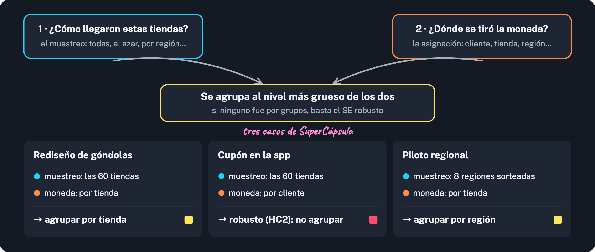
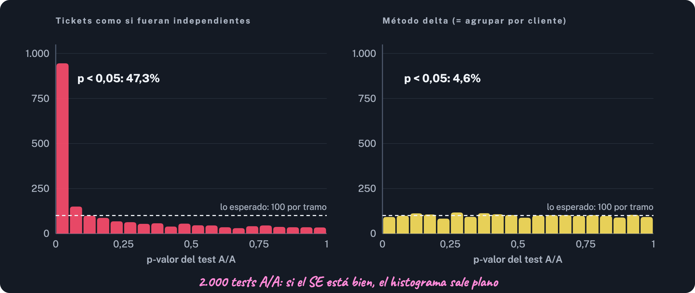
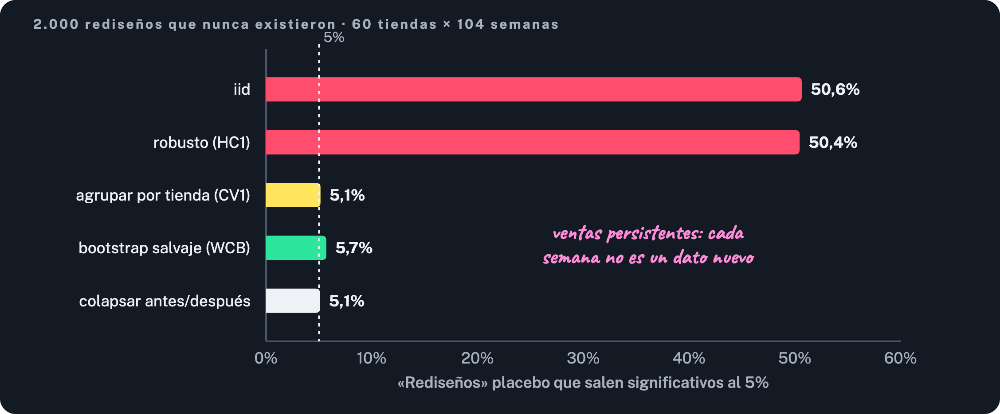

::: {.box .key}
**En este capítulo.**

- Un error estándar (SE) mide **cuánto cambiaría la estimación** si el estudio se repitiera. No mide cuánto varían los datos.
- Para calcularlo bien hay que responder tres preguntas:
  1. **¿Qué incertidumbre** estamos midiendo: la de muestreo o la de diseño?
  2. **¿A qué nivel se tiró la moneda?** Ese es el nivel al que se agrupa.
  3. **¿Cuántos grupos hay** y qué tan parecidos son?
- Con pocos grupos, la fórmula de siempre (CV1) se equivoca. La receta moderna es comparar **tres termómetros**: CV1, *jackknife* (CV3) y *wild cluster bootstrap* (WCB).
- Con pocos grupos tratados, se recurre a la **aleatorización**.
- Para saber si un SE funciona en nuestros datos, se lo pone a prueba con **tests A/A y placebos**.
:::

## Preparación {.unnumbered}

Todo el capítulo usa **SuperCápsula**, una cadena ficticia de supermercados con 60 tiendas de tamaños muy distintos. La cadena prueba un **rediseño de góndolas** en algunas tiendas y mide el **gasto semanal por cliente** (en miles de pesos). Los datos son sintéticos: los genera `simular_cadena()`, y por eso **sabemos la verdad** y podemos comprobar qué método acierta.

- Cada fila es un cliente, y el rediseño se aplica a la **tienda completa**.
- Hay un **efecto de tienda**: los clientes de una misma tienda se parecen entre sí. La correlación intraclase es $\rho = 0{,}15$.
- En las tiendas grandes, el gasto varía más (heterocedasticidad).

Los métodos están programados «a mano», en pocas líneas de álgebra, para que se vea qué hace cada uno. En cada caso se comparan con los paquetes.

::: {.panel-tabset group="lang"}
## R
```{r}
source("codigo/ee/simular_cadena.R")   # simular_cadena(), simular_panel(), simular_app()
source("codigo/ee/se_metodos.R")       # mco(), vc_cv1(), vc_cv3(), wcb_p(), var_delta(), ri_p()
library(fixest)        # regresiones con SE iid, robustos y por clúster
library(sandwich)      # HC0–HC3 y jackknife por clúster
library(clubSandwich)  # CR2 con grados de libertad de Satterthwaite
library(dfadjust)      # HC2 con el ajuste de Bell-McCaffrey (Imbens y Kolesár)
set.seed(4143)
head(simular_cadena(G = 60, m = 200, tau = 2), 3)
```

## Python
```{python}
import sys, math
import numpy as np, pandas as pd
import pyfixest as pf                    # SE iid, robustos, CRV1, CRV3, wild bootstrap, aleatorización
import statsmodels.formula.api as smf    # HC0–HC3
sys.path.insert(0, "codigo/ee")
from se_cadena import *                  # los mismos generadores y métodos que en R
rng = np.random.default_rng(4143)
simular_cadena(G=60, m=200, tau=2, rng=rng).head(3)
```
:::

::: {.box .warn}
R y Python usan generadores de números aleatorios distintos, así que **los números de las dos pestañas no coinciden** con la misma semilla. Las conclusiones sí. Las figuras salen de simulaciones largas en R (`codigo/R/S1…S6` en la carpeta del tema), con miles de réplicas.
:::

## ¿Qué es un error estándar?

Supongamos que el rediseño aumenta el gasto en **2 mil pesos** por cliente y semana. Ese es el efecto verdadero, y la cadena no lo conoce. Lo estima comparando tiendas con y sin rediseño y obtiene un $\hat\beta$. Si repitiera el estudio, tendría otras tiendas, otros clientes y otra asignación del rediseño, y obtendría otro $\hat\beta$.

::: {.box .def label="Definición · Error estándar"}
El **error estándar** de $\hat\beta$ es la desviación estándar de $\hat\beta$ entre **repeticiones hipotéticas** del estudio:

$$\text{SE}(\hat\beta) = \sqrt{\text{Var}(\hat\beta)}.$$

No hay que confundirlo con la **desviación estándar de los datos**, que mide cuánto varía el gasto entre clientes. Esa no se achica al juntar más datos. El SE sí: con más información, $\hat\beta$ baila menos.
:::

En la práctica vemos un solo estudio. El SE se **estima** con una fórmula, y la pregunta de todo el capítulo es cuál fórmula usar. Con datos simulados podemos hacer trampa: repetimos el estudio mil veces y miramos cuánto baila $\hat\beta$ de verdad.

{.still}

::: {.panel-tabset group="lang"}
## R
```{r}
R <- 300; tau <- 2
res <- t(replicate(R, {
  df <- simular_cadena(G = 60, m = 200, tau = tau)
  X <- cbind(1, df$d); f <- mco(df$gasto, X); n <- nrow(X)
  c(b      = unname(f$b[2]),
    sd_y   = sd(df$gasto),                                            # dispersión de los DATOS
    se_iid = sqrt(sum(f$u^2) / (n - 2) * solve(crossprod(X))[2, 2]),  # SE clásico
    se_cv1 = sqrt(vc_cv1(X, f$u, df$tienda)[2, 2]))                   # SE agrupado por tienda
}))
round(c(sd_datos = mean(res[, "sd_y"]), se_real = sd(res[, "b"]),
        se_clasico = mean(res[, "se_iid"]), se_agrupado = mean(res[, "se_cv1"])), 2)
```

## Python
```{python}
def un_estudio(rng, tau=2):
    df = simular_cadena(G=60, m=200, tau=tau, rng=rng)
    X = np.column_stack([np.ones(len(df)), df.d]); y = df.gasto.to_numpy(); b, u = mco(y, X); n = len(y)
    se_iid = np.sqrt(u @ u / (n - 2) * np.linalg.inv(X.T @ X)[1, 1])
    return b[1], y.std(ddof=1), se_iid, np.sqrt(vc_cv1(X, u, df.tienda.to_numpy())[1, 1])

res = np.array([un_estudio(rng) for _ in range(300)])
pd.Series({"sd_datos": res[:, 1].mean(), "se_real": res[:, 0].std(ddof=1),
           "se_clasico": res[:, 2].mean(), "se_agrupado": res[:, 3].mean()}).round(2)
```
:::

::: {.box .intuit}
**Universos paralelos.** Imagina mil SuperCápsulas en mil universos paralelos, cada una haciendo el mismo estudio. Cada universo obtiene su propio $\hat\beta$. El SE es la dispersión de esos mil números, y la fórmula intenta adivinarla mirando **un solo universo**.
:::

::: {.box .turn label="Tu turno · 1"}
Con las réplicas `res`, calcula la **cobertura** del IC 95% con cada SE: la fracción de réplicas en que $\hat\beta \pm 1{,}96 \cdot \text{SE}$ contiene el 2. ¿Cuál se acerca al 95%?
:::

::: {.callout-tip collapse="true"}
## Solución
```r
mean(abs(res[, "b"] - 2) <= 1.96 * res[, "se_iid"])            # ≈ 0,20
mean(abs(res[, "b"] - 2) <= qt(0.975, 59) * res[, "se_cv1"])   # ≈ 0,92
```
El SE clásico cubre cerca del 20%: casi siempre declara un efecto más preciso de lo que es. El agrupado cubre alrededor del 92%, cerca del 95% pero algo por debajo. En la @sec-receta vemos por qué: con 60 tiendas desiguales, el CV1 todavía se queda un poco corto.
:::

## ¿Qué incertidumbre estamos midiendo?

Hay **dos razones** por las que $\hat\beta$ podría cambiar si se repite el estudio:

- **Muestreo:** se habrían observado *otras* tiendas. Pasa cuando las 60 tiendas son una muestra de una población más grande, como «todas las tiendas que la cadena podría abrir».
- **Diseño:** con las *mismas* 60 tiendas, el rediseño habría caído en *otras* 30. Es la moneda de la asignación.

SuperCápsula observa **todas** sus tiendas, así que no hay muestreo. ¿Tiene sentido entonces un SE? Sí: queda la incertidumbre del diseño. Esta forma de pensar la inferencia se llama **basada en el diseño** [@aaiw2020; @rambachan2025].

{.still}

::: {.panel-tabset group="lang"}
## R
```{r}
# Una sola cadena: las tiendas y sus resultados potenciales quedan fijos; solo cambia la moneda
base <- simular_cadena(G = 60, m = 100, tau = 2, sd_tau = 6)
sims <- t(replicate(500, {
  d <- as.integer(base$tienda %in% sample(60, 30))          # otra asignación del rediseño
  y <- base$y0 + base$tau_t * d; X <- cbind(1, d); f <- mco(y, X)
  c(b = unname(f$b[2]), se = sqrt(vc_cv1(X, f$u, base$tienda)[2, 2]))
}))
round(c(efecto_de_esta_cadena = mean(base$tau_t), sd_diseno = sd(sims[, "b"]),
        se_cv1_promedio = mean(sims[, "se"])), 2)
```

## Python
```{python}
base = simular_cadena(G=60, m=100, tau=2, sd_tau=6, rng=rng)
g = base.tienda.to_numpy(); y0 = base.y0.to_numpy(); tt = base.tau_t.to_numpy()
def otra_moneda(rng):
    d = np.isin(g, rng.choice(60, 30, replace=False)).astype(float)
    y = y0 + tt * d; X = np.column_stack([np.ones(len(y)), d]); b, u = mco(y, X)
    return b[1], np.sqrt(vc_cv1(X, u, g)[1, 1])
sims = np.array([otra_moneda(rng) for _ in range(500)])
pd.Series({"efecto_de_esta_cadena": tt.mean(), "sd_diseno": sims[:, 0].std(ddof=1),
           "se_cv1_promedio": sims[:, 1].mean()}).round(2)
```
:::

::: {.box .key}
Cuando se observa **a toda la población**, el SE de siempre mide un poco de más: incluye una incertidumbre de muestreo que no existe. Es **conservador**. Si el efecto es igual en todas las tiendas, la diferencia desaparece. Si varía mucho, el SE de diseño es menor, pero no se puede estimar sin supuestos adicionales. Por eso, en la práctica, se reporta el SE habitual sabiendo que es conservador.
:::

::: {.box .paper label="Del paper · Abadie, Athey, Imbens y Wooldridge (2020); Rambachan y Roth (2025)"}
AAIW (2020) muestran que, con una población finita observada completa (todos los estados, todos los colegios, todas las tiendas), la incertidumbre viene de la asignación y los SE robustos habituales son conservadores. Rambachan y Roth (2025) lo extienden a cuasi-experimentos (DiD, IV): si la población finita es grande, los SE convencionales siguen siendo válidos, pero conservadores.
:::

::: {.box .turn label="Tu turno · 2"}
Repite el experimento de la cadena con `sd_tau = 0` (el rediseño suma lo mismo en todas las tiendas). ¿Qué pasa con la distancia entre la DE de diseño y el SE agrupado promedio?
:::

::: {.callout-tip collapse="true"}
## Solución
Se achica hasta casi desaparecer. Con efecto homogéneo, la varianza de muestreo del efecto promedio es cero ($\tau_t = \tau$ en todas las tiendas). Entonces la incertidumbre total es solo de diseño, y el SE agrupado la estima bien. La brecha de la figura viene de la **heterogeneidad del efecto**.
:::

## El SE clásico, el robusto y las muestras chicas

Todos los SE de este capítulo, salvo los de remuestreo, tienen la misma forma: un **sandwich**.

::: {.hero}
[La varianza de MCO: un sandwich]{.cap}
[[$\widehat{\text{Var}}(\hat\beta)$]{.v}[]{.u}[cuánto baila β̂]{.n}]{.tm style="--c:#EEF2F7"}
[=]{.op}
[[$(X'X)^{-1}$]{.v}[]{.u}[pan: lo que informan los X]{.n}]{.tm style="--c:#FF8A4C"}
[[$\hat\Omega$]{.v}[]{.u}[relleno: cómo es el ruido]{.n}]{.tm style="--c:#FFE45E"}
[[$(X'X)^{-1}$]{.v}[]{.u}[pan otra vez]{.n}]{.tm style="--c:#FF8A4C"}
[Clásico: $\hat\Omega = \hat\sigma^2 X'X$ · Robusto: $\hat\Omega = \sum_i \hat u_i^2 x_i x_i'$ · Por clúster: $\hat\Omega = \sum_g \big(\sum_{i\in g} x_i \hat u_i\big)\big(\sum_{i \in g} x_i \hat u_i\big)'$]{.nums}
:::

{.still}

### Heterocedasticidad: HC0 a HC3

Si el ruido no es parejo (en SuperCápsula, el gasto varía más en las tiendas grandes), el SE clásico se equivoca y se usa el **robusto** (HC, *heteroskedasticity-consistent*). Hay varias versiones, que difieren en cómo corrigen los residuos:

::: {.box .def label="Definición · Las versiones HC"}
- **HC0:** $\hat u_i^2$ tal cual (White).
- **HC1:** HC0 × $n/(n-k)$. Es el `robust` de Stata y el `"hetero"` de `fixest`.
- **HC2:** $\hat u_i^2 / (1 - h_{ii})$, donde $h_{ii}$ es el *leverage* de la observación $i$. Las observaciones con mucho *leverage* «tiran» de la recta hacia sí y quedan con residuos artificialmente chicos; HC2 los agranda.
- **HC3:** $\hat u_i^2 / (1 - h_{ii})^2$. Corrige todavía más; se parece a un *jackknife*.
:::

En muestras grandes dan lo mismo. En muestras chicas, o con observaciones de mucho *leverage*, HC0 y HC1 **subestiman** el SE. Probémoslo con un análisis a nivel de tienda (20 tiendas) que controla por el tamaño, que tiene *leverage* alto porque hay unas pocas tiendas enormes:

::: {.panel-tabset group="lang"}
## R
```{r}
set.seed(4143)
df20 <- simular_cadena(G = 20, m = 200, tau = 2)
tiendas <- aggregate(cbind(gasto, d, tam) ~ tienda, df20, mean)   # una fila por tienda
m_t <- lm(gasto ~ d + log(tam), tiendas)
round(sapply(c("const", "HC0", "HC1", "HC2", "HC3"), function(t) sqrt(vcovHC(m_t, type = t)["d", "d"])), 3)
round(max(hatvalues(m_t)), 2)   # leverage máximo (el promedio es k/n = 3/20 = 0,15)
dfadjustSE(m_t)                 # HC2 + grados de libertad de Bell-McCaffrey
```

## Python
```{python}
df20 = simular_cadena(G=20, m=200, tau=2, rng=np.random.default_rng(4143))
tiendas = df20.groupby("tienda").agg(gasto=("gasto", "mean"), d=("d", "first"), tam=("tam", "first")).reset_index()
m_t = smf.ols("gasto ~ d + np.log(tam)", tiendas)
print({t: round(m_t.fit(cov_type=t).bse["d"], 3) for t in ["nonrobust", "HC0", "HC1", "HC2", "HC3"]})
print("leverage máximo:", round(m_t.fit().get_influence().hat_matrix_diag.max(), 2))
```
:::

::: {.box .key}
**Sin clústeres y con muestra chica, usa HC2 con los grados de libertad de Bell-McCaffrey**, no HC1 con la normal. Imbens y Kolesár (2016) lo recomiendan como cálculo de rutina, y la mejora se nota incluso con 50 observaciones o más [@imbenskolesar2016]. En R está en `dfadjust`.
:::

::: {.box .warn}
El HC1 es el **robusto por defecto de Stata**. Mucho de lo que se lee sobre «los SE robustos fallan en muestras chicas» es, en realidad, sobre HC1. Volveremos a esto en el debate de la @sec-formas.
:::

## Clústeres: cuando los clientes no son independientes

Los clientes de una tienda comparten barrio, formato, gerente y góndolas. Si una tienda tiene una semana buena, todos sus clientes gastan más. Sus residuos están **correlacionados**, y el robusto no lo sabe: sigue tratando a cada cliente como un dato independiente.

::: {.box .def label="Definición · Correlación intraclase y factor de diseño"}
La **correlación intraclase** $\rho$ es la correlación entre dos clientes de la misma tienda. Con tiendas de $m$ clientes y el tratamiento asignado por tienda, la varianza de $\hat\beta$ se multiplica por el **factor de diseño** (el efecto Moulton):

$$\text{DEFF} = 1 + (m - 1)\,\rho, \qquad N_{\text{efectivo}} = \frac{N}{\text{DEFF}}.$$

Con tamaños desiguales es peor: $m$ se reemplaza por $\bar m\,(1 + \text{CV}^2)$, donde CV es el coeficiente de variación de los tamaños.
:::

{.still}

::: {.box .intuit}
**Un $\rho$ chico no es inocente.** Un 0,15 parece poco, pero se multiplica por el tamaño de la tienda. Con 200 clientes por tienda, el DEFF es 31: la varianza real es 31 veces la que cree el SE clásico, y el SE (su raíz) es 5,6 veces más grande.
:::

El SE **agrupado por clúster** (CRVE, o CV1) suma los residuos dentro de cada tienda antes de elevarlos al cuadrado, como en el panel derecho del relleno. Así la correlación dentro de la tienda queda en la varianza. Su corrección para muestras finitas es $\frac{G}{G-1}\cdot\frac{n-1}{n-k}$, donde $G$ es el número de clústeres.

::: {.panel-tabset group="lang"}
## R
```{r}
X <- cbind(1, df20$d); f <- mco(df20$gasto, X)
c(a_mano = sqrt(vc_cv1(X, f$u, df20$tienda)[2, 2]),
  fixest = unname(se(feols(gasto ~ d, df20, cluster = ~tienda))["d"]),
  robusto_HC1 = unname(se(feols(gasto ~ d, df20, vcov = "hetero"))["d"]))
# CR2: el análogo de HC2 para clústeres, con grados de libertad de Satterthwaite
coef_test(lm(gasto ~ d, df20), vcov = "CR2", cluster = df20$tienda, test = "Satterthwaite")
```

## Python
```{python}
X = np.column_stack([np.ones(len(df20)), df20.d]); y = df20.gasto.to_numpy(); g = df20.tienda.to_numpy()
b, u = mco(y, X)
fit20 = pf.feols("gasto ~ d", data=df20, vcov={"CRV1": "tienda"})
{"a_mano": np.sqrt(vc_cv1(X, u, g)[1, 1]), "pyfixest": fit20.se()["d"],
 "robusto_HC1": pf.feols("gasto ~ d", data=df20, vcov="hetero").se()["d"]}
```
:::

::: {.box .warn}
Fíjate en que los grados de libertad del CR2 (Satterthwaite) son **muchos menos que 20**: el valor crítico de la *t* es mayor que 1,96. Con clústeres, los grados de libertad efectivos dependen de $G$ y de qué tan parecidos son los clústeres, no de $n$. Hasta donde revisamos, `pyfixest` (versión 0.70) no trae el CR2; en Python, el CV3 de la @sec-receta cumple un rol parecido.
:::

::: {.box .turn label="Tu turno · 3"}
Calcula el cociente $(\text{SE}_{CV1} / \text{SE}_{HC1})^2$ en `df20`. Compáralo con el DEFF que predice la fórmula con $\rho = 0{,}15$ y el tamaño promedio de las tiendas de `df20`. ¿Por qué no coinciden exactamente?
:::

::: {.callout-tip collapse="true"}
## Solución
```r
se1 <- unname(se(feols(gasto ~ d, df20, cluster = ~tienda))["d"])
seh <- unname(se(feols(gasto ~ d, df20, vcov = "hetero"))["d"])
(se1 / seh)^2                                   # DEFF «observado»
tam <- table(df20$tienda); mbar <- mean(tam); cv2 <- var(tam) / mbar^2
c(iguales = 1 + (mbar - 1) * 0.15, desiguales = 1 + (mbar * (1 + cv2) - 1) * 0.15)
```
No coinciden porque el cociente se calcula con **una sola muestra** de 20 tiendas (el SE agrupado es ruidoso con pocos clústeres), y porque el $\rho$ de la muestra no es exactamente 0,15. La fórmula con tamaños desiguales suele acercarse más.
:::

## ¿A qué nivel agrupo?

Clientes dentro de tiendas, tiendas dentro de comunas, comunas dentro de regiones: casi siempre hay varios niveles posibles. Una regla antigua decía «agrupa lo más alto posible». La respuesta moderna es otra: **el nivel sale del diseño**, no de los residuos [@aaiw2023].

{.still}

::: {.box .key}
**Se agrupa al nivel en que se tiró la moneda o en que se muestrearon los grupos, el más grueso de los dos.**

- Si el rediseño se asignó por tienda, se agrupa por tienda.
- Si el cupón se sorteó entre clientes y se observan todas las tiendas, basta el SE robusto, aunque los clientes de una tienda se parezcan.
:::

::: {.box .warn}
**«Lo más alto posible» no es gratis.** Agrupar por región cuando la moneda se tiró por tienda deja pocos clústeres. El SE queda inflado, se pierde poder y, con muy pocos grupos, el CV1 incluso se vuelve poco confiable. AAIW (2023) muestran un ejemplo con datos de EE. UU. en el que agrupar por estado da un SE más de 20 veces mayor que el robusto, sin que haga falta.
:::

::: {.box .paper label="Del paper · Abadie, Athey, Imbens y Wooldridge (2023)"}
«¿Cuándo hay que ajustar los SE por clústeres?» Su respuesta es que clusterizar es una pregunta de **diseño**: se ajusta si el muestreo fue por grupos o si la asignación está correlacionada dentro de los grupos. Que los residuos estén correlacionados no basta para justificarlo. Para los casos intermedios (algo de muestreo por grupos, efecto heterogéneo), proponen un estimador que queda entre el robusto y el agrupado.
:::

::: {.box .turn label="Tu turno · 4"}
Para cada caso, ¿a qué nivel agrupas?

a) La app sortea un cupón entre los clientes, pero solo en 12 tiendas elegidas al azar de las 60.
b) El rediseño se asigna por tienda, y además se mide a los mismos clientes durante 10 semanas.
c) Se compara el gasto de las tiendas de la Región Metropolitana con el resto, por un cambio de ley regional.
:::

::: {.callout-tip collapse="true"}
## Solución
a) **Por tienda.** La moneda se tiró por cliente, pero las tiendas se **muestrearon**, así que el muestreo es el nivel más grueso.

b) **Por tienda.** Las semanas del mismo cliente están correlacionadas, pero el cliente está anidado en la tienda, y agrupar por tienda ya cubre esa correlación.

c) Por **región**, pero solo hay dos «grupos» de tratamiento. Es el problema de **pocos clústeres tratados** (@sec-pocos): ningún SE agrupado funciona y hay que recurrir a otros métodos.
:::

## La receta moderna: tres termómetros {#sec-receta}

El CV1 es un estimador **asintótico en $G$**: funciona cuando hay muchos clústeres parecidos. Con pocos, o con tamaños muy desiguales, rechaza de más. La guía de MacKinnon, Nielsen y Webb (2023) recomienda no confiar en un solo número y mirar **tres termómetros** [@mnw2023guia].

### El *jackknife* por clúster (CV3)

Se saca **una tienda a la vez**, se re-estima $\hat\beta$ y se mide cuánto cambia:

$$\widehat{\text{Var}}_{CV3}(\hat\beta) = \frac{G-1}{G}\sum_{g=1}^{G}\big(\hat\beta_{(g)} - \hat\beta\big)^2,$$

donde $\hat\beta_{(g)}$ es la estimación sin la tienda $g$. Si una tienda pesa mucho, sacarla mueve mucho a $\hat\beta$, y el CV3 lo registra. Hansen muestra que el CV1 puede tener, en el peor caso, **cobertura cero**, mientras que el CV3 es conservador [@hansen_jk]; MNW (2023) entregan un cálculo rápido [@mnw2023rapido].

### El *wild cluster bootstrap* (WCB)

1. Se estima el modelo **imponiendo $H_0$** ($\beta = 0$) y se guardan los residuos de cada tienda.
2. A cada tienda se le asigna un peso aleatorio $w_g = \pm 1$ (Rademacher, o los 6 puntos de Webb si hay menos de ~12 tiendas) y se arman datos nuevos: $y^* = \hat y_{H_0} + w_g \hat u$. **Todos los clientes de una tienda comparten el mismo signo**, y así se conserva la correlación dentro de la tienda.
3. Con cada muestra se calcula el estadístico *t* (con CV1).
4. El p-valor es la fracción de las *t* bootstrap que superan, en valor absoluto, a la *t* observada.

::: {.panel-tabset group="lang"}
## R
```{r}
# Los dos métodos «a mano» (son los de codigo/ee/se_metodos.R)
vc_cv3 <- function(y, X, g) {
  b <- mco(y, X)$b; grupos <- unique(g); G <- length(grupos)
  bs <- sapply(grupos, function(h) mco(y[g != h], X[g != h, , drop = FALSE])$b)  # sin una tienda
  (G - 1) / G * (bs - b) %*% t(bs - b)
}
wcb_p <- function(y, X, g, j = 2, B = 999, pesos = "rademacher") {
  n <- nrow(X); k <- ncol(X); grupos <- unique(g); G <- length(grupos); id <- match(g, grupos)
  pan <- solve(crossprod(X)); a <- drop(X %*% pan[, j]); c1 <- G / (G - 1) * (n - 1) / (n - k)
  t_de <- function(bj, U) bj / sqrt(c1 * colSums(rowsum(a * U, id)^2))   # t con CV1
  f <- mco(y, X); t0 <- t_de(f$b[j], matrix(f$u))
  r <- mco(y, X[, -j, drop = FALSE]); yr <- y - r$u                       # H0 impuesta
  vals <- if (pesos == "webb") c(-sqrt(1.5), -1, -sqrt(.5), sqrt(.5), 1, sqrt(1.5)) else c(-1, 1)
  W <- matrix(sample(vals, G * B, replace = TRUE), G, B)                 # un signo por tienda
  Ys <- yr + r$u * W[id, , drop = FALSE]
  Bs <- pan %*% crossprod(X, Ys); Us <- Ys - X %*% Bs
  mean(abs(t_de(Bs[j, ], Us)) >= abs(t0))
}
y <- df20$gasto; g <- df20$tienda; X <- cbind(1, df20$d); f <- mco(y, X)
t_cv1 <- f$b[2] / sqrt(vc_cv1(X, f$u, g)[2, 2]); t_cv3 <- f$b[2] / sqrt(vc_cv3(y, X, g)[2, 2])
round(c(p_CV1 = 2 * pt(-abs(t_cv1), 19), p_CV3 = 2 * pt(-abs(t_cv3), 19),
        p_WCB = wcb_p(y, X, g, B = 9999)), 3)
```

## Python
```{python}
def vc_cv3(y, X, g):
    b, _ = mco(y, X); grupos = np.unique(g); G = len(grupos)
    bs = np.array([mco(y[g != h], X[g != h])[0] for h in grupos])     # sin una tienda
    return (G - 1) / G * (bs - b).T @ (bs - b)

y = df20.gasto.to_numpy(); g = df20.tienda.to_numpy(); X = np.column_stack([np.ones(len(y)), df20.d]); b, u = mco(y, X)
from scipy import stats
t1 = b[1] / np.sqrt(vc_cv1(X, u, g)[1, 1]); t3 = b[1] / np.sqrt(vc_cv3(y, X, g)[1, 1])
print({"p_CV1": 2 * stats.t.sf(abs(t1), 19), "p_CV3": 2 * stats.t.sf(abs(t3), 19),
       "p_WCB_a_mano": wcb_p(y, X, g, j=1, B=9999, rng=1)})
```

```{python}
#| eval: false
# El mismo WCB con pyfixest. Córrelo en tu Python: dentro de R (reticulate) falla, porque usa numba.
fit20.wildboottest(param="d", reps=9999, seed=1)["Pr(>|t|)"]   # 0,4959: igual que el WCB a mano con rng=1
```
:::

::: {.box .warn label="Ojo con las convenciones del CV3"}
Cada paquete corrige el CV3 a su manera. Aquí se usa la de MNW (2023): $\frac{G-1}{G}\sum(\hat\beta_{(g)} - \hat\beta)^2$, que coincide con `sandwich::vcovJK` de R. `pyfixest` multiplica además el SE por $G/(G-1)$, un 5% más con 20 tiendas. Al comparar resultados entre paquetes, revisa la convención.
:::

### ¿Qué tan bien funciona cada uno?

La simulación S3 lo pone a prueba. Se generan cadenas **sin efecto real** con $G$ tiendas de unos 30 clientes, de tamaños desiguales, y se cuenta cuántas veces cada método declara un efecto «significativo» al 5%. Un método correcto debería equivocarse el 5% de las veces.

{.still}

::: {.panel-tabset group="lang"}
## R
```{r}
s3 <- read.csv("data/ee/S3_rechazo_vs_G.csv")
tab <- reshape(s3, idvar = "G", timevar = "metodo", direction = "wide")
names(tab) <- sub("rechazo.", "", names(tab)); tab[, -1] <- round(100 * tab[, -1], 1)
tab   # % de rechazos bajo H0 (debería ser 5)
```

## Python
```{python}
s3 = pd.read_csv("data/ee/S3_rechazo_vs_G.csv")
(100 * s3.pivot(index="G", columns="metodo", values="rechazo"))[["iid", "HC1", "CV1", "CR2", "CV3", "WCB"]].round(1)
```
:::

### El diagnóstico

Además de los tres termómetros, MNW piden **diagnosticar** los datos. Si algo de esto aparece, desconfía del CV1:

- **$G$:** ¿cuántos clústeres hay?
- **La heterogeneidad de tamaños:** el coeficiente de variación de los tamaños de los clústeres.
- **El *leverage* parcial de cada clúster** para el coeficiente de interés: cuánto de la variación del tratamiento está en ese clúster. Si una tienda concentra mucho, el CV1 se vuelve frágil. Es lo que reporta `summclust` en Stata.

::: {.panel-tabset group="lang"}
## R
```{r}
tam <- as.vector(table(df20$tienda))
d_res <- resid(lm(d ~ 1, df20))                                      # tratamiento sin la constante
lev <- tapply(d_res^2, df20$tienda, sum) / sum(d_res^2)            # leverage parcial de cada tienda
round(c(G = length(tam), cv_tamanos = sd(tam) / mean(tam), lev_max = max(lev), lev_parejo = 1 / length(tam)), 3)
```

## Python
```{python}
tam = df20.groupby("tienda").size()
d_res = df20.d - df20.d.mean()
lev = (d_res**2).groupby(df20.tienda).sum() / (d_res**2).sum()
{"G": len(tam), "cv_tamanos": tam.std() / tam.mean(), "lev_max": lev.max(), "lev_parejo": 1 / len(tam)}
```
:::

::: {.box .key label="La receta (MacKinnon, Nielsen y Webb, 2023)"}
1. Agrupa al nivel del diseño (sección anterior).
2. Reporta **CV1, CV3 y el p-valor del WCB**.
3. Diagnostica $G$, los tamaños y el *leverage* parcial.
4. **Si los tres termómetros coinciden**, todo bien. **Si discrepan**, el problema está en los datos, no en el método: hay pocas tiendas, o una que pesa demasiado. Reporta la versión más conservadora y dilo.

MacKinnon (2026) lo resume así: ningún método es confiable en todos los casos, y la forma práctica de saberlo es correr varios y ver si coinciden [@mackinnon2026].
:::

::: {.box .turn label="Tu turno · 5"}
Genera una cadena con solo **8 tiendas** (`simular_cadena(G = 8, m = 200)`, sin efecto) y calcula los tres p-valores. Usa pesos de Webb en el WCB. Repite con varias semillas. ¿Coinciden los tres termómetros?
:::

::: {.callout-tip collapse="true"}
## Solución
```r
for (s in 1:5) {
  set.seed(s); d8 <- simular_cadena(G = 8, m = 200)
  y <- d8$gasto; g <- d8$tienda; X <- cbind(1, d8$d); f <- mco(y, X)
  t1 <- f$b[2] / sqrt(vc_cv1(X, f$u, g)[2, 2]); t3 <- f$b[2] / sqrt(vc_cv3(y, X, g)[2, 2])
  print(round(c(CV1 = 2 * pt(-abs(t1), 7), CV3 = 2 * pt(-abs(t3), 7), WCB = wcb_p(y, X, g, B = 999, pesos = "webb")), 3))
}
```
Con 8 tiendas, el p-valor del CV1 suele ser el más chico, y a menudo bastante más chico que los otros dos. Es la señal de alarma de la receta. Con solo 8 tiendas, Rademacher daría como máximo $2^8 = 256$ muestras bootstrap distintas; por eso se usan los pesos de Webb.
:::

## Pocos clústeres tratados {#sec-pocos}

Antes del lanzamiento, SuperCápsula hizo un **piloto en 3 tiendas**, y antes de eso, en una sola tienda «insignia». Las otras 57 (o 59) son el control. Hay muchos clústeres en total, pero **pocos tratados**, y ahí casi todo falla: el efecto se estima comparando unas pocas tiendas con el resto, y no hay forma de separar el efecto del rediseño de lo particular de esas tiendas.

{.still}

### Inferencia por aleatorización

La idea es de Fisher. Si el rediseño no hizo nada, la etiqueta «tratada» podría haber caído en **cualquier** grupo de 3 tiendas y el resultado habría sido el mismo. Entonces:

1. Se calcula la diferencia observada entre tratadas y controles.
2. Se reasigna la etiqueta al azar entre las 60 tiendas, muchas veces, y se recalcula la diferencia.
3. El p-valor es la fracción de reasignaciones con una diferencia al menos tan grande como la observada.

No usa ninguna fórmula de SE ni ninguna aproximación asintótica: solo usa **cómo se asignó** el tratamiento [@atheyimbens2017].

::: {.panel-tabset group="lang"}
## R
```{r}
set.seed(7)
piloto <- simular_cadena(G = 60, m = 200, G1 = 3)          # 3 tiendas con rediseño, sin efecto real
X <- cbind(1, piloto$d); f <- mco(piloto$gasto, X)
t1 <- f$b[2] / sqrt(vc_cv1(X, f$u, piloto$tienda)[2, 2])
round(c(efecto = unname(f$b[2]), p_CV1 = unname(2 * pt(-abs(t1), 59)),
        p_aleatorizacion = ri_p(piloto$gasto, piloto$d, piloto$tienda, R = 1999)), 3)
choose(60, 3)   # asignaciones posibles: 34.220
```

## Python
```{python}
piloto = simular_cadena(G=60, m=200, G1=3, rng=np.random.default_rng(7))
fp = pf.feols("gasto ~ d", data=piloto, vcov={"CRV1": "tienda"})
print({"efecto": fp.coef()["d"], "p_CV1": fp.pvalue()["d"],
       "p_aleatorizacion_a_mano": ri_p(piloto.gasto.to_numpy(), piloto.d.to_numpy(), piloto.tienda.to_numpy(), R=1999, rng=1)})
```

```{python}
#| eval: false
# La misma prueba con pyfixest (también usa numba: córrela fuera de R)
fp.ritest(resampvar="d", reps=1999, cluster="tienda", rng=np.random.default_rng(1))["Pr(>|t|)"]   # 0,373 (a mano: 0,374)
```
:::

### Con una sola tratada, importa cuál

{.still}

La aleatorización tampoco es mágica. Supone que, bajo $H_0$, **todas las tiendas son intercambiables**. Si la tratada es mucho más chica (o más grande) que las demás, no lo son: su promedio tiene otra varianza.

::: {.box .paper label="Del paper · Pocos tratados"}
- **Conley y Taber (2011)** usan los residuos de los controles para aproximar la distribución del error de los pocos tratados [@conleytaber2011].
- **Ferman y Pinto (2019)** muestran que, si los grupos tienen tamaños distintos, esa idea falla, porque la varianza depende del tamaño. Proponen corregir por esa heterocedasticidad [@fermanpinto2019]. Es justo lo que muestra la figura.
- **Alvarez, Ferman y Wüthrich (2025)** ordenan todos estos métodos en un *survey* reciente, en corte transversal y en panel. Su mensaje: con pocos tratados, la inferencia asintótica falla **aunque la muestra total sea enorme** [@alvarez2025].
:::

::: {.box .turn label="Tu turno · 6"}
En el piloto de 3 tiendas, ¿cuántas asignaciones posibles hay? Si hicieras la aleatorización **exacta** (todas las asignaciones), ¿cuál es el p-valor más chico que podrías obtener? ¿Y con una sola tienda tratada?
:::

::: {.callout-tip collapse="true"}
## Solución
Hay $\binom{60}{3} = 34.220$ asignaciones, así que el p-valor mínimo es $1/34.220 \approx 0{,}00003$. Con una sola tratada hay solo 60 asignaciones, y el p-valor mínimo es $1/60 \approx 0{,}017$: incluso con un efecto enorme, el p-valor no puede bajar de 1,7%. Con muy pocos tratados, el límite es la **información** disponible, no el método.
:::

## Formas de estimar y validar el SE {#sec-formas}

Hasta aquí vimos fórmulas. Pero hay varias familias de métodos, y conviene distinguir los que **estiman** el SE de los que lo **validan**.

| Método | Qué hace | Cuándo usarlo | Pros | Contras | Paquete |
|---|---|---|---|---|---|
| **Sandwich** (HC, CV1, CR2) | Fórmula analítica: pan × relleno × pan | Por defecto, con suficientes clústeres | Rápido; estándar | Asintótico en $n$ o en $G$ | `fixest`, `sandwich`, `clubSandwich`; `pyfixest`, `statsmodels` |
| **Método delta** | Aproxima la varianza de una función de estimadores con su recta tangente | Cocientes y transformaciones (ticket promedio, elasticidades) | Fórmula cerrada | Lineal: falla si la función es muy curva | A mano; `car::deltaMethod` |
| **Bootstrap por pares (por clúster)** | Remuestrea tiendas completas con reposición | Estadísticos sin fórmula fácil | General | Falla con pocos clústeres y en *matching* | `sandwich::vcovBS`, `boot` |
| **Bootstrap salvaje (WCB)** | Cambia el signo de los residuos de cada clúster, con $H_0$ impuesta | Pocos clústeres (más de ~10) | Muy buen tamaño de la prueba | Solo p-valores (los IC requieren invertir la prueba); con pocos *tratados* pierde poder | A mano; `pyfixest`, `wildboottest` |
| **Bootstrap por bloques** | Remuestrea bloques de tiempo consecutivos | Series de tiempo | Conserva la autocorrelación | Hay que elegir el largo del bloque | `tseries`, `boot::tsboot` |
| ***Jackknife* (CV3)** | Saca un clúster a la vez | Pocos clústeres o clústeres que pesan mucho | Conservador; detecta clústeres influyentes | Puede ser muy conservador | `sandwich::vcovJK`, `pyfixest` |
| **Aleatorización** | Reasigna el tratamiento según el diseño real | Experimentos; pocos tratados | Exacta bajo $H_0$ nula estricta | Prueba un $H_0$ distinto (efecto cero en *todos*); supone intercambiabilidad | `ri_p()` a mano; `pyfixest.ritest` |
| **Tests A/A y placebos** | Corre el análisis donde se sabe que no hay efecto | Para **validar** cualquiera de los anteriores | Calibra en tus propios datos | No estima el SE: solo dice si funciona | A mano |
| **Simulación** | Genera datos con un DGP conocido | Para entender, enseñar y planificar | Muestra la verdad | Depende del DGP supuesto | A mano |

: Familias de métodos para el error estándar {tbl-colwidths="[13,20,17,15,17,18]"}

::: {.box .warn}
**El bootstrap no siempre funciona.** Con estimadores de *matching* con un número fijo de vecinos, el bootstrap estándar es **inconsistente**: no converge a la varianza correcta [@abadieimbens2008]. Es el puente con la clase de Matching.
:::

::: {.box .paper label="Debate · Young (2019) vs Data Colada"}
Young (2019) re-analizó 53 papers experimentales de revistas de la AEA con pruebas de aleatorización. Encontró entre 13% y 22% **menos** resultados significativos que los reportados [@young2019]. Su conclusión: los p-valores de regresión (con SE robustos) engañan en muestras experimentales.

Simonsohn (Data Colada #99) responde que las simulaciones de Young comparan la aleatorización con el **HC1 por defecto de Stata**, que es justamente el que falla en muestras chicas. Con HC2 o HC3, buena parte de la diferencia desaparece. Para él, el problema era el HC1 y no los p-valores de regresión en general [@datacolada99].

**Para pensar:** ¿la lección es «usa aleatorización» o «no uses HC1 en muestras chicas»? Probablemente ambas. Fíjate también en que S3 y S4 dicen algo parecido: el problema aparece cuando la fórmula asintótica se usa fuera de su zona de confianza.
:::

## Tests A/A y placebos

Una forma directa de saber si un SE funciona en **nuestros** datos: correr el análisis donde **sabemos** que no hay efecto y contar cuántas veces sale significativo. Es como pesar en la balanza algo que sabemos que pesa 1 kg.

::: {.box .def label="Definición · Test A/A"}
Un **test A/A** divide a las unidades en dos grupos al azar, **sin tratar a ninguno**, y compara la métrica. Como $H_0$ es verdadera por construcción, si el SE está bien:

- el 5% de los tests A/A sale con p < 0,05 (y el 20% con p < 0,2);
- el **histograma de los p-valores es plano** (uniforme entre 0 y 1).

Un test A/A no estima el SE. Lo **calibra**: verifica que el SE y la prueba rechazan lo que deberían.
:::

### La app de fidelización: unidad de aleatorización ≠ unidad de análisis

La app de SuperCápsula sortea ofertas **por cliente**, pero el equipo de producto mira el **ticket promedio**: el gasto por compra. Un cliente que compra 20 veces aporta 20 tickets, y sus tickets se parecen entre sí. Si se tratan los tickets como independientes, el SE queda corto, igual que con los clientes de una tienda.

::: {.box .def label="Definición · Método delta para un cociente"}
El ticket promedio de un grupo es un **cociente**: $R = \sum_i S_i / \sum_i N_i$, donde $S_i$ es el gasto total del cliente $i$ y $N_i$ su número de tickets. Las sumas son por cliente, que es la unidad aleatorizada. La aproximación lineal (la recta tangente) da:

$$\widehat{\text{Var}}(R) \approx \frac{1}{n\,\bar N^2}\Big[\text{Var}(S) - 2R\,\text{Cov}(S, N) + R^2\,\text{Var}(N)\Big].$$

Da lo mismo que regresar el monto de cada ticket en el tratamiento y **agrupar por cliente** [@deng2018].
:::

{.still}

::: {.panel-tabset group="lang"}
## R
```{r}
set.seed(4143)
app <- simular_app(n = 20000)
S <- drop(rowsum(app$monto, app$cliente)); S2 <- drop(rowsum(app$monto^2, app$cliente))
N <- tabulate(app$cliente)                                  # tickets por cliente
un_aa <- function() {
  z <- rbinom(length(N), 1, 0.5)                            # dos grupos idénticos: nadie recibe nada
  brazo <- function(k) { Nt <- sum(N[k]); m <- sum(S[k]) / Nt
    c(m = m, v_ing = (sum(S2[k]) - Nt * m^2) / (Nt - 1) / Nt, v_del = var_delta(S[k], N[k])) }
  a <- brazo(z == 1); b <- brazo(z == 0); dif <- unname(a["m"] - b["m"])
  c(ingenuo = 2 * pnorm(-abs(dif) / sqrt(a[["v_ing"]] + b[["v_ing"]])),
    delta   = 2 * pnorm(-abs(dif) / sqrt(a[["v_del"]] + b[["v_del"]])))
}
p <- t(replicate(500, un_aa()))
round(100 * colMeans(p < 0.05), 1)        # % de tests A/A «significativos» (debería ser 5)
```

## Python
```{python}
app = simular_app(n=20000, rng=np.random.default_rng(4143))
S = np.bincount(app.cliente, weights=app.monto); S2 = np.bincount(app.cliente, weights=app.monto**2)
N = np.bincount(app.cliente)
pval = lambda z: math.erfc(abs(z) / math.sqrt(2))
def un_aa(rng):
    z = rng.integers(0, 2, len(N)).astype(bool)
    def brazo(k):
        Nt = N[k].sum(); m = S[k].sum() / Nt
        return m, (S2[k].sum() - Nt * m**2) / (Nt - 1) / Nt, var_delta(S[k], N[k])
    (ma, vi_a, vd_a), (mb, vi_b, vd_b) = brazo(z), brazo(~z)
    return pval((ma - mb) / np.sqrt(vi_a + vi_b)), pval((ma - mb) / np.sqrt(vd_a + vd_b))
p = np.array([un_aa(rng) for _ in range(500)])
pd.Series(100 * (p < 0.05).mean(0), index=["ingenuo", "delta"]).round(1)
```
:::

::: {.box .paper label="Del paper · La práctica de la industria"}
El equipo de experimentación de Microsoft corre tests A/A simulados sobre datos históricos y revisa si los p-valores son uniformes. En un producto típico, **entre el 10% y el 15% de las métricas fallan** esa prueba, y en algunos productos hasta el 30%. Las causas más comunes son las métricas con la unidad de análisis distinta de la de aleatorización y los *outliers* [@msr_pvalues]. El libro de referencia sobre experimentos en línea dedica un capítulo a los tests A/A [@kohavi2020].
:::

### Placebos en el panel: «rediseños» que nunca existieron

El análogo en economía son las **leyes placebo** de Bertrand, Duflo y Mullainathan (2004). Tomaron datos reales de salarios por estado, inventaron leyes que nunca existieron y estimaron su «efecto» con diferencias en diferencias. Con SE que ignoran la correlación en el tiempo, hasta el **45%** de las leyes falsas salía significativo [@bdm2004].

En SuperCápsula: ventas semanales de 60 tiendas durante 2 años, con *shocks* persistentes (una semana buena tiende a seguir de otra buena). Se inventa un rediseño en 30 tiendas desde una semana al azar.

{.still}

::: {.panel-tabset group="lang"}
## R
```{r}
set.seed(4143)
p <- simular_panel(G = 60, S = 104, phi = 0.8)
trat <- sample(60, 30); p$d <- as.integer(p$tienda %in% trat & p$semana >= 53)   # un rediseño falso
fit <- feols(log_ventas ~ d | tienda + semana, p)
round(c(iid = pvalue(summary(fit, vcov = "iid"))[["d"]], HC1 = pvalue(summary(fit, vcov = "hetero"))[["d"]],
        CV1 = pvalue(summary(fit, vcov = ~tienda))[["d"]]), 4)
```

## Python
```{python}
pan = simular_panel(G=60, S=104, phi=0.8, rng=np.random.default_rng(4143))
trat = np.random.default_rng(1).choice(60, 30, replace=False)
pan["d"] = (pan.tienda.isin(trat) & (pan.semana >= 52)).astype(int)
fit = pf.feols("log_ventas ~ d | tienda + semana", data=pan)
{v if isinstance(v, str) else "CV1": fit.vcov(v).pvalue()["d"] for v in ["iid", "hetero", {"CRV1": "tienda"}]}
```
:::

::: {.box .key}
Con datos de panel, **cada semana no es un dato nuevo**: si las ventas son persistentes, 104 semanas de una tienda informan mucho menos que 104 tiendas. En DiD **se agrupa por unidad** (la tienda, el estado), que es donde se asigna el tratamiento y donde vive la autocorrelación.
:::

::: {.box .turn label="Tu turno · 7"}
Repite el placebo de la app usando la mediana del gasto por cliente en lugar del ticket promedio. ¿Qué método de SE usarías y cómo verificarías con tests A/A que funciona?
:::

::: {.callout-tip collapse="true"}
## Solución
La mediana no tiene una fórmula de SE sencilla, así que es un buen caso para el **bootstrap por cliente**: se remuestrean clientes con reposición, se recalcula la diferencia de medianas y se toma la desviación estándar. Para validarlo, se corren muchos tests A/A, se calcula el p-valor de cada uno con ese SE y se revisa que el 5% salga bajo 0,05 y que el histograma sea plano. Como la métrica ya es por cliente (la unidad aleatorizada), no hace falta el método delta.
:::

## Otras dependencias: un mapa

Las tiendas no son la única fuente de correlación. Un mapa breve, para saber que existen y qué usar:

- **Clústeres en dos dimensiones.** En un panel de tiendas × semanas, puede haber correlación dentro de la tienda (en el tiempo) y dentro de la semana (entre tiendas, por un feriado o una promoción nacional). El SE de dos vías suma ambas y resta la intersección [@cgm2011]. En `fixest`: `vcov = ~tienda + semana`. Necesita **muchos** grupos en ambas dimensiones; con pocas semanas, no funciona bien.
- **Dependencia espacial.** Tiendas vecinas compiten por los mismos clientes y comparten clima y economía local. Los SE de tipo Conley ponderan la covarianza según la distancia. Müller y Watson (2022) proponen el **SCPC**, con mejor tamaño de la prueba en la práctica [@mullerwatson2022].
- **Series de tiempo.** Con una sola serie larga (las ventas totales de la cadena), los SE de tipo Newey-West (HAR) corrigen la autocorrelación. Lazarus, Lewis, Stock y Watson (2018) recomiendan truncar en $S = 1{,}3\sqrt{T}$ y usar valores críticos *fixed-b* [@llsw2018]. En R: `sandwich::NeweyWest`.

## Puentes con las clases

- **IV (clase 2).** Si se hacen las dos etapas «a mano» (regresar $D$ en $Z$ y luego $Y$ en $\hat D$), el SE de la segunda etapa está **mal**: usa los residuos con $\hat D$ en vez de $D$. Usa siempre la rutina de IV (`feols(y ~ 1 | d ~ z)`), que lo calcula bien, y agrupa al nivel en que varía el instrumento.
- **DiD (clase 3).** BDM: agrupa por unidad, no por unidad × período. Con pocas unidades tratadas, ve la @sec-pocos.
- **RDD (clase 4).** Usa los intervalos robustos con corrección de sesgo de Calonico, Cattaneo y Titiunik [@cct2014]. Y **no agrupes por la variable de asignación** cuando es discreta: Kolesár y Rothe (2018) muestran que empeora la cobertura [@kolesarrothe2018].
- **Matching (clase 5).** El bootstrap estándar falla con *matching* por vecino más cercano [@abadieimbens2008]. Usa el SE analítico de Abadie-Imbens, que es el que reportan `Matching` en R y `teffects` en Stata.

## La receta en una tarjeta

::: {.box .key label="Para pegar junto al computador"}
1. **¿Qué incertidumbre?** Si observas a toda la población, el SE es de diseño y el habitual es conservador.
2. **¿Dónde se tiró la moneda y cómo se muestreó?** Agrupa al nivel más grueso de los dos. No «lo más alto posible».
3. **Sin clústeres y con muestra chica:** HC2 con Bell-McCaffrey, no HC1.
4. **Con clústeres:** reporta **CV1, CV3 y WCB**. Diagnostica $G$, los tamaños y el *leverage*. Si discrepan, desconfía.
5. **Con pocos tratados:** aleatorización, sabiendo que supone tiendas intercambiables.
6. **Unidad de análisis ≠ unidad aleatorizada:** método delta, o agrupar por la unidad aleatorizada.
7. **Valida:** tests A/A o placebos en tus datos. El 5% tiene que salir 5%.
:::

Los próximos temas del material complementario siguen desde aquí: qué pasa cuando se prueban **muchas** hipótesis a la vez (FWER y correcciones) y cuántas tiendas hacen falta para **detectar** un efecto (poder estadístico).

::: {.box .paper label="Estado del arte · revisado 12-nov-2026"}
Este capítulo se armó a partir de un sondeo de la literatura (*surveys* primero, luego papers de 2022–2026 y el software vigente). Las guías principales:

- **MacKinnon, Nielsen y Webb (2023)**, la guía de práctica empírica para inferencia con clústeres: CV1 + CV3 + WCB y diagnóstico [@mnw2023guia].
- **Abadie, Athey, Imbens y Wooldridge (2023)**: el nivel de agrupación es una pregunta de diseño [@aaiw2023].
- **Alvarez, Ferman y Wüthrich (2025)**: *survey* sobre pocos tratados [@alvarez2025].
- **MacKinnon (2026)**: correr varios métodos y comparar [@mackinnon2026].
- **Cameron y Miller (2015)**: el clásico práctico, todavía útil para la intuición [@cameronmiller2015].

**Software.** `fwildclusterboot` (R) fue retirado de CRAN en mayo de 2024. Por eso el WCB se programa a mano (unas 15 líneas) y se compara con `pyfixest`.
:::

## Referencias {.unnumbered}

::: {#refs}
:::
