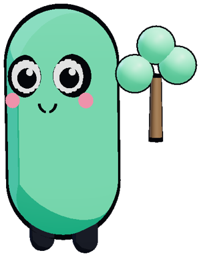
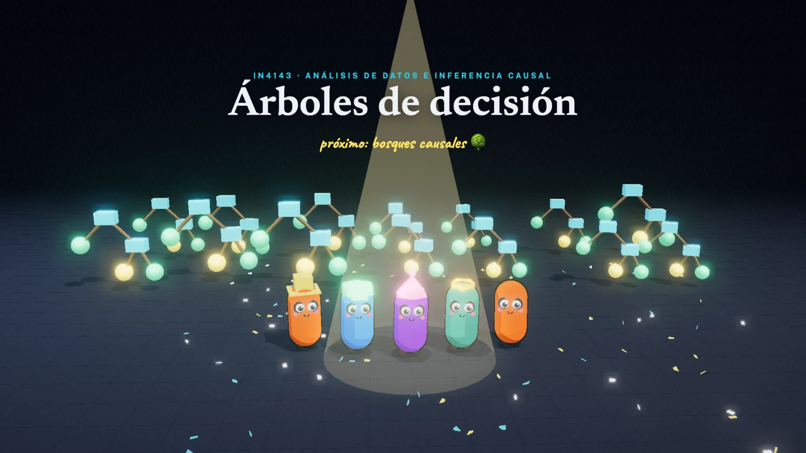

# Bienvenida {.unnumbered}

::: {.portada}

IN4143 · Análisis de datos e inferencia causal

Estos apuntes acompañan las clases y los videos del curso. Cada capítulo sigue el mismo hilo que su video, con las mismas cápsulas, pero va más profundo: fórmulas completas, código en **R y Python** que puedes ejecutar y ejercicios con solución.

:::

{.still fig-alt="Cápsulas celebrando frente a un bosque de árboles de decisión"}

## Cómo leer estos apuntes {.unnumbered}

Las cajas tienen un rol fijo. Es el mismo sistema que las diapositivas:

::: {.box .key}
**Lo que no te puedes perder.** Si solo lees estas cajas, te llevas lo esencial del capítulo.
:::

::: {.box .intuit}
Una imagen o una analogía para entender la idea antes de la fórmula.
:::

::: {.box .def}
La definición formal: el material de referencia para estudiar.
:::

::: {.box .warn}
Errores comunes y supuestos que no hay que olvidar.
:::

::: {.box .turn}
Un ejercicio para hacer en el momento. Las soluciones están al final de cada capítulo.
:::

::: {.box .paper}
Lo que dice la literatura: resultados, cifras y referencias.
:::

El código viene en dos pestañas, **R** y **Python**. Elige una y el resto del libro te mostrará ese lenguaje.

## Capítulos {.unnumbered}

1. [Árboles de decisión](arboles.qmd): regresión y clasificación, cómo elige cada corte, sobreajuste, sesgo y varianza, validación cruzada, poda, métricas, bosques y boosting.

2. [Causal ML (1): del control lineal al Double ML](causal_ml_1.qmd): controlar es limpiar (Frisch, Waugh y Lovell), *cross-fitting*, la receta de Double ML, el estimador doblemente robusto y lo que el *machine learning* no arregla.
3. [Causal ML (2): efectos heterogéneos y personalización](causal_ml_2.qmd): el CATE, los *meta-learners*, árbol causal y honestidad, bosque causal, validar el orden (GATES, TOC y RATE) y decidir a quién tratar.

**Material complementario**

4. [Errores estándar](errores_estandar.qmd): qué incertidumbre miden, a qué nivel agrupar, la receta moderna (CV1, *jackknife* y *wild cluster bootstrap*), pocos clústeres tratados, aleatorización, método delta, tests A/A y placebos.
5. [Test & Roll](test_and_roll.qmd): A/B tests para decidir, la regla de elegir al ganador, el tamaño óptimo del test, de dónde sale el *prior*, el *holdout* chico y Thompson sampling.
