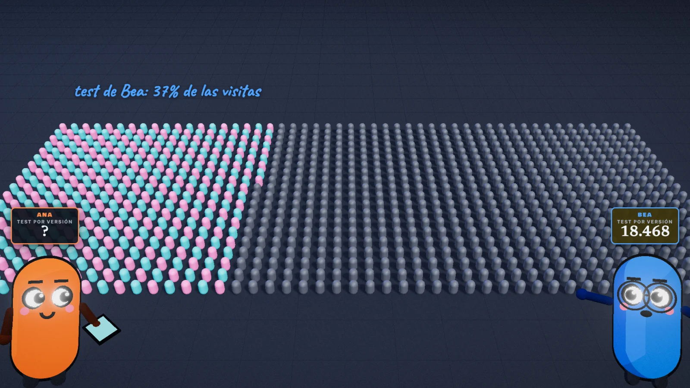
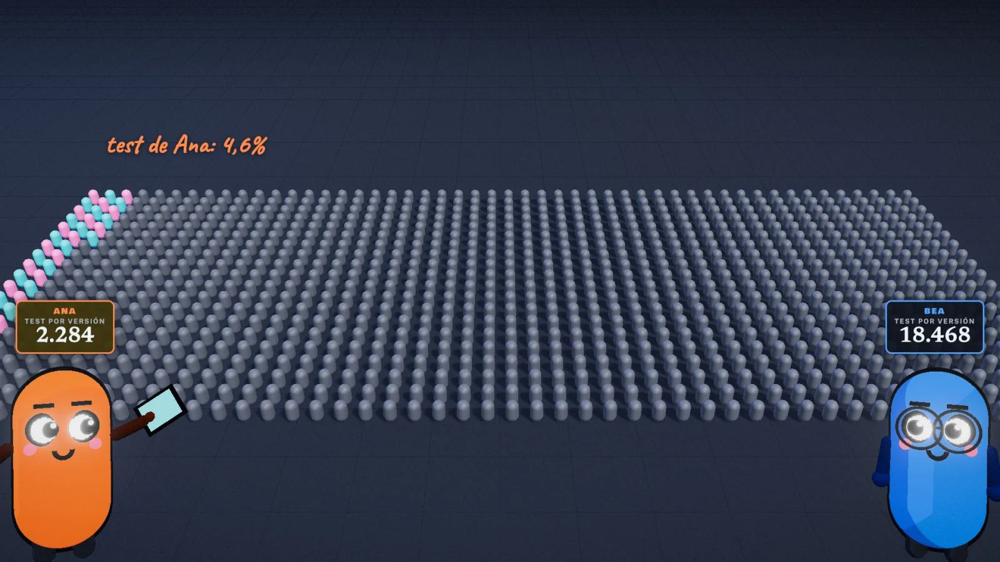
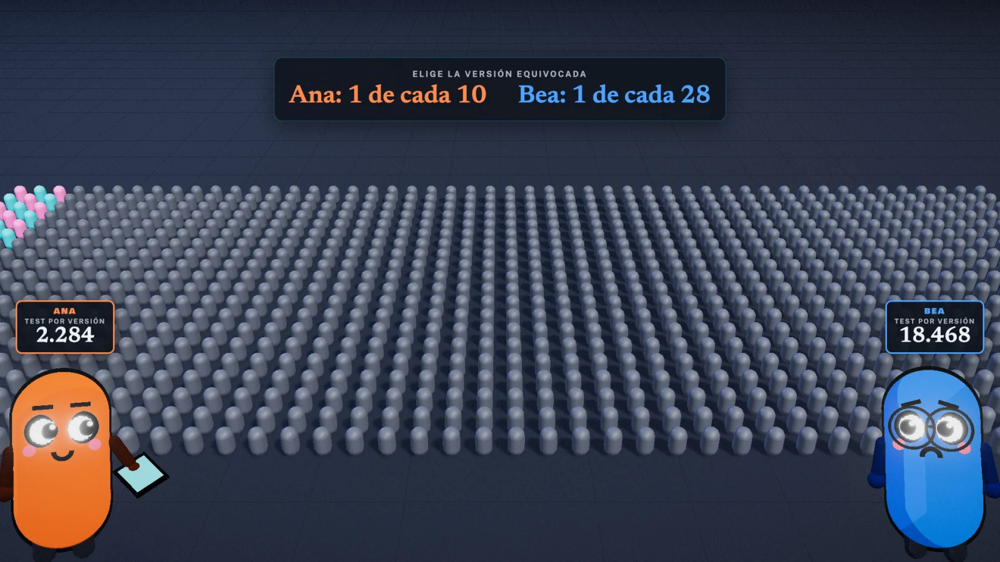
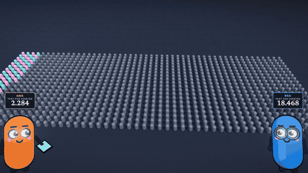
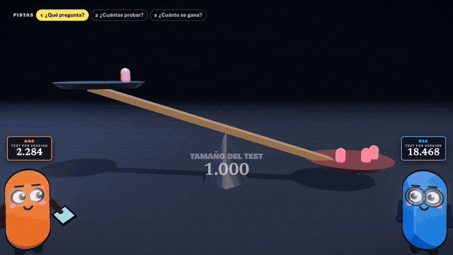
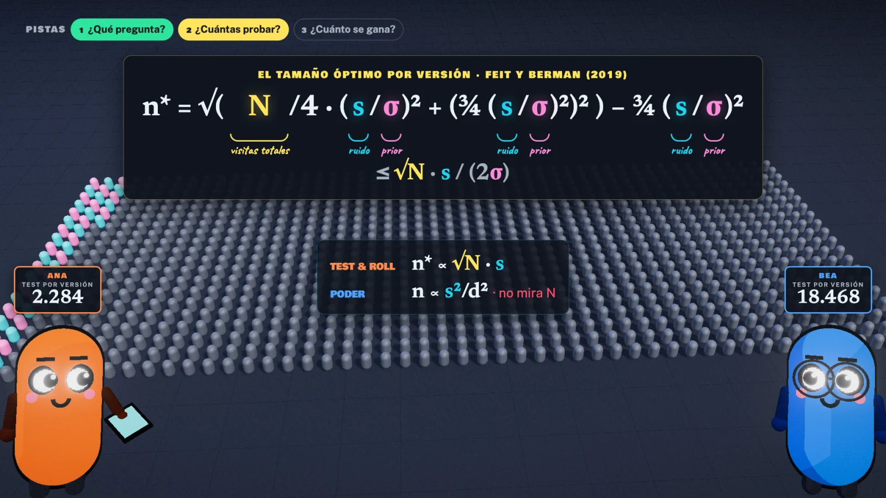
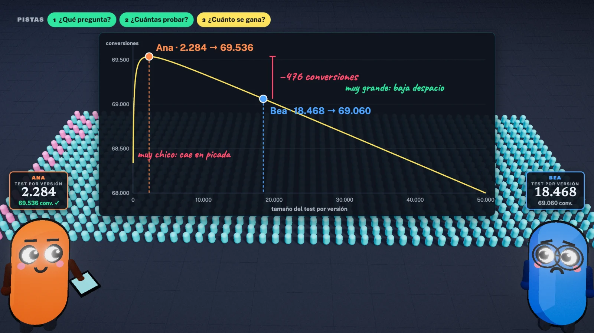
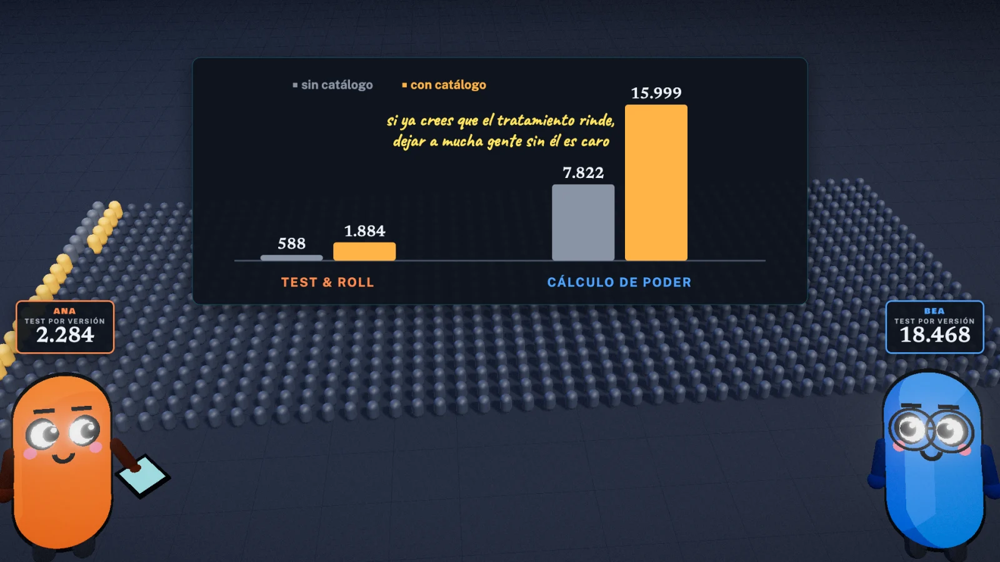
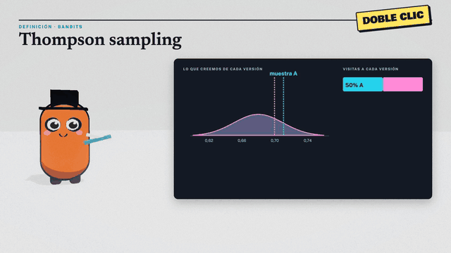
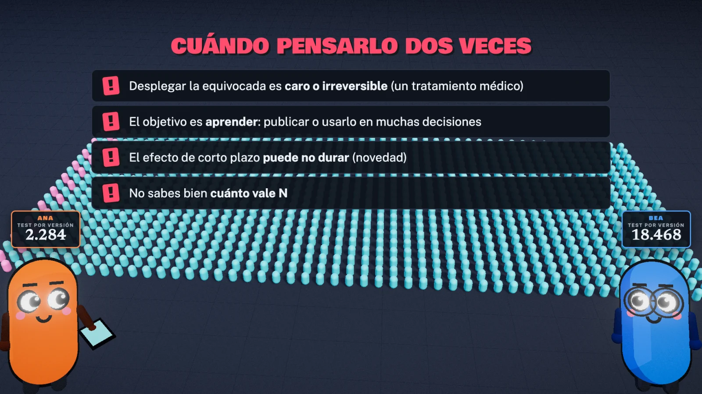

<div class="vidwin">
<iframe src="https://www.youtube-nocookie.com/embed/N9Ad9JvJXbQ" title="Test & Roll · IN4143" allow="accelerometer; autoplay; clipboard-write; encrypted-media; gyroscope; picture-in-picture; web-share" referrerpolicy="strict-origin-when-cross-origin" allowfullscreen></iframe>
</div>

::: {.box .key}
**En este capítulo.**

- Muchos A/B tests no buscan **publicar** un hallazgo, sino **decidir** qué versión mostrar al resto de los clientes. Feit y Berman [-@feit2019] llaman a esto **test & roll**: se prueba con una parte de la población y se despliega la ganadora al resto.
- Con ese objetivo, el error tipo I casi no cuesta: si las dos versiones son iguales, da lo mismo cuál se despliegue. La regla óptima es **elegir la que rindió más**, sea o no significativa la diferencia.
- El tamaño óptimo del test tiene una fórmula cerrada. Crece con **√N** (la población) y con el **ruido s**, y no con s² como el cálculo de poder. Casi siempre es **mucho más chico**.
- La fórmula necesita un ***prior***: cuánto suelen diferir dos versiones. Se estima con **experimentos anteriores**.
- Un bandit (Thompson sampling) gana un poco más, pero es más difícil de operar.
:::

## Preparación {.unnumbered}

Todo el capítulo usa el **ejemplo del sitio web** de Feit y Berman [-@feit2019, sección 5.1]. Un sitio va a recibir **N = 100.000 visitas** durante el período de despliegue y hay dos versiones de una página, A y B. De cada 100 visitas, unas 68 hacen clic.

| Parámetro | Valor | Qué es |
|---|---|---|
| $N$ | 100.000 | visitas totales (test + despliegue) |
| $\mu$ | 0,68 | tasa de clic esperada de cada versión, antes de probar |
| $\sigma$ | 0,03 | cuánto puede variar esa tasa entre versiones: el ***prior*** |
| $s$ | 0,466 | ruido de la respuesta de cada visita: $\sqrt{0{,}68 \cdot 0{,}32}$ |

Las funciones están programadas a mano, en pocas líneas, a partir de las ecuaciones del paper. No hay un paquete estable de test & roll: el repositorio de Feit tiene solo scripts de replicación, y `bayesAB` salió de CRAN en 2025.

::: {.panel-tabset group="lang"}
## R
```{r}
source("codigo/tr/test_roll.R")   # n_opt(), ganancia(), tasa_error(), n_hipotesis(), ganancia_asim(), thompson()
N <- 1e5; mu <- 0.68; sigma <- 0.03; s <- 0.466
```

## Python
```{python}
import sys, numpy as np, pandas as pd
sys.path.insert(0, "codigo/tr")
from test_roll import *          # las mismas funciones que en R
pd.set_option("display.width", 140); pd.set_option("display.max_columns", 10)
N, mu, sigma, s = 100_000, 0.68, 0.03, 0.466
```
:::

## Lo bayesiano en dos minutos {#sec-bayes}

Este capítulo abre la parte bayesiana del apunte, así que partimos por lo mínimo. Un análisis bayesiano tiene tres piezas:

1. **Prior:** lo que creemos sobre un parámetro **antes** de ver los datos. Aquí, la tasa de clic de una versión: «anda por 0,68, y rara vez se aleja más de 0,06».
2. **Verosimilitud:** qué tan probables son los datos para cada valor del parámetro.
3. **Posterior:** lo que creemos **después** de ver los datos. Combina las dos anteriores.

Con un prior normal y datos normales, la posterior también es normal, y su media es un **promedio ponderado** entre lo que creíamos y lo que vimos:

::: {.hero}
[Media posterior de una versión, después de n visitas con tasa observada ȳ]{.cap}
[[$\mathbb{E}[m \mid \bar y]$]{.v}[]{.u}[lo que creemos después]{.n}]{.tm}
[=]{.op}
[[$w$]{.v}[]{.u}[peso de los datos]{.n}]{.tm style="--c:#22D3EE"}
[·]{.op}
[[$\bar y$]{.v}[]{.u}[lo que vimos]{.n}]{.tm style="--c:#FFE45E"}
[+]{.op}
[[$(1-w)$]{.v}[]{.u}[peso del prior]{.n}]{.tm style="--c:#FF8AD8"}
[·]{.op}
[[$\mu$]{.v}[]{.u}[lo que creíamos]{.n}]{.tm style="--c:#A7B0BE"}
[con $w = \dfrac{n/s^2}{1/\sigma^2 + n/s^2}$: con pocas visitas manda el prior; con muchas, los datos.]{.nums}
:::

Y la **decisión** se toma minimizando la **pérdida esperada** bajo la posterior. Esa es la diferencia con una prueba de hipótesis: no se pregunta «¿puedo rechazar que son iguales?», sino «¿qué hago, dado lo que sé?».

::: {.interactivo}
[Interactivo · Del prior a la posterior]{.kicker}

```{ojs}
//| echo: false
viewof bay = Inputs.form({
  n: Inputs.range([0, 4], {step: 0.05, value: 2.5, label: "Visitas observadas (log₁₀)"}),
  ybar: Inputs.range([0.60, 0.76], {step: 0.005, value: 0.71, label: "Tasa de clic observada"})
})
```

```{ojs}
//| echo: false
{
  const n = Math.round(10 ** bay.n), prec = 1 / TR.sigma ** 2 + n / TR.s ** 2, w = (n / TR.s ** 2) / prec;
  const pm = w * bay.ybar + (1 - w) * TR.mu, psd = Math.sqrt(1 / prec), xs = d3.range(0.56, 0.80, 0.0008);
  const dens = (m, sd) => xs.map(x => ({x, y: Math.exp(-0.5 * ((x - m) / sd) ** 2) / (sd * Math.sqrt(2 * Math.PI))}));
  const p = Plot.plot({ ...TR.estilo, width: Math.min(760, width), height: 280, x: {label: "tasa de clic de la versión", domain: [0.56, 0.80]}, y: {label: "densidad"},
    color: {domain: ["prior", "posterior"], range: ["#FF8AD8", "#22D3EE"], legend: true},
    marks: [Plot.areaY(dens(TR.mu, TR.sigma), {x: "x", y: "y", fill: "#FF8AD8", fillOpacity: 0.18}), Plot.line(dens(TR.mu, TR.sigma), {x: "x", y: "y", stroke: "#FF8AD8", strokeWidth: 2.5}),
      Plot.areaY(dens(pm, psd), {x: "x", y: "y", fill: "#22D3EE", fillOpacity: 0.25}), Plot.line(dens(pm, psd), {x: "x", y: "y", stroke: "#22D3EE", strokeWidth: 3}),
      Plot.ruleX([bay.ybar], {stroke: "#FFE45E", strokeDasharray: "6 4", strokeWidth: 2})] });
  return html`${p}<div class="lectura">${TR.miles(n)} visitas · peso de los datos <b>${TR.pct(w)}</b> · media posterior <b>${TR.fmt(pm, 3)}</b> (prior 0,680, observado ${TR.fmt(bay.ybar, 3)}) · desviación posterior <b>${TR.fmt(psd, 4)}</b></div>`;
}
```
:::

::: {.box .turn label="Tu turno · 1"}
Con la tasa observada fija en 0,71, mueve las visitas desde 1 hasta 10.000. ¿Con cuántas visitas el peso de los datos llega a 50%? Compáralo con $s^2/\sigma^2 = 0{,}466^2 / 0{,}03^2 \approx 241$. ¿Por qué coincide?
:::

## Dos tests para dos preguntas {#sec-dos}

[▶ ver en el video · 0:00](https://youtu.be/N9Ad9JvJXbQ?t=0){.vidlink}

Dos analistas reciben el encargo de elegir entre A y B.

**Bea** usa el cálculo de poder del capítulo de poder estadístico. Quiere detectar una mejora de 2% en la tasa de clic ($d = 0{,}68 \times 0{,}02 = 0{,}0136$), con 5% de significancia y 80% de poder:

$$n_{HT} = (z_{0,975} + z_{0,80})^2 \, \frac{2 s^2}{d^2} \approx 18.468 \text{ visitas por versión.}$$

**Ana** usa test & roll y pide **2.284 por versión**, ocho veces menos.

:::: {layout-ncol=2}
{.still}

{.still}
::::

Las dos responden preguntas distintas:

| | **Test de hipótesis (Bea)** | **Test & roll (Ana)** |
|---|---|---|
| Pregunta | ¿El efecto es distinto de cero? | ¿Qué versión despliego para ganar más? |
| Objetivo | Poder $1-\beta$ con error tipo I $\alpha$ | Ganancia total esperada (test + despliegue) |
| Insumos | $\alpha$, $\beta$, efecto mínimo $d$, $s$ | $N$, $s$, prior ($\mu$, $\sigma$) |
| Tamaño | $\propto s^2/d^2$, no depende de $N$ | $\propto \sqrt{N}\, s/\sigma$, siempre $< N$ |
| Decisión | Rechazar o no H0 (¿y si no rechaza?) | Siempre elige: la de mayor media posterior |
| Cuándo conviene | Conocimiento que se publica y generaliza; costos asimétricos; regulación | Decisiones tácticas repetidas sobre una población finita: mails, web, avisos, cupones |

{.still}

## El problema test & roll {#sec-problema}

[▶ ver en el video · 0:38](https://youtu.be/N9Ad9JvJXbQ?t=38){.vidlink} [▶ ver en el video: aprender cuesta · 2:21](https://youtu.be/N9Ad9JvJXbQ?t=141){.vidlink}

Un test & roll tiene **dos etapas** [@feit2019, sección 2]:

1. **Test:** $n_1$ visitas ven A y $n_2$ ven B, al azar.
2. ***Roll*:** las $N - n_1 - n_2$ visitas restantes ven la versión elegida con los datos del test.

{.still}

El tamaño del test se elige para maximizar la **ganancia total esperada**, sumando las dos etapas. Con priors simétricos, $n_1 = n_2 = n$ y la ganancia esperada es [@feit2019, ecs. 7 y 9]:

::: {.hero}
[Conversiones totales esperadas con n visitas por versión]{.cap}
[[$\mathbb{E}[\Pi]$]{.v}[]{.u}[test + despliegue]{.n}]{.tm}
[=]{.op}
[[$2n\mu$]{.v}[]{.u}[el test: en promedio, μ]{.n}]{.tm style="--c:#22D3EE"}
[+]{.op}
[[$(N-2n)$]{.v}[]{.u}[visitas que quedan]{.n}]{.tm style="--c:#A7B0BE"}
[·]{.op}
[[$\Big(\mu + \dfrac{\sqrt2\,\sigma^2}{\sqrt\pi\,\sqrt{2\sigma^2 + 2s^2/n}}\Big)$]{.v}[]{.u}[μ + lo que se gana por elegir bien]{.n}]{.tm style="--c:#FFE45E"}
:::

El último término es la clave. Con $n$ chico, el test casi no informa y elegir es como tirar una moneda: se gana $\mu$. Con $n$ grande, se elige casi siempre la mejor y la ganancia por visita se acerca a $\mu + \sigma/\sqrt\pi$. Pero cada visita del test es una visita menos en el despliegue, y la mitad de ellas vio la versión peor.

::: {.box .intuit}
**Aprender cuesta, equivocarse también.** Cada visita que agregas al test sube el costo de aprender (más gente ve la versión peor). Cada visita que quitas sube el riesgo de desplegar la peor a todo el resto. El tamaño óptimo equilibra los dos costos.
:::

{.still}

## La regla: elige el ganador {#sec-regla}

[▶ ver en el video · 1:29](https://youtu.be/N9Ad9JvJXbQ?t=89){.vidlink}

::: {.box .def label="Definición · Regla de decisión de test & roll"}
Despliega la versión con **mayor media posterior** [@feit2019, ec. 8]. Con priors simétricos y grupos del mismo tamaño, eso equivale a desplegar la versión con **mayor tasa observada en el test**, sea o no significativa la diferencia.
:::

¿Por qué ignorar la significancia? Porque en esta decisión el **error tipo I casi no cuesta**. Si A y B son iguales, da lo mismo cuál se despliegue: la ganancia es la misma. Y si son distintas, la regla elige la mejor con alta probabilidad cuando la diferencia es grande, y se equivoca sobre todo cuando la diferencia es chica, es decir, cuando equivocarse cuesta poco.

::: {.box .warn}
**«No significativo» no significa «no sé qué hacer».** Quedarse con la versión actual, alargar el test hasta que salga significativo o elegir al azar son prácticas comunes [@feit2019, sección 1], pero todas desperdician información. Además, alargar el test hasta que salga significativo infla los falsos positivos (el *p-hacking* por detención opcional; ver el capítulo de pruebas múltiples).
:::

## ¿Cuántos probar? {#sec-nopt}

[▶ ver en el video · 2:40](https://youtu.be/N9Ad9JvJXbQ?t=160){.vidlink}

Maximizando la ganancia esperada se obtiene una fórmula cerrada [@feit2019, ec. 10 y proposición A.2]:

::: {.hero}
[Tamaño óptimo por versión · Feit y Berman (2019)]{.cap}
[[$n^*$]{.v}[]{.u}[visitas por versión]{.n}]{.tm}
[=]{.op}
[[$\sqrt{\dfrac{N}{4}\Big(\dfrac{s}{\sigma}\Big)^2 + \Big(\dfrac34\Big(\dfrac{s}{\sigma}\Big)^2\Big)^2}$]{.v}[]{.u}[crece con √N]{.n}]{.tm style="--c:#FFE45E"}
[−]{.op}
[[$\dfrac34\Big(\dfrac{s}{\sigma}\Big)^2$]{.v}[]{.u}[ruido sobre prior]{.n}]{.tm style="--c:#22D3EE"}
[≤]{.op}
[[$\sqrt N\,\dfrac{s}{2\sigma}$]{.v}[]{.u}[cota simple]{.n}]{.tm style="--c:#FF8AD8"}
:::

Tres perillas:

- **$N$, la población.** Más visitas por delante → vale más aprender. Pero el tamaño crece con $\sqrt N$, no con $N$: la fracción de la población que se usa en el test **baja** cuando $N$ sube.
- **$s$, el ruido de la respuesta.** Más ruido → cada visita enseña menos. El tamaño crece con $s$, no con $s^2$ como en el cálculo de poder. Con respuestas muy ruidosas (ventas en pesos, por ejemplo), la diferencia entre los dos enfoques es enorme.
- **$\sigma$, el prior.** Cuán distintas esperamos que sean las versiones. Con $\sigma$ grande, las diferencias son grandes y fáciles de ver, y alcanza con un test chico.

{.still}

::: {.panel-tabset group="lang"}
## R
```{r}
d <- mu * 0.02
data.frame(N = c(1e4, 1e5, 1e6, 1e7)) |>
  transform(n_opt = round(n_opt(N, s, sigma)),
            n_poder = round(n_hipotesis(s, d)),
            pct_test_opt = round(100 * 2 * n_opt(N, s, sigma) / N, 1))
```

## Python
```{python}
d = mu * 0.02
pd.DataFrame({"N": [1e4, 1e5, 1e6, 1e7]}).assign(
    n_opt=lambda x: n_opt(x.N, s, sigma).round(),
    n_poder=round(n_hipotesis(s, d)),
    pct_test_opt=lambda x: (100 * 2 * n_opt(x.N, s, sigma) / x.N).round(1))
```
:::

Con 10.000 visitas, el óptimo es 617 por versión; el cálculo de poder pide **18.468 por versión** (18.430 con nuestro redondeo de $d$), casi cuatro veces la población. El cálculo de poder también da 18.468 con 10 millones de visitas, donde el óptimo es unas 24.000. Por eso el paper dice que el tamaño de una prueba de hipótesis «no mira $N$».

::: {.interactivo}
[Interactivo · Las tres perillas de n*]{.kicker}

```{ojs}
//| echo: false
viewof per = Inputs.form({
  logN: Inputs.range([3, 7], {step: 0.05, value: 5, label: "Visitas totales N (log₁₀)"}),
  s: Inputs.range([0.1, 1.5], {step: 0.001, value: 0.466, label: "Ruido de la respuesta s"}),
  sigma: Inputs.range([0.005, 0.10], {step: 0.001, value: 0.03, label: "Prior σ"})
})
```

```{ojs}
//| echo: false
{
  const N = 10 ** per.logN, ns = Math.min(N / 2, TR.nopt(N, per.s, per.sigma)), nh = TR.nHT(per.s, 0.68 * 0.02);
  const barra = (n, col, lab) => { const f = Math.min(1, 2 * n / N); return html`<div style="margin:.35rem 0"><div style="font:700 .82rem 'Public Sans';color:${col}">${lab}</div>
    <div style="display:flex;height:22px;border-radius:6px;overflow:hidden;background:#2A3446"><div style="width:${100 * f}%;background:repeating-linear-gradient(90deg,#22D3EE 0 6px,#FF8AD8 6px 12px)"></div></div>
    <div style="font:.82rem 'Public Sans';color:#A7B0BE">${2 * n > N ? `<b style="color:#FF4D6D">pide ${TR.miles(2 * n)} visitas: más que las ${TR.miles(N)} que hay</b>` : `${TR.pct(f)} de las visitas en el test`}</div></div>`; };
  const grid = d3.range(3, 7.01, 0.05).map(l => ({N: 10 ** l, n: Math.min(10 ** l / 2, TR.nopt(10 ** l, per.s, per.sigma))}));
  const p = Plot.plot({ ...TR.estilo, width: Math.min(640, width), height: 260, x: {type: "log", label: "N (visitas totales)"}, y: {type: "log", label: "visitas por versión"},
    marks: [Plot.line(grid, {x: "N", y: "n", stroke: "#FFE45E", strokeWidth: 3}), Plot.ruleY([nh], {stroke: "#4DA3FF", strokeDasharray: "8 5", strokeWidth: 2}),
      Plot.text([{N: 1e3, n: nh}], {x: "N", y: "n", text: () => "cálculo de poder", dy: -10, textAnchor: "start", fill: "#4DA3FF"}),
      Plot.dot([{N, n: ns}], {x: "N", y: "n", r: 7, fill: "#FF8A4C", stroke: "#fff"})] });
  return html`<div class="fila"><div style="min-width:280px;flex:1">${barra(ns, "#FF8A4C", `Test & roll · n* = ${TR.miles(ns)} por versión`)}${barra(nh, "#4DA3FF", `Cálculo de poder · ${TR.miles(nh)} por versión (mejora de 2%)`)}</div>${p}</div>
    <div class="lectura">N = ${TR.miles(N)} · s/σ = ${TR.fmt(per.s / per.sigma, 1)} · n* = <b>${TR.miles(ns)}</b> · error de despliegue con n*: <b>${TR.pct(TR.err(ns, per.sigma, per.s))}</b></div>`;
}
```
:::

::: {.box .turn label="Tu turno · 2"}
1. Duplica el ruido $s$. ¿Cuánto crece $n^*$? ¿Y el tamaño del cálculo de poder?
2. Multiplica $N$ por 100. ¿Cuánto crece $n^*$? ¿Qué pasa con la fracción de visitas que se usa en el test?
:::

::: {.callout-tip collapse="true"}
## Solución
1. $n^*$ casi se duplica (crece como $s$); el del cálculo de poder se cuadruplica (crece como $s^2$).
2. $n^*$ crece unas 10 veces ($\sqrt{100}$), así que la fracción en el test cae unas 10 veces.
:::

## ¿Cuánto se gana? {#sec-gana}

[▶ ver en el video · 4:48](https://youtu.be/N9Ad9JvJXbQ?t=288){.vidlink}

La curva de conversiones totales frente al tamaño del test [@feit2019, fig. 3] tiene una forma característica: sube en picada hasta el óptimo y después **baja despacio**.

{.still}

::: {.panel-tabset group="lang"}
## R
```{r}
PI <- info_perfecta(N, mu, sigma)
plan <- function(nombre, n) {
  g <- if (n == 0) N * mu else ganancia(N, n, mu, sigma, s)
  data.frame(plan = nombre, n_por_version = round(n), conversiones = round(g),
             regret_pct = round(100 * (PI - g) / PI, 2), error_pct = round(100 * ifelse(n == 0, 0.5, tasa_error(n, sigma, s)), 1))
}
rbind(plan("Sin test (al azar)", 0), plan("Test de hipótesis", n_hipotesis(s, d)),
      plan("Test de hipótesis con FPC", n_hipotesis_fpc(s, d, N)), plan("Test & roll", n_opt(N, s, sigma)))
```

## Python
```{python}
PI = info_perfecta(N, mu, sigma)
def plan(nombre, n):
    g = N * mu if n == 0 else ganancia(N, n, mu, sigma, s)
    return dict(plan=nombre, n_por_version=round(n), conversiones=round(g),
                regret_pct=round(100 * (PI - g) / PI, 2), error_pct=round(100 * (0.5 if n == 0 else tasa_error(n, sigma, s)), 1))
pd.DataFrame([plan("Sin test (al azar)", 0), plan("Test de hipótesis", n_hipotesis(s, d)),
              plan("Test de hipótesis con FPC", n_hipotesis_fpc(s, d, N)), plan("Test & roll", n_opt(N, s, sigma))])
```
:::

Las cifras reproducen la tabla 1 del paper. Las pequeñas diferencias (18.430 frente a 18.468, por ejemplo) vienen de cómo se redondean $d$ y los cuantiles normales.

| Plan | n por versión | Conversiones | *Regret* | Error de despliegue |
|---|---:|---:|---:|---:|
| Sin test (al azar) | — | 68.000 | 2,43% | 50% |
| Test de hipótesis | 18.468 | 69.060 | 0,91% | 3,6% |
| Test de hipótesis con FPC | 13.487 | 69.225 | 0,67% | 4,2% |
| **Test & roll** | **2.284** | **69.536** | **0,22%** | **10,0%** |
| Thompson sampling | — | 69.672 | 0,03% | — |
| Información perfecta | — | 69.693 | 0% | — |

: Tabla 1 de Feit y Berman (2019): el ejemplo web. El *regret* es lo que se pierde frente a saber de antemano cuál es la mejor versión. {tbl-colwidths="[34,14,16,14,22]"}

::: {.box .def label="Definición · Regret"}
El ***regret*** es la diferencia entre lo que se habría ganado con **información perfecta** (desplegar la mejor versión a todos, sin probar) y lo que gana el plan. Con priors normales, la información perfecta vale $N(\mu + \sigma/\sqrt\pi)$ [@feit2019, ec. 13]. Test & roll captura el **91%** de lo que se puede ganar sobre elegir al azar.
:::

Dos resultados del paper explican la tabla:

- **El error de despliegue óptimo no es 5%.** Con $n^*$, el sitio despliega la versión peor el 10% de las veces, pero casi solo cuando A y B son casi iguales [@feit2019, ecs. 11 y 12].
- ***Regret* que crece como $\sqrt N$.** El de test & roll está acotado por $3 s\sqrt N/\sqrt\pi$, es decir, crece como $O(\sqrt N)$. El de un tamaño fijado por poder crece como $\Omega(N)$: con poblaciones grandes, la diferencia se agranda [@feit2019, ecs. 14 y 16].

::: {.box .warn}
**Ojo al leer la ecuación (12) del paper.** Entrega la probabilidad *conjunta* de que la versión B sea mejor **y** se despliegue la A. La tasa de error de la tabla 1 (10%) es la probabilidad *condicional* de equivocarse dado que una es mejor, que es el doble. La función `tasa_error()` de este capítulo ya incluye ese factor 2.
:::

::: {.interactivo}
[Interactivo · La curva de ganancia]{.kicker}

```{ojs}
//| echo: false
viewof cur = Inputs.range([1, 4.7], {step: 0.001, value: Math.log10(2284), label: "Visitas por versión en el test (log₁₀)"})
```

```{ojs}
//| echo: false
{
  const n = 10 ** cur, g = TR.gan(n), PI = TR.N * (TR.mu + TR.sigma / Math.sqrt(Math.PI)), azar = TR.N * TR.mu;
  const grid = d3.range(1, 4.7, 0.01).map(l => ({n: 10 ** l, g: TR.gan(10 ** l), e: TR.err(10 ** l, TR.sigma, TR.s)}));
  const marcas = [{n: 2284, lab: "Ana · 2.284", c: "#FF8A4C"}, {n: 18468, lab: "Bea · 18.468", c: "#4DA3FF"}];
  const p1 = Plot.plot({ ...TR.estilo, width: TR.ancho(width), height: 280, x: {type: "log", label: "visitas por versión (escala log)"}, y: {label: "conversiones totales", domain: [68000, 69750]},
    marks: [Plot.line(grid, {x: "n", y: "g", stroke: "#FFE45E", strokeWidth: 3}), Plot.ruleY([PI], {stroke: "#2EE59D", strokeDasharray: "6 4"}),
      Plot.dot(marcas, {x: "n", y: d => TR.gan(d.n), fill: "c", r: 5}), Plot.dot([{n, g}], {x: "n", y: "g", r: 8, fill: "#fff", stroke: "#FFE45E", strokeWidth: 3})] });
  const p2 = Plot.plot({ ...TR.estilo, width: TR.ancho(width), height: 280, x: {type: "log", label: "visitas por versión (escala log)"}, y: {label: "error de despliegue", domain: [0, 0.5], tickFormat: "%"},
    marks: [Plot.line(grid, {x: "n", y: "e", stroke: "#FF4D6D", strokeWidth: 3}), Plot.dot([{n, e: TR.err(n, TR.sigma, TR.s)}], {x: "n", y: "e", r: 8, fill: "#fff", stroke: "#FF4D6D", strokeWidth: 3})] });
  return html`<div class="fila">${p1}${p2}</div><div class="lectura">${TR.miles(n)} por versión · conversiones <b>${TR.miles(g)}</b> · <i>regret</i> <b>${TR.pct((PI - g) / PI, 2)}</b> · captura <b>${TR.pct((g - azar) / (PI - azar))}</b> de lo posible · error <b>${TR.pct(TR.err(n, TR.sigma, TR.s))}</b></div>`;
}
```
:::

::: {.box .turn label="Tu turno · 3"}
Con la función `ganancia()`, calcula cuántas conversiones se pierden frente al óptimo si el test tiene **2.000 visitas menos** por versión (284) y si tiene **2.000 más** (4.284). ¿Hacia qué lado conviene equivocarse?
:::

::: {.callout-tip collapse="true"}
## Solución
```r
g <- ganancia(N, 2284, mu, sigma, s)
g - ganancia(N, 284, mu, sigma, s)    # ≈ 299 conversiones menos
g - ganancia(N, 4284, mu, sigma, s)   # ≈ 30 conversiones menos
```
Quedarse corto por 2.000 visitas cuesta unas diez veces más que pasarse por lo mismo: la curva cae en picada a la izquierda del óptimo y baja despacio a la derecha. Ante la duda, conviene pasarse un poco [@feit2019, sección 5.1]. (Ojo: la comparación es por la misma **cantidad** de visitas. Con la mitad y el doble del óptimo, las pérdidas son parecidas: 33 y 37.)
:::

## ¿De dónde sale el prior? {#sec-prior}

[▶ ver en el video: doble clic: el prior · 3:14](https://youtu.be/N9Ad9JvJXbQ?t=194){.vidlink}

La fórmula necesita $\mu$ y $\sigma$ **antes** de probar. Feit y Berman los estimaron con **2.101 tests anteriores** en sitios web [@feit2019, sección 5.1 y apéndice E]. Ajustaron un modelo jerárquico a las tasas de clic de todos los brazos y obtuvieron que se reparten como una normal $\mathcal N(0{,}68;\ 0{,}03^2)$. Eso es un análisis **bayesiano empírico**: el prior sale de los datos de muchos experimentos parecidos.

¿Cuánto implica que difieran dos versiones? Si $m_1$ y $m_2$ son independientes $\mathcal N(\mu, \sigma^2)$, la diferencia $m_1 - m_2$ es $\mathcal N(0, 2\sigma^2)$, y su valor absoluto tiene media $2\sigma/\sqrt\pi \approx 0{,}034$: **unos 3,4 puntos de cada 100 visitas**.

::: {.box .warn label="Ojo · Una errata en el paper"}
El texto del paper dice que la media de $|m_1 - m_2|$ es $\sqrt2\,\sigma/\sqrt\pi = 0{,}023$. Es una errata: falta un factor $\sqrt2$. La figura 2 del paper (densidad 18,8 en cero) y su afirmación de que $d = 0{,}0136$ es el percentil 25,1 del efecto son coherentes con $0{,}034$, no con $0{,}023$. Compruébalo simulando:

```r
m <- matrix(rnorm(2e6, 0.68, 0.03), ncol = 2)
mean(abs(m[, 1] - m[, 2]))             # ≈ 0,034
mean(abs(m[, 1] - m[, 2]) < 0.0136)    # ≈ 0,251
```
:::

::: {.box .paper label="Del paper · Dos riesgos al estimar el prior"}
- **Si el archivo guarda solo los ganadores**, el prior queda inflado: parece que las versiones difieren más de lo que difieren. Lo mismo pasa si se mezclan programas o métricas distintas [@schultzberg2026].
- **Colas gruesas.** Si unas pocas ideas son mucho mejores que el resto, la normal subestima esos casos. Azevedo et al. [-@azevedo2020] lo encuentran en los experimentos de Bing y concluyen que conviene una estrategia ***lean***: muchos tests chicos, en vez de pocos grandes. Sudijono et al. [-@sudijono2024] llegan a una recomendación parecida con programación dinámica.
:::

### Priors asimétricos: el *holdout* chico {#sec-holdout}

[▶ ver en el video · 6:01](https://youtu.be/N9Ad9JvJXbQ?t=361){.vidlink}

Si una versión parte favorita, los grupos óptimos son **desiguales** [@feit2019, sección 4]. El ejemplo del paper es un minorista que manda catálogos a 100.000 clientes. Con 30 envíos anteriores estimó los priors de las ventas por cliente en el mes siguiente: $\mathcal N(30{,}06;\ 13{,}48^2)$ con catálogo y $\mathcal N(19{,}39;\ 20{,}97^2)$ sin él, con ruido $s = 179{,}36$ y $s = 87{,}69$. Cada catálogo cuesta unos $0,80, que se restan de las ventas del grupo tratado.

::: {.panel-tabset group="lang"}
## R
```{r}
ctrl <- c(19.39, 20.97, 87.69); trat <- c(30.06 - 0.80, 13.48, 179.36)
n_opt_asim(N, ctrl, trat)          # 588 sin catálogo y 1.884 con catálogo
c(poder_ctrl = 7822, poder_trat = 15999)   # lo que pedía el cálculo de poder (tabla 3 del paper)
```

## Python
```{python}
ctrl, trat = (19.39, 20.97, 87.69), (30.06 - 0.80, 13.48, 179.36)
n_opt_asim(N, ctrl, trat)          # (588, 1884, ganancia esperada)
```
:::

{.still}

Si ya crees que el tratamiento rinde, dejar a mucha gente sin él es caro. Así se racionaliza una práctica común en marketing: el **grupo de control chico**.

::: {.interactivo}
[Interactivo · ¿Cuán chico el holdout?]{.kicker}

```{ojs}
//| echo: false
viewof lift = Inputs.range([-20, 50], {step: 1, value: Math.round(30.06 - 0.8 - 19.39), label: "Efecto esperado del catálogo (US$ por cliente, neto)"})
```

```{ojs}
//| echo: false
{
  const ctrl = [19.39, 20.97, 87.69], trat = [19.39 + lift, 13.48, 179.36], o = TR.optAsim(TR.N, ctrl, trat);
  const curva = TR.fig7;
  const p = Plot.plot({ ...TR.estilo, width: Math.min(620, width), height: 270, x: {label: "efecto esperado del catálogo"}, y: {label: "visitas en el test"},
    color: {domain: ["sin catálogo", "con catálogo"], range: ["#A7B0BE", "#FFB347"], legend: true},
    marks: [Plot.areaY(curva, {x: "lift", y1: 0, y2: "n1", fill: "#A7B0BE", fillOpacity: 0.5}), Plot.areaY(curva, {x: "lift", y1: "n1", y2: d => d.n1 + d.n2, fill: "#FFB347", fillOpacity: 0.5}),
      Plot.ruleX([lift], {stroke: "#FFE45E", strokeWidth: 2, strokeDasharray: "6 4"})] });
  return html`<div class="fila">${p}<div style="min-width:240px;align-self:center;font:600 1.6rem 'Newsreader'">
    <div style="color:#A7B0BE">sin catálogo: ${TR.miles(o.n1)}</div><div style="color:#FFB347">con catálogo: ${TR.miles(o.n2)}</div>
    <div style="font:600 .95rem 'Public Sans';color:#EEF2F7;margin-top:.4rem">control = <b style="color:#FFE45E">${TR.pct(o.n1 / (o.n1 + o.n2))}</b> del test</div></div></div>`;
}
```
:::

## ¿Y un bandit? {#sec-bandit}

[▶ ver en el video · 6:35](https://youtu.be/N9Ad9JvJXbQ?t=395){.vidlink} [▶ ver en el video: doble clic: Thompson sampling · 6:45](https://youtu.be/N9Ad9JvJXbQ?t=405){.vidlink}

Test & roll fija el tamaño del test de antemano. Un ***bandit*** ajusta el reparto **visita a visita**, mostrando más la versión que va ganando. El más conocido es ***Thompson sampling*** [@russo2018].

::: {.box .def label="Definición · Thompson sampling"}
Para cada visita, se saca un valor al azar de la **posterior** de cada versión y se le muestra la versión que sacó el valor más alto. Así, cada versión recibe visitas en proporción a la **probabilidad de que sea la mejor**: al principio el reparto es parejo; a medida que llegan datos, se inclina hacia la ganadora.
:::

{.still}

En el ejemplo web, Thompson sampling pierde **0,03%** frente a la información perfecta, contra 0,22% de test & roll [@feit2019, tabla 1]. El *regret* de los dos crece como $O(\sqrt N)$ [@feit2019, sección 3.2]. ¿Por qué no usar siempre un bandit? Porque hay que reprogramar el sitio para que reparta en tiempo real, la decisión nunca tiene un momento claro y la inferencia sobre el efecto se complica. Test & roll queda cerca, con un plan fijo y una decisión transparente.

::: {.panel-tabset group="lang"}
## R
```{r}
set.seed(4143)
thompson(N, mu, sigma, s, reps = 1000, lote = 100)   # regret ≈ 0,09%: actualiza cada 100 visitas
```

## Python
```{python}
conv, _, _, reg = thompson(N, mu, sigma, s, reps=1000, lote=100)
round(conv), round(reg, 3)                           # regret ≈ 0,09%
```
:::

Nuestra simulación actualiza las creencias cada 100 visitas, no en cada una, y por eso pierde algo más (≈ 0,09%) que la versión del paper (0,03%). Aun así, queda por debajo del 0,22% de test & roll.

::: {.interactivo}
[Interactivo · Thompson sampling contra test & roll en un mes]{.kicker}

```{ojs}
//| echo: false
viewof th = Inputs.range([1, 60], {step: 1, value: 7, label: "Mes simulado nº (otras tasas reales y otros datos)"})
```

```{ojs}
//| echo: false
{
  const r = TR.mulberry(th * 7919), m = [TR.mu + TR.sigma * TR.gauss(r), TR.mu + TR.sigma * TR.gauss(r)], mejor = m[0] >= m[1] ? 0 : 1, lote = 200;
  // Thompson por lotes
  let S = [0, 0], n = [0, 0], regTS = 0; const serie = [];
  // Test & roll: 2.284 por versión, después se despliega la de mayor media observada
  const ns = 2284; let y = [0, 0];
  for (let j = 0; j < 2; j++) { let sum = 0; for (let k = 0; k < 20; k++) sum += m[j] * (ns / 20) + TR.s * Math.sqrt(ns / 20) * TR.gauss(r); y[j] = sum / ns; }
  const elige = y[0] >= y[1] ? 0 : 1;
  for (let k = 0; k < TR.N / lote; k++) {
    const prec = n.map(v => 1 / TR.sigma ** 2 + v / TR.s ** 2), pm = [0, 1].map(j => (TR.mu / TR.sigma ** 2 + S[j] / TR.s ** 2) / prec[j]);
    const p0 = TR.Phi((pm[0] - pm[1]) / Math.sqrt(1 / prec[0] + 1 / prec[1]));
    let k0 = 0; for (let i = 0; i < lote; i++) if (r() < p0) k0++;
    const kk = [k0, lote - k0];
    for (let j = 0; j < 2; j++) { if (kk[j] > 0) S[j] += kk[j] * m[j] + TR.s * Math.sqrt(kk[j]) * TR.gauss(r); n[j] += kk[j]; regTS += kk[j] * (m[mejor] - m[j]); }
    const vis = (k + 1) * lote, regTR = vis <= 2 * ns ? (vis / 2) * Math.abs(m[0] - m[1]) : ns * Math.abs(m[0] - m[1]) + (vis - 2 * ns) * (m[mejor] - m[elige]);
    if (k % 5 === 4) serie.push({vis, plan: "Thompson sampling", regret: regTS}, {vis, plan: "Test & roll", regret: regTR}, {vis, plan: "% a la mejor (Thompson)", regret: n[mejor] / vis});
  }
  const p = Plot.plot({ ...TR.estilo, width: Math.min(700, width), height: 280, x: {label: "visitas del mes"}, y: {label: "conversiones perdidas (acumuladas)"},
    color: {domain: ["Thompson sampling", "Test & roll"], range: ["#2EE59D", "#FF8A4C"], legend: true},
    marks: [Plot.line(serie.filter(d => d.plan !== "% a la mejor (Thompson)"), {x: "vis", y: "regret", stroke: "plan", strokeWidth: 3}), Plot.ruleX([2 * ns], {stroke: "#A7B0BE", strokeDasharray: "5 4"})] });
  const fin = serie.slice(-3);
  return html`${p}<div class="lectura">Tasas reales: A ${TR.fmt(m[0], 3)} · B ${TR.fmt(m[1], 3)} (diferencia ${TR.fmt(Math.abs(m[0] - m[1]), 3)}) · test & roll eligió <b>${elige === mejor ? "la mejor" : "la peor"}</b> ·
    pérdidas: test & roll <b>${TR.miles(fin[1].regret)}</b>, Thompson <b>${TR.miles(fin[0].regret)}</b> · Thompson mandó el <b>${TR.pct(fin[2].regret)}</b> de las visitas a la mejor</div>`;
}
```
:::

::: {.box .turn label="Tu turno · 4"}
Recorre varios meses simulados. ¿En qué meses test & roll elige la peor versión? ¿Cuán grande es la diferencia entre A y B en esos meses? ¿Y cuánto se pierde?
:::

::: {.box .paper label="Del paper · Elegir al final o ganar en el camino"}
Si lo que importa no es ganar durante el experimento sino **elegir bien al final** (por ejemplo, una política pública que se aplicará después), el objetivo cambia de *regret* a **identificar el mejor brazo**. Kasy y Sautmann [-@kasy2021] proponen para ese caso una variante de Thompson sampling, el *exploration sampling*. Su resultado teórico fue discutido después por otros autores, así que el tema sigue abierto.
:::

## Cuándo pensarlo dos veces {#sec-cuando}

[▶ ver en el video · 7:40](https://youtu.be/N9Ad9JvJXbQ?t=460){.vidlink}

{.still}

Test & roll supone que la decisión es **táctica, reversible y neutral al riesgo**. Hay que pensarlo dos veces cuando:

- **Desplegar la opción equivocada es caro o irreversible**, como un tratamiento médico [@feit2019, sección 6]. Ahí importa la aversión al riesgo, y Manski y Tetenov [-@manski2016; -@manski2019] proponen tamaños que garantizan decisiones casi óptimas en el peor caso.
- **El objetivo es aprender**: un resultado que se publicará o se usará en muchas decisiones futuras. Kohavi, Deng y Vermeer [-@kohavi2022] piden, al contrario, **más** evidencia para resultados sorprendentes.
- **El efecto de corto plazo puede no durar**, por novedad o aprendizaje de los usuarios.
- **No sabes bien cuánto vale $N$**: el horizonte del despliegue rara vez es fijo.

::: {.box .paper label="Debate · ¿Con prior o sin prior?"}
El tamaño óptimo bayesiano depende del prior. La alternativa sin prior es el criterio de **minimax regret** de la teoría de decisión estadística [@hirano2020; @manski2016]. Kawato y Sakaguchi [-@kawato2026] argumentan que el minimax estricto recomienda experimentos absurdamente chicos y proponen una regla de beneficio marginal en el peor caso, que da una **«regla de los tercios»**: probar con cerca de $N/3$ de la población. Es un *preprint* de 2026, todavía sin revisión de pares.
:::

## Puentes con otros capítulos {#sec-puentes}

- **Errores estándar:** $s$ es el ruido de la respuesta, y su versión agrupada importa si se aleatoriza por tienda o por sesión y se analiza por visita.
- **Poder estadístico:** el tamaño $n_{HT}$ de Bea es exactamente el del capítulo de poder. Test & roll cambia la pregunta, no las matemáticas del ruido.
- **Pruebas múltiples:** en 2.766 A/B tests de Optimizely, cerca del 70% de las ideas no tiene efecto, y la tasa de falsos descubrimientos al 5% es de 18% a 25% [@berman2022]. Eso es justamente lo que debe reflejar un buen prior.

## La receta en una tarjeta {#sec-receta}

[▶ ver en el video: veredicto · 8:15](https://youtu.be/N9Ad9JvJXbQ?t=495){.vidlink}

::: {.box .key label="Receta · Diseñar un test & roll"}
1. **Define la decisión**: ¿qué se despliega, a quién y durante cuánto tiempo? Eso fija $N$.
2. **Estima el prior** con experimentos anteriores parecidos ($\mu$, $\sigma$) y revisa que no esté sesgado por guardar solo ganadores.
3. **Estima el ruido $s$** con datos históricos de la métrica.
4. **Calcula $n^*$** con la fórmula (o numéricamente, si los priors son asimétricos o la respuesta es binaria con tasas extremas).
5. **Despliega la de mayor media posterior** al terminar el test, sin esperar significancia.
6. **Pregúntate si es una decisión táctica**: si es cara, irreversible o se va a publicar, vuelve al test de hipótesis o a criterios con aversión al riesgo.
:::

::: {.box .paper label="Estado del arte · revisado 17-nov-2026"}
Este capítulo se armó a partir de un sondeo de la literatura (*surveys* primero, luego papers de 2020–2026 y el software vigente). Las referencias principales:

- **Feit y Berman (2019)**, el paper ancla: tamaño óptimo, regla de decisión y comparación con Thompson sampling [@feit2019].
- **Larsen et al. (2024)**, la revisión de la metodología de A/B testing en la industria [@larsen2024], y **Kohavi, Tang y Xu (2020)**, el manual práctico dentro del paradigma de pruebas de hipótesis [@kohavi2020].
- **Hirano y Porter (2020)**, el marco de teoría de decisión estadística en econometría [@hirano2020], y **Manski y Tetenov**, tamaños de muestra para decidir bien [@manski2016].
- **Azevedo et al.**, priors con colas gruesas [@azevedo2020] y priors normales [@azevedo2023].
- **Berman y Van den Bulte (2022)**, falsos descubrimientos en A/B tests [@berman2022].
:::

## Referencias {.unnumbered}

::: {#refs}
:::

```{ojs}
//| echo: false
//| output: false
TR = {
  const N = 100000, mu = 0.68, sigma = 0.03, s = 0.466;
  const erf = x => { const t = 1 / (1 + 0.3275911 * Math.abs(x)), y = 1 - (((((1.061405429 * t - 1.453152027) * t) + 1.421413741) * t - 0.284496736) * t + 0.254829592) * t * Math.exp(-x * x); return x >= 0 ? y : -y; };
  const Phi = z => 0.5 * (1 + erf(z / Math.SQRT2)), phi = z => Math.exp(-z * z / 2) / Math.sqrt(2 * Math.PI);
  const nopt = (N, s, sg) => { const r = (s / sg) ** 2; return Math.sqrt(N / 4 * r + (0.75 * r) ** 2) - 0.75 * r; };
  const gan = n => 2 * n * mu + (N - 2 * n) * (mu + Math.SQRT2 * sigma ** 2 / (Math.sqrt(Math.PI) * Math.sqrt(2 * sigma ** 2 + 2 / n * s ** 2)));
  const err = (n, sg, s) => 2 * (0.25 - 1 / (2 * Math.PI) * Math.atan(Math.SQRT2 * sg / s * Math.sqrt(n / 2)));
  const nHT = (s, d) => (1.959964 + 0.841621) ** 2 * 2 * s ** 2 / d ** 2;
  const ganAsim = (N, n1, n2, a, b) => { const e = b[0] - a[0], v = Math.sqrt(a[1] ** 4 / (a[1] ** 2 + a[2] ** 2 / n1) + b[1] ** 4 / (b[1] ** 2 + b[2] ** 2 / n2));
    return n1 * a[0] + n2 * b[0] + (N - n1 - n2) * (a[0] + e * Phi(e / v) + v * phi(e / v)); };
  const optAsim = (N, a, b) => { let best = {g: -Infinity};
    for (let n1 = 10; n1 <= 3000; n1 += 20) for (let n2 = 10; n2 <= 8000; n2 += 20) { const g = ganAsim(N, n1, n2, a, b); if (g > best.g) best = {g, n1, n2}; }
    const c = best; for (let n1 = Math.max(2, c.n1 - 20); n1 <= c.n1 + 20; n1 += 2) for (let n2 = Math.max(2, c.n2 - 20); n2 <= c.n2 + 20; n2 += 2) { const g = ganAsim(N, n1, n2, a, b); if (g > best.g) best = {g, n1, n2}; }
    return best; };
  const fig7 = d3.range(-20, 51, 5).map(l => { const o = optAsim(N, [19.39, 20.97, 87.69], [19.39 + l, 13.48, 179.36]); return {lift: l, n1: o.n1, n2: o.n2}; });
  const mulberry = seed => () => { seed |= 0; seed = seed + 0x6D2B79F5 | 0; let t = Math.imul(seed ^ seed >>> 15, 1 | seed); t = t + Math.imul(t ^ t >>> 7, 61 | t) ^ t; return ((t ^ t >>> 14) >>> 0) / 4294967296; };
  const gauss = r => { let u = 0, v = 0; while (!u) u = r(); while (!v) v = r(); return Math.sqrt(-2 * Math.log(u)) * Math.cos(2 * Math.PI * v); };
  const miles = v => Math.round(v).toLocaleString("es-CL"), fmt = (v, d = 2) => v.toFixed(d).replace(".", ","), pct = (v, d = 1) => fmt(100 * v, d) + "%";
  const estilo = {style: {background: "#141A24", color: "#EEF2F7", fontFamily: "Public Sans", fontSize: "13px"}, marginLeft: 60, marginBottom: 42, grid: true};
  const ancho = w => Math.max(280, Math.floor((w - 60) / 2));
  return {N, mu, sigma, s, Phi, nopt, gan, err, nHT, ganAsim, optAsim, fig7, mulberry, gauss, miles, fmt, pct, estilo, ancho};
}
```
